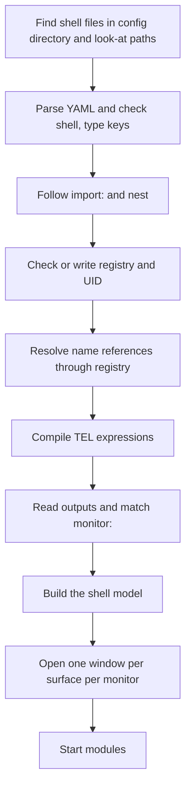
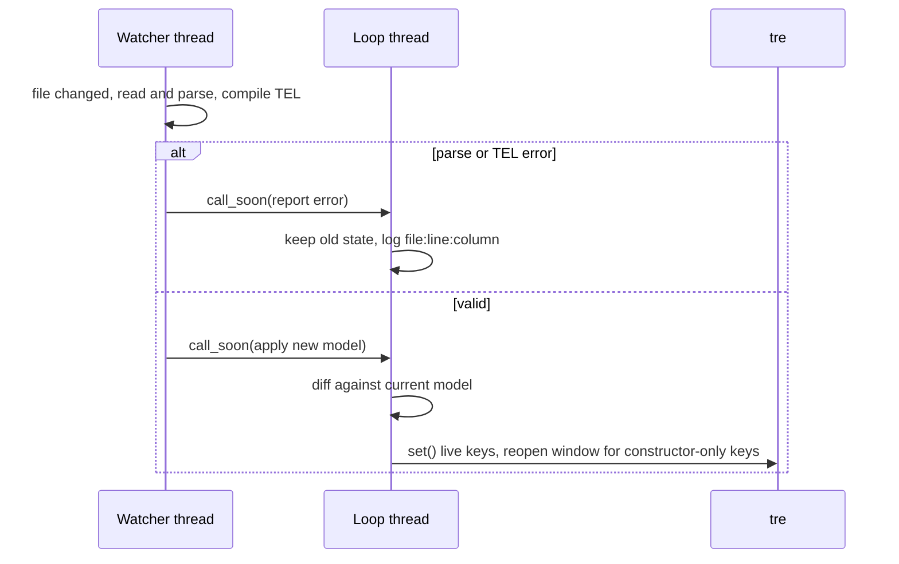
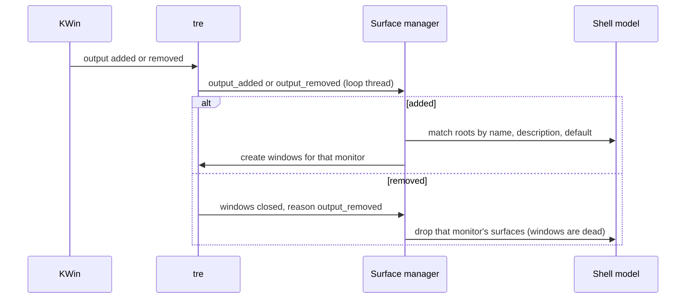

# Data flow

> [!summary]
> Five flows carry data through the shell: loading a shell, live module data, hot reload, monitor hot-plug and user input. Each starts in a named component of [[Layers and Components]], crosses threads only through `call_soon` ([[Process Model and Threading]]), and ends in a tre node. The diagrams are proposals built on the accepted ADRs; where an ADR decides a step, the step cites it.

## Loading a shell

| Step | Decided by | Failure |
|---|---|---|
| Files, `shell:` key, `type:` | [[ADR-0007 Shell UI Layer#Recognising a shell file and importing (2026-10-25)]] | A file without `shell:` is refused and named |
| `import:` and nesting | [[ADR-0007 Shell UI Layer#Recognising a shell file and importing (2026-10-25)]] | Cycle, missing file or name defined twice: load error with `file:line:column` |
| Registry and UID | [[ADR-0007 Shell UI Layer#Config directory and registry (2026-10-25)]] | A mismatch registers a new entry; an unresolved reference is an error at load |
| TEL compile | [[ADR-0008 Tesserae Expression Language]] | Error with file, line and column inside the YAML |
| `monitor:` matching | [[V1 Scope#Multi-monitor]] | A root with no `monitor` is ignored; `monitor: default` covers monitors no root names |
| Module start | [[ADR-0007 Shell UI Layer#Module Python (2026-10-25)]] | A module with no matching `.py` is a load error naming both files |

## Live module data

The hand-off is decided ([[ADR-0007 Shell UI Layer#Module data reaches the view through shell entry points (2026-10-25)]]): the module sends values to shell entry points, the shell converts what it can, and the renderer updates. The sequence diagram is in [[Process Model and Threading#Handing a value to the loop (proposed)]].

What the diagram adds to the ADR (proposals):

- A **value store** holds the latest value per module and key.
- TEL **records the names** each expression read, so a changed value re-runs only the expressions that read it.
- A re-evaluated expression sets a node property with `node.set(...)`; tre redraws only what changed.
- Static expressions (no live names) are evaluated once at load.

## Hot reload

- tre's layer window takes `layer`, `anchor`, `size`, `exclusive_zone`, `exclusive_edge`, `margin`, `keyboard` and `input_region` live through `set()` in one commit. `namespace` and `output` are constructor-only, so changing them means closing and recreating the window ([[TRE-REQ-001 Layer Surface Window#Proposed API]]).
- A bad file leaves the old state ([[Process Model and Threading#Lifecycle (proposed)]]).
- The shell's own UID write must not trigger a reload loop ([[ADR-0007 Shell UI Layer#Open items]]).
- A changed module `.py` is not reloaded by default: a module's `reload` hook is optional. Decide in [[42 Python API]]. #needs-verification

## Monitor hot-plug

- tre fires `output_added`, `output_removed` and `output_updated` with the `Output` ([Outputs](https://mindderivative.github.io/tre/reference/outputs/)). A removed output closes its layer windows with reason `"output_removed"`, and a dead window is never reused.
- `output_updated` keeps the surfaces and re-evaluates only the match rules ([[V1 Scope#Multi-monitor]]).
- A Popup is exclusive to the monitor of its caller ([[Surface Types#Open questions]]).
- **No windows.** tre raises when none are registered ([[Process Model and Threading#Lifecycle (proposed)]]).

## User input

A pointer or key event reaches a tre node on the loop thread. The node's handler is a TEL handler or a call into a module. What the handler vocabulary is belongs to the TEL project (statements or only expressions: [[Expression Language Requirements#Open questions]]). The shell's side:

- A handler may set a value in the shell's store (a local state) or call a module method.
- A module method that does slow work hands it to the module's thread and returns at once.
- Window actions (close, dismiss a popup) are shell-provided.

## Open questions

- [ ] Where the value store sits and how a module's last value is kept across a reload.
- [ ] The handler vocabulary for input (TEL).
- [ ] Whether a module's `.py` can be reloaded.
- [ ] How the diff of a reload works: by UID, by name, or by position in the file.
- [ ] What `output_updated` does to surfaces whose size depends on the output.

## Links

- [[20 Architecture]] · [[Layers and Components]] · [[Process Model and Threading]] · [[System Context]]
