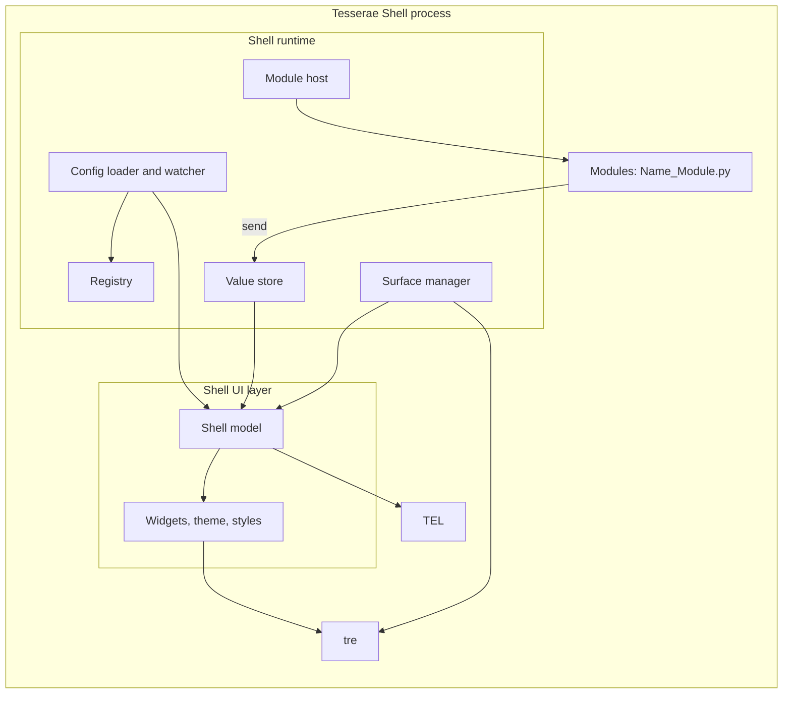

# Layers and Components

> [!summary]
> The shell is one process built on three libraries and one runtime. tre draws and places surfaces. TEL evaluates expressions and structure. The shell's UI layer turns a shell file into a tree of surfaces and widgets. The shell runtime loads configuration, keeps the registry, hosts modules and manages monitors. Modules feed data in. Dependencies point one way: modules and the runtime use the UI layer; the UI layer uses TEL and tre; TEL and tre know nothing of the shell. Components marked "proposed" are this note's suggestion; nothing here is accepted beyond the ADRs it cites.

## Diagram

## Libraries

| Layer | Owns                                                                                            | Never owns                                     | Spec                                    |
|-------|-------------------------------------------------------------------------------------------------|------------------------------------------------|-----------------------------------------|
| tre   | Frames, layout, paint, animation, input, layer surfaces, outputs, hit testing                   | Widgets, themes, file formats, shell meaning   | [[TRE-REQ-001 Layer Surface Window]] |
| TEL   | Expression syntax, evaluation, limits, name tracking, conditions and repeaters, error positions | Surfaces, modules, files, the registry, any UI | [[Expression Language Requirements]] |

## Shell Components (Proposed)

| Component                 | Responsibility                                                                                                                                                                           | Thread                                                           |
|---------------------------|------------------------------------------------------------------------------------------------------------------------------------------------------------------------------------------|------------------------------------------------------------------|
| Config loader and watcher | Finds shell files in the config directory and its Modules, Styles, Themes and Stylesheets folders, parses TDL with the shell's own parser (a lossless tree, [[ADR-0014 Shell File Language]]), follows `Import`, reports errors with `file:line:column`, watches files | Watching on a worker; applying on the loop                       |
| Registry                  | `registry.json`: UIDs, names, kinds, locations; one registry of names for blocks, surface types and modules ([[TDL Language#Names and the Registry]]); writes the `UID:` into the metadata block of files; resolves cross-file references                                                                             | Loop (file I/O on a worker for large writes) #needs-verification |
| Shell model               | The tree built from a shell file: `Monitor` blocks, surfaces, widgets, modules, with TEL expressions compiled                                                                                       | Loop                                                             |
| Widgets, theme, styles    | The widget set in [[V1 Widgets]], tokens from theme files, style files and stylesheets                                                                          | Loop                                                             |
| Surface manager           | Reads outputs, creates and closes a `LayerWindow` or `PopupWindow` per surface and monitor, handles hot-plug and `Monitor` matching                                                     | Loop                                                             |
| Module host               | Imports `<Name>_Module.py`, creates the module class once, calls `start`, `stop`, `reload`; gives it a context                                                                           | Loop for calls; module work on module threads                    |
| Value store               | Holds the latest values modules sent, by module and key; the scope TEL reads names from; records which names an expression read                                                          | Written from the loop, via `call_soon`                           |
| Modules                   | A module is a layout TDL file (widgets, expressions, params), a style TDL file and a Python class ([[ADR-0007 Shell UI Layer#What a module is (2026-10-26)]]); the class owns the module's data and threads        | Module threads                                                   |

The store is this note's addition. The ADR says a module sends data to shell entry points and the shell passes it to the renderer ([[ADR-0007 Shell UI Layer#Module data reaches the view through shell entry points (2026-10-25)]]); the store is where that data lives so that TEL can read it and re-evaluate what changed.

## Dependency Rules

1. tre and TEL do not import the shell. The shell imports both ([[ADR-0008 Tesserae Expression Language]]).
2. The UI layer does not talk to D-Bus, files or sockets. Only modules and the runtime do.
3. Modules do not touch tre nodes. They send values; the shell renders.
4. Python never runs in layout or paint ([[AGENTS#3. Layering principle]]). Expressions and module callbacks run between frames on the loop thread.
5. Tesserae UI is not imported anywhere ([[ADR-0006 Shell Independent of Tesserae UI]]).

## Where Each Existing Decision Lands

| Decision                                                                                                  | Component                                     |
|-----------------------------------------------------------------------------------------------------------|-----------------------------------------------|
| One process, one loop ([[ADR-0003 Process Model]])                                           | The whole process; the loop is tre's `App`    |
| Surface types ([[Surface Types]])                                                   | Surface manager, shell model                  |
| Registry, UID, names ([[ADR-0007 Shell UI Layer]])                                            | Registry, loader                              |
| Monitors, `Index: default` ([[V1 Scope#Multi-monitor]])                                    | Surface manager                               |
| Module contract ([[ADR-0007 Shell UI Layer#Module Python (2026-10-25)]])                                                 | Module host                                   |
| Coexistence, shortcuts ([[ADR-0004 Plasma Coexistence]], [[ADR-0005 Global Shortcuts]]) | Modules and a shortcut service in the runtime |

## Open Questions

- [ ] Is the value store a component of its own, or part of the shell model?
- [x] How a widget event (a click) reaches a module: the shell maps the event to a module method or a shell action; TEL only evaluates argument expressions ([[ADR-0007 Shell UI Layer#Events and module reload (2026-10-26)]]). The key names are set in the TDL reference (folder `41 TDL Reference/`).
- [ ] Where theme changes (light/dark, high contrast, reduced motion following the desktop) are read and pushed ([[Goals and Non-Goals]] G7).
- [ ] The global shortcut service: a runtime component or a module.
- [ ] After [[ADR-0014 Shell File Language]], `If` and `For` are TDL keyword blocks, while the TEL row above and the summary still list conditions, repeaters and "structure" under TEL. Which component builds and rebuilds the `If` and `For` branches (the parser, the shell model, TEL) is not decided here. Needs the maintainer.

## Links

- [[20 Architecture]] · [[System Context]] · [[Process Model and Threading]] · [[Data Flow]]
