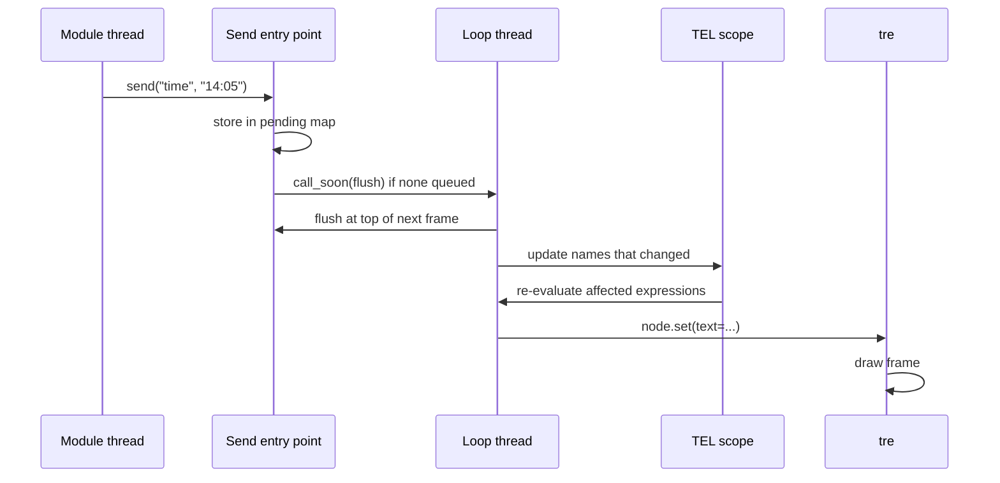
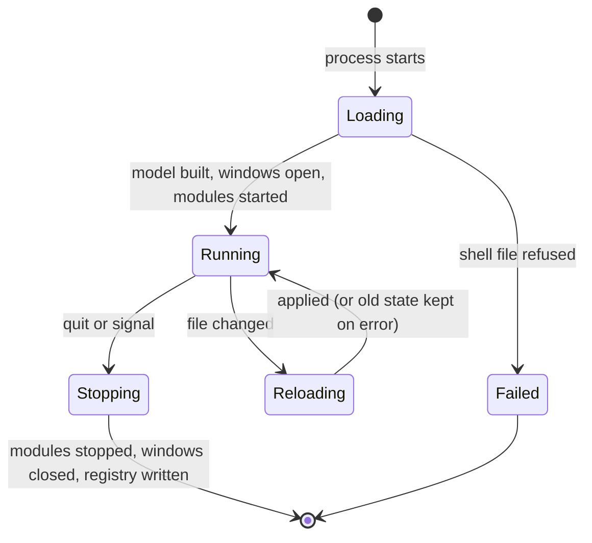

# Process model and threading

> [!summary]
> One process, one tre event loop on the main thread ([[ADR-0003 Process Model]]). Everything that touches a window or node, every TEL evaluation and every module callback runs there, between frames. Everything that waits (D-Bus, files, sockets, timers of module work) runs on other threads and hands finished values back with `LoopHandle.call_soon`. Decided: the single process and the thread rule. Proposed in this note: the thread inventory, coalescing, the watchdog and the lifecycle.

## What tre guarantees

From the [tre threading guide](https://mindderivative.github.io/tre/guide/threading/) (read 2026-10-25):

- tre runs on the one thread that created the `App`. Its windows, nodes, listeners, animation completions and draw callbacks live and run there once `App.run()` starts.
- `App.thread_handle()` returns a `LoopHandle`, the one tre object any thread may use. `call_soon(fn)` queues `fn` for the loop thread and wakes the loop, even when idle.
- Callbacks run in the order queued, at the top of the next frame, where they can touch windows and nodes as a listener can. One that raises is logged and does not stop the loop or the callbacks after it.
- `window.after(ms, fn)` and `window.every(ms, fn)` run something later on the loop thread; `call_soon` has no delay.
- A `call_soon` callback runs between frames, so it should only apply a finished result.
- `App.run()` raises `RuntimeError` when no window is registered, and ends when every window has closed ([App reference](https://mindderivative.github.io/tre/reference/app/)).

## Threads

| Thread | Runs | Touches nodes | Crosses into the loop by |
|---|---|---|---|
| Loop (main) | tre `App.run()`; surface manager; shell model; TEL evaluation; module host calls (`start`, `stop`, `reload`); registry updates | Yes | n/a |
| Module threads | A module's blocking work: D-Bus, sockets, polling, files, decoding | Never | The shell's send entry point, which uses `call_soon` |
| Config watcher | Waiting for file changes; reading and parsing a changed file | Never | `call_soon` with a finished result |
| Service thread (optional) | An event loop (for example `asyncio`) that several modules share for D-Bus | Never | The same send entry point |
| Watchdog | Checks that the loop is still ticking | Never | Logs, and asks the supervisor to restart if the loop is stuck |

tre also runs its own threads internally (the layer surface connection, for example). They are tre's concern; the shell sees only the loop thread and its callbacks.

## The rules

1. **Nothing blocking on the loop.** No D-Bus call, file read, subprocess or network call on the loop thread ([[ADR-0003 Process Model]]).
2. **Only the loop touches nodes.** A thread that wants a change sends a value; it never holds a node.
3. **Only finished data crosses.** A worker reads, parses or decodes; the loop applies.
4. **Python is never in layout or paint** ([[AGENTS#3. Layering principle]]). TEL expressions and module callbacks run in callbacks between frames and are short.
5. **Every module spec states its thread** and how it crosses into the loop ([[AGENTS#3. Layering principle]]).

## Handing a value to the loop (proposed)

A module thread calls the shell's send entry point (the hand-off decided in [[ADR-0007 Shell UI Layer#Module data reaches the view through shell entry points (2026-10-25)]]). The entry point must be safe from any thread. Proposed behaviour:

- **Coalesce.** The entry point writes the value into a pending map keyed by module and key, then queues one `call_soon` flush if none is queued. A module that sends the volume 200 times a second leaves only the latest in the map, and the loop applies it once per turn.
- **Order.** Values from one module keep their order per key. Across keys, the flush applies them together in one turn, so a view never shows half an update.
- **No blocking.** The send never waits for the loop.
- **Conversion** (HEX to RGBA and the like) happens in the flush on the loop, or in the send on the module thread if it is pure; decide in the Python API spec.

## Lifecycle (proposed)

- **Loading.** Read the config directory, parse, validate, follow imports, check or write the registry, resolve references, read outputs, build the model. Errors stop here with `file:line:column`.
- **Running.** Modules start after the model is built, so a value that arrives before its surface exists is kept in the store.
- **Reloading.** A watcher thread reads and parses a changed file; the loop applies it. A bad file leaves the old state and logs an error ([[Data Flow#Hot reload]]).
- **Stopping.** Call each module's `stop`, join its threads with a timeout, close windows, write the registry. `App.run()` returns when the last window closes.
- **No windows: stay idle** (decided 2026-10-26). If every monitor is set to "none", or no output is present, the shell does not exit; it waits and reacts when an output is added ([[Data Flow#Monitor hot-plug]]). How, with tre: `App.run()` raises when no window is registered, so the engine side is asked: `tre` was asked over the mailbox on 2026-10-26 whether `run()` can stay alive with none, and what to do if not. Until it answers, the policy is decided and the mechanism is open. #needs-verification

## Failure and recovery

| Failure | Effect | Handling (proposed) |
|---|---|---|
| A module raises in `start` or a callback | That module is marked failed | Log with the module name and UID; surfaces keep their last values or fall back; other modules continue |
| A module thread dies | No more values from it | The module host sees no heartbeat or a thread helper reports the exception; log; optional restart |
| A module blocks the loop | Every surface freezes ([[ADR-0003 Process Model#Consequences]]) | Watchdog sees no ticks; logs the stall; with a supervisor, restart the process |
| Wayland connection lost | tre windows close | Process exits; supervisor restarts it |
| A bad shell file on reload | New state refused | Keep the old state; log an error with position |
| A bad module `.py` on reload | New code refused | Keep the old instance running; log the error ([[ADR-0007 Shell UI Layer#Events and module reload (2026-10-26)]]) |

The loop cannot interrupt itself, so detecting a blocked loop needs a separate watchdog thread that reads a counter the loop bumps from a timer (`window.every`). A supervisor outside the process is the only way to recover from a hard hang. Both are proposals; [[60 Quality]] owns the final design.

> [!danger] Single point of failure
> One hung Python callback blocks every surface ([[ADR-0003 Process Model]]). The mitigation is conventions (rule 1), tooling (the send entry point, thread helpers), a watchdog and a supervisor. None of those is built.

## Performance notes

- A frame at 60 Hz is about 16.7 ms. `call_soon` callbacks and TEL evaluations share that time with layout and paint. Budgets are set in [[60 Quality]].
- tre 0.5.8 documents that an idle surface draws no frames and wakes the loop only for its own timers ([[TRE-REQ-001 Layer Surface Window]]). The shell must not add a timer that wakes the loop without a reason: a clock updates once a second, not every frame.
- The shared GIL means a CPU-heavy module thread slows the loop. Heavy work belongs in a subprocess or native code; the module contract says so ([[42 Python API]], to write).

## Open questions

- [ ] **Module threads: who owns them?** Options. **A.** Each module starts and owns its threads; the shell gives a helper that catches and logs thread exceptions (flexible, simple contract; recommended). **B.** The shell runs a shared `asyncio` thread for services and modules are coroutines (less thread code, forces async on module authors). **C.** A shell thread pool for module work. Recommendation A, with B available as an optional shared service thread for D-Bus.
- [ ] **D-Bus client library.** Surveyed: [[D-Bus Libraries for Python]]. Recommendation: `dbus-fast` on a shared asyncio service thread, with `jeepney` as the fallback. Needs the maintainer's choice. If accepted, the service thread is part of the thread inventory above and Option B is available as the shared service thread.
- [ ] **Registry I/O and the UID write** on the loop or a single writer thread ([[ADR-0007 Shell UI Layer#Open items]]).
- [ ] **Supervisor** in v1 or later.
- [x] **No windows** policy: stay idle (maintainer, 2026-10-26). Mechanism: awaiting `tre`.
- [ ] **Where conversions run** (send or flush).

## Links

- [[20 Architecture]] · [[ADR-0003 Process Model]] · [[Layers and Components]] · [[Data Flow]] · [[System Context]]
