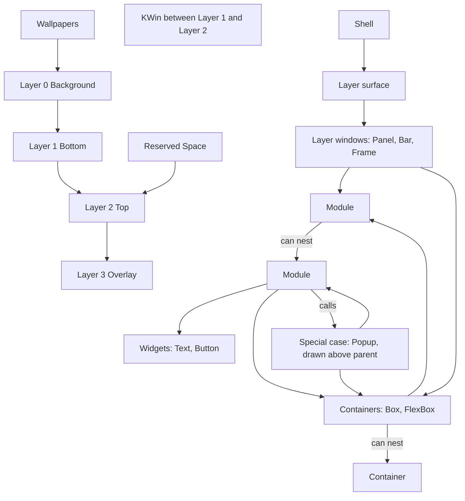

# Shell structure

> [!summary]
> The maintainer's flow diagram ([[Shell Flow Diagram.canvas]], third version, 2026-10-26) shows what a shell is made of, from the desktop environment down to widgets. This note puts it in words, checks it against the rest of the vault and the layer-shell protocol, and lists what does not yet match. The diagram is the maintainer's design; the points below are questions, not corrections.

![[Shell Flow Diagram.canvas]]

## What the diagram shows

| Group | Contents | Relation |
|---|---|---|
| Desktop Environment | The layer surface, KWin, Wallpapers | The compositor owns the four layers. Wallpapers on Layer 0; KWin's windows between Layer 1 and Layer 2; Reserved Space on Layer 2 |
| Layer Surface | Layer 0 Background, Layer 1 Bottom, Layer 2 Top, Layer 3 Overlay | The Shell attaches to these |
| Layer Windows | Panel (Bottom/Top/Overlay), Bar (Bottom/Top/Overlay), Frame (Top) | Each kind with the layers it may use |
| Containers | Box, FlexBox | "Can nest": a container holds containers |
| Module | Module | "Can nest": a module holds modules |
| Widgets | Text, Button | Reached from a module |
| Special Cases | Popup, "drawn above parent" | A module calls it (the "Calls" edge); it holds containers and modules. A place for future popup-like kinds, such as a Notification window |

Reading the arrows: a layer window holds modules directly, or containers; containers hold modules; a module holds containers, widgets (through its inner module) and, as a special case, a popup. A module calls a popup, which holds containers and modules and is drawn above its parent.

## Checked against the vault and the protocol

| Diagram | Check | Result |
|---|---|---|
| Four layers numbered 0 to 3 | The layer-shell protocol's four layers, "ordered by z depth, bottom-most first" ([protocol](https://wayland.app/protocols/wlr-layer-shell-unstable-v1)) | Matches exactly ([[Common Keys and Conventions]]) |
| KWin "between Layer 1 and Layer 2" | The protocol: ordinary windows are rendered between the bottom and top layers | Matches exactly |
| Reserved Space on Layer 2 | Enforced by the shell as its own rule | Decided ([[Surface Types#Layers per kind]]) |
| Panel, Bar, Frame as layer windows with the layers shown | [[Surface Types#Layers per kind]] | Matches |
| Popup "drawn above parent" | `xdg_popup` parented to a layer surface: the compositor draws it above its parent | Matches the protocol's idea. The protocol page does not describe the stacking itself; it points to the xdg_popup rules |
| Layer 0 wallpapers only | Wallpaper is later in [[V1 Scope]] | Consistent |
| Modules nest, containers nest | Was open ([[Module File#Open]]) | Confirmed by the diagram |

## Decided from the diagram

- **Layer 0 is for wallpapers only, for now** (maintainer, 2026-10-26). No kind uses `layer: background`. The maintainer can see it used later for window tiling, or as a base layer for a desktop dashboard.
- **Frame is Top only.** Its strips move to `top` ([[Surface Types]]). Top suits the painter, which must be above windows to be seen; the strips are invisible so any layer works, and Top-layer reservation is the case known to work on KWin.
- **The shell enforces `top` as the only layer that reserves space.** The protocol ties exclusive zones to no layer, so this is the shell's rule, chosen to reduce confusion. Handling proposed: an `exclusive_zone` off `top` is a load error.
- **KWin is "between Layer 1 and Layer 2",** as the protocol says.

## What does not match, or needs a decision

1. ~~Popup: a kind or declared inside a module?~~ **Decided (maintainer, 2026-10-26): Popup stays as it is, a `kind: popup` entry in the shell file.** The diagram's edge is **"Calls"**: a module can *call* a popup, and the popup can hold modules and containers. It is not declared inside the module. The Special Cases group exists because the maintainer can see other surfaces that behave like a popup but need their own kind, such as a **Notification window**. Not v1 ([[V1 Scope#After v1]]); recorded in [[Surface Types#Special cases]].
2. **Widgets only through a module.** The Widgets group is reached only from a module; no arrow runs from Containers to Widgets. In the Label example a `FlexBox` holds an `Icon` and a `Text`. Can a container on a surface, outside any module, hold widgets directly?
3. **Containers and widgets share a key?** The diagram keeps Containers and Widgets as separate groups. In the Label example `FlexBox:` is written like `Text:`. Same key (`widget: FlexBox` / `FlexBox:`) or its own?
4. **How a surface holds modules and containers.** `modules:` is a key on a surface today; the diagram shows modules and containers both under a layer window. Option **A:** `children:` holds containers and module uses; **B:** keep `modules:` and add a container key. Recommendation A.
5. **Nested modules.** What a nested module means for params, names, UIDs and the Python (one instance per file, nested uses) needs spelling out.
6. **Popup placement of keyboard focus.** A popup inherits its parent's keyboard setting ([protocol](https://wayland.app/protocols/wlr-layer-shell-unstable-v1)): a bar with `keyboard: none` cannot give a popup focus. Whether the module sets the parent to `on_demand` while a popup is open is for the module spec.

## Open

- [ ] The points above.
- [ ] Whether the diagram is the single reference for the structure, with other notes linking to it.

## Links

- [[20 Architecture]] · [[Surface Types]] · [[Module File]] · [[Shell File]] · [[Layers and Components]]
