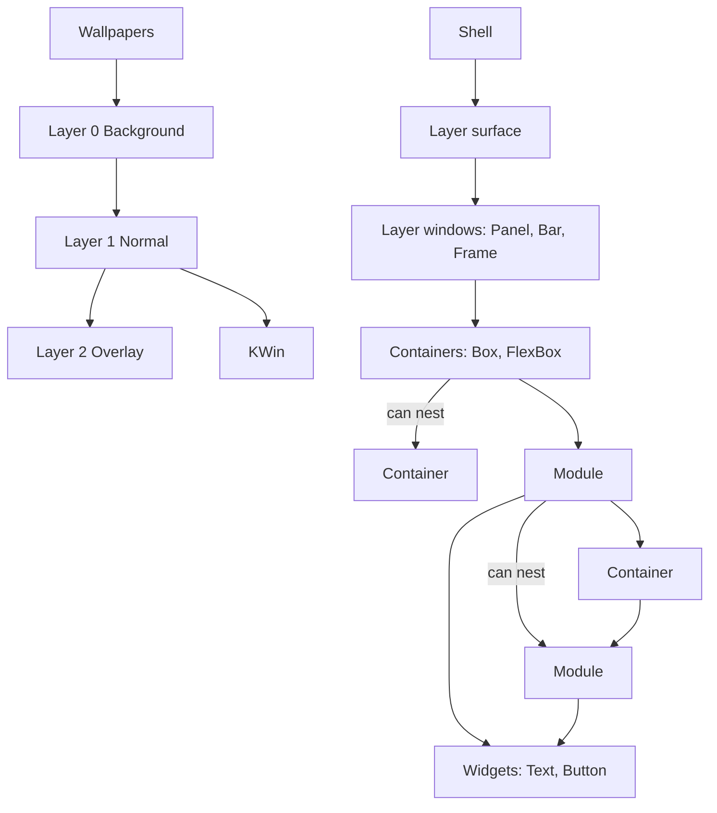

# Shell structure

> [!summary]
> The maintainer's flow diagram ([[Shell Flow Diagram.canvas]], read 2026-10-26) shows what a shell is made of, from the desktop environment down to widgets. This note puts it in words, checks it against the rest of the vault, and lists where the two disagree. The diagram is the maintainer's design; the differences below are questions for the maintainer, not corrections.

![[Shell Flow Diagram.canvas]]

## What the diagram shows

| Group in the diagram | Contents | Relation |
|---|---|---|
| Desktop Environment | The layer surface (three layers), KWin, Wallpapers | The compositor owns the layers. Wallpapers go on Layer 0; KWin's windows live on Layer 1 |
| Layer Surface | Layer 0: Background, Layer 1: Normal, Layer 2: Overlay | The Shell attaches to these |
| Layer Windows | Panel, Bar, Frame | Placed on a layer |
| Containers | Box, FlexBox | "Can nest": a container can hold containers |
| Modules | Module | "Can nest": a module can hold modules; a module holds a container, which holds modules |
| Widgets | Text, Button | Modules hold widgets |

Reading order: Shell, layer surface, layer windows, containers, modules, widgets.

## How it matches the vault

| Diagram | Vault | Match |
|---|---|---|
| Layer windows: Panel, Bar, Frame | Surface kinds: bar, frame, panel, popup ([[Surface Types]]) | Three of four. **Popup is not in the diagram** |
| Layer 2: Overlay is the top layer | `layer: overlay` ([[Surface Types#Overlay]]) | Yes |
| Layer 0 Background, Layer 1 Normal, Layer 2 Overlay | Four layer-shell layers: `background`, `bottom`, `top`, `overlay` ([[Common Keys and Conventions]]) | **Three layers against four** |
| Box and FlexBox are containers | Box and FlexBox are `widget:` values ([[ADR-0007 Shell UI Layer#Keys that say what a thing is (2026-10-26)]]) | Same things; the diagram separates containers from widgets |
| A layer window holds containers, which hold modules | A surface lists modules under `modules:` ([[Shell File]]) | **The container level between surface and module is new** |
| Modules can nest | "Whether a module can contain other modules" was open ([[Module File#Open]]) | The diagram says yes |
| Containers can nest | Widgets nest inside container widgets | Yes |
| Module holds widgets (Text, Button) | A module file holds a widget tree ([[Module File]]) | Yes |
| Wallpapers on Layer 0, KWin on Layer 1 | The shell does not own wallpaper or windows ([[Goals and Non-Goals]] N1); wallpaper is later in [[V1 Scope]] | Consistent |

## Differences to settle

1. **Layers.** The diagram has Background, Normal, Overlay. The layer-shell protocol has `background`, `bottom`, `top`, `overlay`, and windows sit between `bottom` and `top`. KWin's windows are on "Layer 1: Normal". A bar that reserves space sits above windows (`top`); a frame's space-reserving strips can sit below (`bottom`). Options: **A.** the YAML has the three names and the shell picks `bottom` or `top` from the kind and the zone; **B.** the YAML has the four protocol names. Recommendation A for simplicity if the shell can choose reliably; B if the author needs to say "above windows" or "below windows" explicitly. Needs the maintainer's choice.
2. **Popup.** The diagram lists Panel, Bar and Frame. Earlier decisions have four kinds, with Popup for menus and flyouts the compositor places (tray menus flip at screen edges and close on an outside click). A panel on the overlay layer cannot do that placement. Is Popup dropped, folded into Panel, or just not drawn?
3. **The container level.** In the diagram a surface holds containers and containers hold modules. In [[Shell File]] a surface holds `modules:` directly. Options: **A.** a surface is itself the outermost container, so its children are containers and modules (`children:` holding `FlexBox`, module uses and so on); **B.** keep `modules:` and put layout in a container inside the surface. Recommendation A, with `children:` for everything a surface holds.
4. **Modules nest.** A module can hold modules. What it means for params, UIDs, names and the Python (one instance per file, but nested uses) needs spelling out.
5. **Containers against widgets.** The diagram has Containers (Box, FlexBox) and Widgets (Text, Button) as separate groups. Are containers written `widget: FlexBox` / `FlexBox:` like leaf widgets (as in the Label example), or with their own key?

## Open

- [ ] The five differences above.
- [ ] Whether the diagram should be the single reference for the structure, with other notes linking to it.

## Links

- [[20 Architecture]] · [[Surface Types]] · [[Module File]] · [[Shell File]] · [[Layers and Components]]
