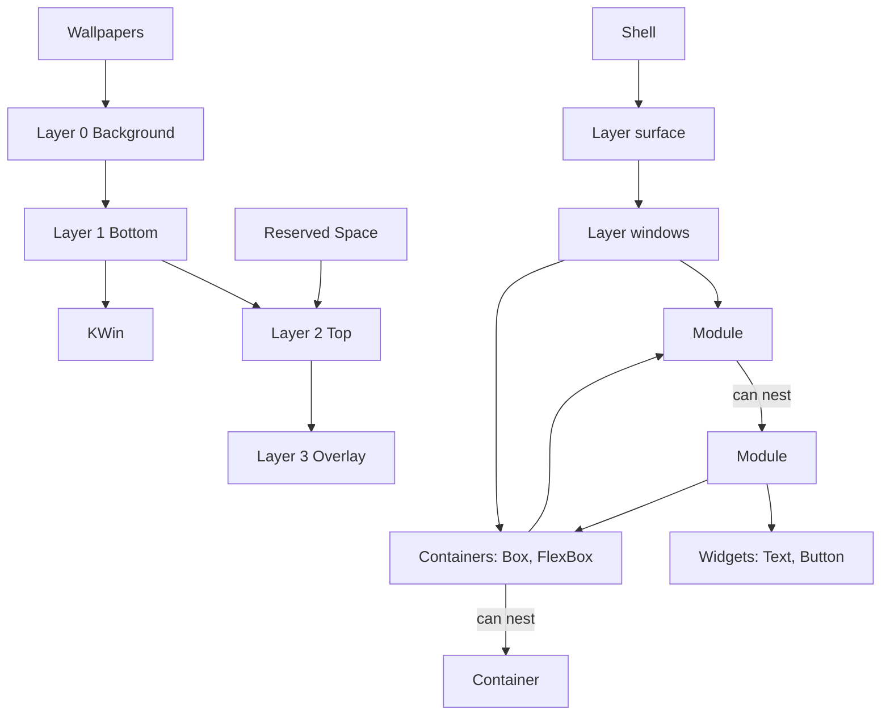

# Shell structure

> [!summary]
> The maintainer's flow diagram ([[Shell Flow Diagram.canvas]], updated 2026-10-26) shows what a shell is made of, from the desktop environment down to widgets. This note puts it in words, checks it against the rest of the vault and the layer-shell protocol, and lists what does not yet match. The diagram is the maintainer's design; the points below are questions, not corrections.

![[Shell Flow Diagram.canvas]]

## What the diagram shows

| Group | Contents | Relation |
|---|---|---|
| Desktop Environment | The layer surface, KWin, Wallpapers | The compositor owns the four layers: Wallpapers on Layer 0, KWin on Layer 1, Reserved Space on Layer 2 |
| Layer Surface | Layer 0 Background, Layer 1 Bottom, Layer 2 Top, Layer 3 Overlay | The Shell attaches to these |
| Layer Windows | Panel (Bottom/Top/Overlay), Bar (Bottom/Top/Overlay), Frame (Top), Popup (Overlay) | Each kind with the layers it may use |
| Containers | Box, FlexBox | "Can nest": a container holds containers |
| Module | Module | "Can nest": a module holds modules |
| Widgets | Text, Button | Reached from a module |

Reading the arrows: a layer window holds modules directly, or containers; containers hold modules; a module holds containers and, through its inner module, widgets.

## Checked against the vault and the protocol

| Diagram | Check | Result |
|---|---|---|
| Four layers numbered 0 to 3: Background, Bottom, Top, Overlay | The layer-shell protocol's four layers, "ordered by z depth, bottom-most first" ([protocol](https://wayland.app/protocols/wlr-layer-shell-unstable-v1)) | Matches exactly. `layer:` takes these four ([[Common Keys and Conventions]]) |
| Panel, Bar, Frame, Popup | The four surface kinds ([[Surface Types]]) | Matches. Popup is back |
| Overlay is the highest layer | `layer: overlay` ([[Surface Types#Overlay]]) | Yes |
| A layer window holds modules directly | `modules:` on a surface ([[Shell File]]) | Yes |
| A layer window holds containers | New | A surface can hold containers as well (see below) |
| Modules nest | Was open ([[Module File#Open]]) | The diagram says yes |
| Containers nest | Widgets nest inside container widgets | Yes |
| Wallpapers on Layer 0, KWin on Layer 1 | The shell does not own wallpaper or windows ([[Goals and Non-Goals]] N1) | Consistent. The protocol puts ordinary windows between Bottom and Top |

## What does not match, or needs a decision

1. **Frame is Top only.** Fine, and a good choice. The Frame's visible ring is drawn by the painter, which must be above windows to appear as a frame. The thin space-reserving strips are transparent, so their layer makes no visual difference. Top also avoids relying on an untested case: the tested KWin case is a bar on Top reserving space, and no bottom-layer zone was found tested on KWin. [[Surface Types]] had the strips on `bottom` (following [[TRE-REQ-001 Layer Surface Window#Use case: screen frame]]); they move to `top`. No tre change is needed, since a layer is a setting. #needs-verification on KWin for the strips on `top` beside the painter.
2. **Reserved Space is drawn on Layer 2 only: a rule or a pointer?** It is not a protocol rule. The layer-shell protocol ties exclusive zones to no layer: it says only that a positive zone is meaningful when the surface is anchored to one edge or an edge and both perpendicular edges, and that the compositor's use of it is implementation-dependent ([protocol](https://wayland.app/protocols/wlr-layer-shell-unstable-v1), read 2026-10-26). Layers decide what is drawn above what. A bar sits on Top because it should be seen above windows, not because reserving space needs Top. (My first draft of this note was loose on this and read like a rule.) A practical rule for v1 is still sensible, since only Top-layer reservation is known to work on KWin. If you adopt it as a rule, the shell ignores or rejects `exclusive_zone` on Bottom and Overlay surfaces; if not, it passes it through and leaves it to the compositor. Needs the maintainer's choice.
3. **Popup (Overlay).** A Popup is not its own layer surface. It is an `xdg_popup` parented to a layer surface, and the protocol does not say how it stacks against its parent; it refers to the xdg_popup rules. In practice a compositor draws it above its parent. Whether it also sits above fullscreen windows when its parent is on Bottom is not stated. The popup also inherits its parent's keyboard setting. So "Popup (Overlay)" is the intended behaviour, not a setting the author chooses. #needs-verification on KWin.
4. **KWin on Layer 1.** The protocol says ordinary windows are rendered between Bottom and Top, and fullscreen windows typically at Top (so a fullscreen window can cover Top-layer surfaces and only Overlay stays above it, not stated by the page). Drawing KWin on Layer 1 is close enough; a note "between Bottom and Top" would be exact.
5. **Widgets only through a module.** The Widgets group is reached only from a module; no arrow runs from Containers to Widgets. In the Label example a `FlexBox` holds an `Icon` and a `Text`. Can a container on a surface (outside any module) hold widgets directly? [[V1 Widgets]] says widgets are used in modules and in a surface's own layout.
6. **Containers and widgets share a key?** The diagram keeps Containers and Widgets as separate groups. In the Label example `FlexBox:` is written like `Text:`. Same key (`widget: FlexBox` / `FlexBox:`) or its own?
7. **Allowed layers per kind.** Panel and Bar may use Bottom, Top or Overlay; Frame only Top; Popup only Overlay. Background is for wallpapers and is not offered to any kind. Is `layer: background` forbidden on every kind?
8. **How a surface holds modules and containers.** `modules:` is a key on a surface today; the diagram shows modules and containers both under a layer window. Option **A:** `children:` holds containers and module uses; **B:** keep `modules:` and add a container key. Recommendation A.
9. **Nested modules.** What a nested module means for params, names, UIDs and the Python (one instance per file, nested uses) needs spelling out.

## Open

- [ ] The points above.
- [ ] Whether the diagram is the single reference for the structure, with other notes linking to it.

## Links

- [[20 Architecture]] · [[Surface Types]] · [[Module File]] · [[Shell File]] · [[Layers and Components]]
