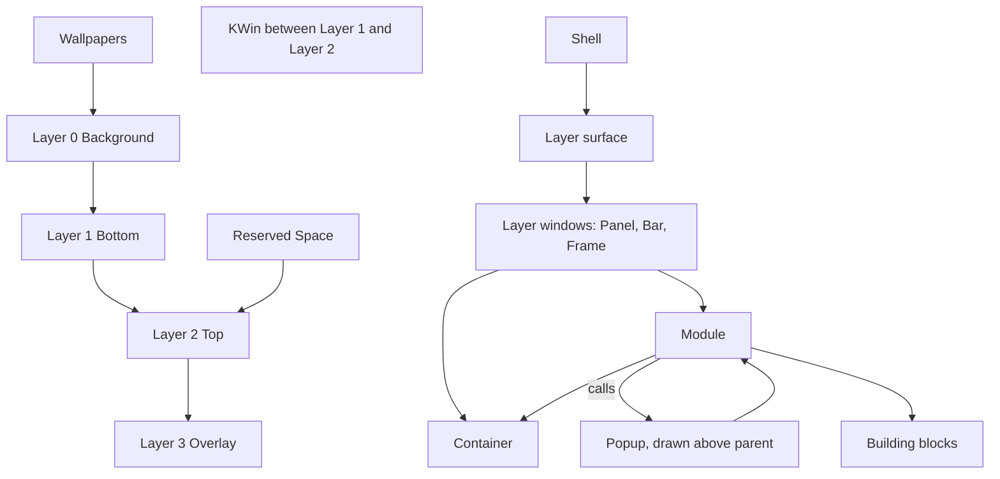

# Shell structure

> [!summary]
> The maintainer's flow diagram ([[Shell Flow Diagram.canvas]], fifth version, 2026-10-26, now in this folder) shows what a shell is made of, from the desktop environment down to building blocks. This note puts it in words, checks it against the rest of the vault and the layer-shell protocol, and lists what is still open. The diagram is the maintainer's design.

![[Shell Flow Diagram.canvas]]

## What the diagram shows

| Group | Contents |
|---|---|
| Desktop Environment | The layer surface (Layer 0 Background, Layer 1 Bottom, Layer 2 Top, Layer 3 Overlay), KWin between Layer 1 and Layer 2, Wallpapers on Layer 0, Reserved Space on Layer 2 |
| Layer Windows | Panel (Bottom, Top or Overlay), Bar (Bottom, Top or Overlay), Frame (Top) |
| Special Cases | Popup, drawn above its parent. A module calls it, and it holds modules |
| Modules (Nestable) | Spacer, List, Toggle, Label, Slider, Marquee text, TextBox, ProgressBar, Checkbox, TextInput, Menu and MenuItem, TextEditor, Revealer, Button, Stack, Icon, Badge, Image, Tooltip |
| Building Blocks | Containers (nestable): FlexBox, Box, Grid. Shapes: Square, Rectangle, Triangle, Hexagon, Circle, Ellipse, Ring, Path. Graphics: Bitmap, SVG. Typography: Text, TextField, TextField (Multi-Line). Other: Terminal, Canvas |

Reading the arrows: the Shell attaches to the layer surface; layer windows (Panel, Bar, Frame) hold modules and containers; a module holds containers and is made of building blocks; a module calls a popup, and a popup holds modules.

## Checked against the vault and the protocol

| Diagram | Check | Result |
|---|---|---|
| Four layers numbered 0 to 3 | The layer-shell protocol's four layers, "ordered by z depth, bottom-most first" ([protocol](https://wayland.app/protocols/wlr-layer-shell-unstable-v1)) | Matches exactly ([[Common Keys and Conventions]]) |
| KWin between Layer 1 and Layer 2 | The protocol: ordinary windows are rendered between the bottom and top layers | Matches exactly |
| Reserved Space on Layer 2 | The shell's own rule | Decided ([[Surface Types#Layers per kind]]) |
| Panel, Bar, Frame with the layers shown | [[Surface Types#Layers per kind]] | Matches |
| Popup, drawn above parent, called by a module | An `xdg_popup` parented to a layer surface is drawn above its parent | Matches; the protocol page leaves the stacking to the xdg_popup rules |
| Building Blocks: Containers, Shapes, Graphics, Typography, Other | [[Building Blocks]] | Matches exactly, including Grid, Path and the multi-line TextField |
| Modules (Nestable) | [[Building Blocks]], [[V1 Widgets]] | 19 modules. **Checkbox is new** (see below). The other 18 match |
| Layer 0 wallpapers only | [[Surface Types#Layers per kind]] | Matches |
| Modules and containers nest | [[ADR-0007 Shell UI Layer#Blocks, modules and styling (2026-10-26)]] | Matches |

## Decided from the diagram

- Layer 0 is for wallpapers only, for now (maintainer, 2026-10-26); the maintainer can see it used later for window tiling or as a base layer for a desktop dashboard.
- Frame is Top only; its strips move to `top` ([[Surface Types]]). Top suits the painter, which must be above windows to be seen; the strips are invisible so any layer works, and Top-layer reservation is the case known to work on KWin.
- The shell enforces `top` as the only layer that reserves space. The protocol ties exclusive zones to no layer, so this is the shell's rule, chosen to reduce confusion. An `exclusive_zone` off `top` is a load error (decided, maintainer, 2026-10-26).
- KWin is "between Layer 1 and Layer 2", as the protocol says.
- A Popup stays a `kind: popup` entry in the shell file; a module calls it; it holds modules ([[Surface Types#Special cases]]). The Special Cases group exists for popup-like kinds, such as a Notification window (not v1).
- The building blocks and the modules are the lists in [[Building Blocks]], with the full decision in [[ADR-0007 Shell UI Layer#Blocks, modules and styling (2026-10-26)]].
- Popup focus is on by default with one flag; tooltip-like popups opt out.

## What does not match, or needs a decision

1. **Checkbox is a new module.** The diagram has Checkbox beside Toggle; the notes had only Toggle (a switch). Taken as a 19th standard module, a check box; added to [[Building Blocks]] and [[V1 Widgets]] (not v1). Correct?
2. **Where leaf blocks can sit.** The diagram connects layer windows to modules and containers, and modules to blocks. A leaf block (Text, Path, Bitmap) is reached only through a module. Can a leaf block sit directly on a surface or in a container (`block: Text` under a bar's `children:`)? The Frame and Panel joins need Path blocks on a surface, unless the Frame draws its own ring. Recommendation: allow it, since a module for every piece of text on a bar would be heavy; if not, say how the Frame draws the ring.
3. **What a popup holds.** The diagram shows a popup holding modules. The notes also say containers. A container is how a popup lays out its modules, so it should be allowed. Correct?

## Blocks and modules (decided 2026-10-26)

The maintainer looked at how Tesserae builds widgets and chose the shell's own building blocks ([[Building Blocks]]). A block is called with `block:`; a module is called by its unique name as the key; `widget:` and `module:` are gone; `import:` embeds a module file. The diagram now shows exactly that split: a Building Blocks group and a Modules group.

What Tesserae does, for reference (design `yaml-language.md` section 3 and guide `components.md`, local clone commit `0eda3fe`, read 2026-10-26): a widget is either built in (Python) or a view (a file with `params:`), both called the same way, and a called view has no ViewModel of its own. The shell kept the declared-properties idea and made two kinds with different keys.

## Open

- [ ] The three points above.

## Links

- [[20 Architecture]] · [[Surface Types]] · [[Module File]] · [[Shell File]] · [[Layers and Components]] · [[Building Blocks]]
