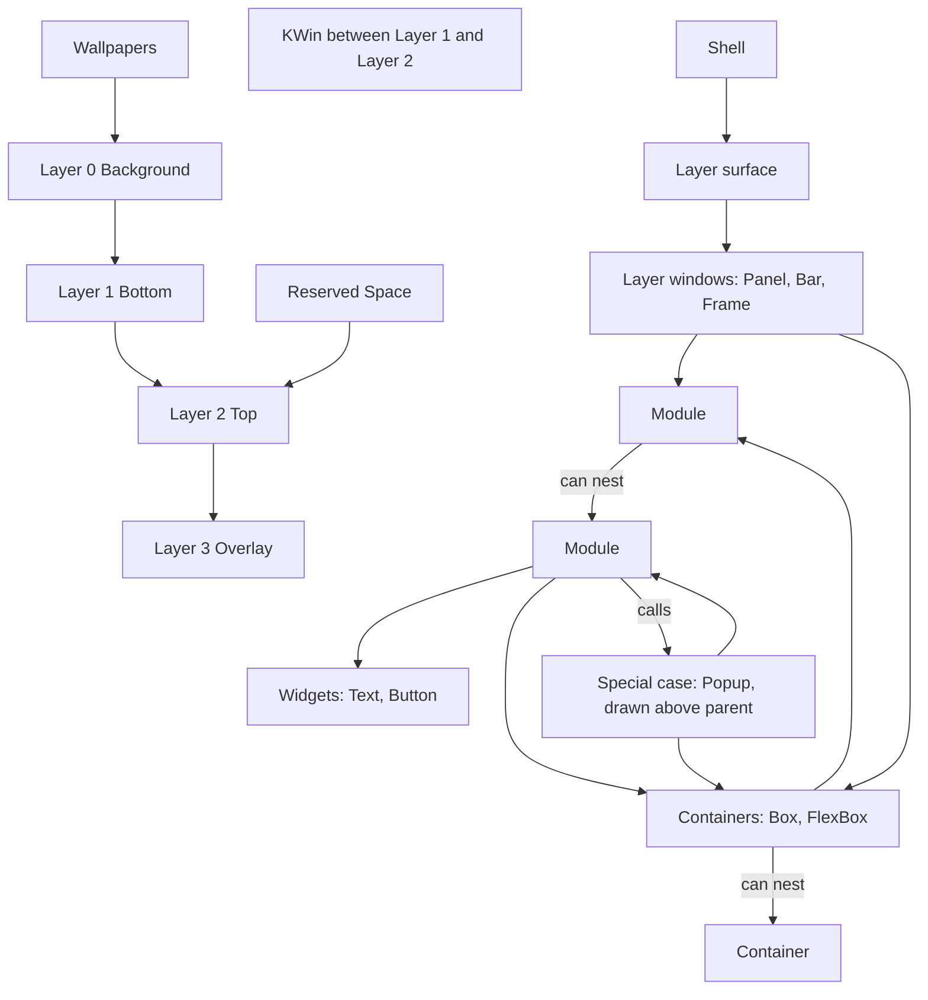

# Shell structure

> [!summary]
> The maintainer's flow diagram ([[Shell Flow Diagram.canvas]], third version, 2026-10-26) shows what a shell is made of, from the desktop environment down to widgets. This note puts it in words, checks it against the rest of the vault and the layer-shell protocol, and lists what does not yet match. The diagram is the maintainer's design; the points below are questions, not corrections.

![[Shell Flow Diagram.canvas]]

## What the diagram shows



| Group | Contents | Relation |
|---|---|---|
| Desktop Environment | The layer surface, KWin, Wallpapers | The compositor owns the four layers. Wallpapers on Layer 0; KWin's windows between Layer 1 and Layer 2; Reserved Space on Layer 2 |
| Layer Surface | Layer 0 Background, Layer 1 Bottom, Layer 2 Top, Layer 3 Overlay | The Shell attaches to these |
| Layer Windows | Panel (Bottom/Top/Overlay), Bar (Bottom/Top/Overlay), Frame (Top) | Each kind with the layers it may use |
| Containers | Box, FlexBox | "Can nest": a container holds containers |
| Module | Module | "Can nest": a module holds modules |
| Widgets | Text, Button | Reached from a module |
| Special Cases | Popup, "drawn above parent" | A module calls it (the "Calls" edge); it holds containers and modules. A place for future popup-like kinds, such as a Notification window |

Reading the arrows: a layer window holds modules directly, or containers; containers hold modules; a module holds containers, widgets (through its inner module) and, as a special case, a popup. A module calls a popup, which holds containers and modules and is drawn above its parent.

## Checked against the vault and the protocol

| Diagram | Check | Result |
|---|---|---|
| Four layers numbered 0 to 3 | The layer-shell protocol's four layers, "ordered by z depth, bottom-most first" ([protocol](https://wayland.app/protocols/wlr-layer-shell-unstable-v1)) | Matches exactly ([[Common Keys and Conventions]]) |
| KWin "between Layer 1 and Layer 2" | The protocol: ordinary windows are rendered between the bottom and top layers | Matches exactly |
| Reserved Space on Layer 2 | Enforced by the shell as its own rule | Decided ([[Surface Types#Layers per kind]]) |
| Panel, Bar, Frame as layer windows with the layers shown | [[Surface Types#Layers per kind]] | Matches |
| Popup "drawn above parent" | `xdg_popup` parented to a layer surface: the compositor draws it above its parent | Matches the protocol's idea. The protocol page does not describe the stacking itself; it points to the xdg_popup rules |
| Layer 0 wallpapers only | Wallpaper is later in [[V1 Scope]] | Consistent |
| Modules nest, containers nest | Was open ([[Module File#Open]]) | Confirmed by the diagram |

## Decided from the diagram

- **Layer 0 is for wallpapers only, for now** (maintainer, 2026-10-26). No kind uses `layer: background`. The maintainer can see it used later for window tiling, or as a base layer for a desktop dashboard.
- **Frame is Top only.** Its strips move to `top` ([[Surface Types]]). Top suits the painter, which must be above windows to be seen; the strips are invisible so any layer works, and Top-layer reservation is the case known to work on KWin.
- **The shell enforces `top` as the only layer that reserves space.** The protocol ties exclusive zones to no layer, so this is the shell's rule, chosen to reduce confusion. Handling proposed: an `exclusive_zone` off `top` is a load error.
- **KWin is "between Layer 1 and Layer 2",** as the protocol says.

## What does not match, or needs a decision

1. ~~Popup: a kind or declared inside a module?~~ **Decided (maintainer, 2026-10-26): Popup stays as it is, a `kind: popup` entry in the shell file.** The diagram's edge is **"Calls"**: a module can *call* a popup, and the popup can hold modules and containers. It is not declared inside the module. The Special Cases group exists because the maintainer can see other surfaces that behave like a popup but need their own kind, such as a **Notification window**. Not v1 ([[V1 Scope#After v1]]); recorded in [[Surface Types#Special cases]].
2. **Widgets only through a module.** Open until the widget and module model is defined (the maintainer, 2026-10-26: it depends on what defines a widget; see below).
3. **Containers and widgets share a key?** **Decided: a container is a fundamental building block, not a widget, so it has its own key** (name not decided).
4. **How a surface holds modules and containers.** **Decided: `children:` only; `modules:` goes away** (maintainer, 2026-10-26). The way a module use is written inside `children:` waits for the widget and module decision.
5. **Nested modules, names and UIDs.** **Decided: anything with a unique name gets a UID; names are unique across the shell and reachable from anywhere through the registry.** Open: how repeated uses of one definition get unique names (path names, proposed in [[ADR-0007 Shell UI Layer#Open items]]) and the params policy ([[Module File#Params down the tree]]).
6. **Popup focus.** **Decided: opt-in.** An open popup marked as taking focus takes keyboard and mouse itself. See [[Surface Types#Special cases]].

## Widgets, modules and building blocks

The maintainer asked (2026-10-26) to look at how Tesserae builds widgets. If the shell follows that route, a widget and a module are the same thing, built from base building blocks in YAML, and one of the two words goes. A container is one of the building blocks.

**What Tesserae does** (design `yaml-language.md` section 3 and the guide `components.md`, local clone commit `0eda3fe`, read 2026-10-26):

- "A widget is **built in** (Python, registered with its declarations) or a **view** (a file with `params:`). Both declare properties the same way."
- Any view can be called with `widget: Name`; "there is no file path and no separate kind of embedded view". Params are keys on the call (`- {widget: Counter, name: counter, start: 5}`).
- A called view has no ViewModel of its own: its expressions read its own state, its params, then the top view's names. It reads the caller's names only through params.
- Its nodes have ids under the call (`root.counter.label`), "so a view can be called as often as you like".
- A container is itself a built-in widget there (`widget: Container`).

**Mapping to the shell**

| Tesserae | Shell today | Notes |
|---|---|---|
| Built-in widget (Python) | Building block: Text, Icon, Image, Button, Slider, ... | Shell-provided; the user does not write it |
| Container (`widget: Container`) | Container: Box, FlexBox | The maintainer wants it separate: its own key |
| A view with `params:` | A module file with `params:` | Same idea: composed from blocks |
| ViewModel | The module's Python | Differs: here one Python instance serves every use of a module file; in Tesserae each call is its own instance |
| Called as `widget: Name` | `modules:` entries today; `children:` after the decision | One call syntax in Tesserae |

**Options**

| Option | What it means | Keys |
|---|---|---|
| 1. One callable concept, the Tesserae route (recommended) | Anything placed in `children:` is a **widget** call: a building block (shell-provided) or a **module** (a file that composes blocks, with params and an optional Python file). The word *module* stays as the file type; *widget* is anything you can call. Resolution is by name: built-ins first, then the module search paths. Params are keys on the call | `container:` for containers; `widget:` for blocks and modules; `children:` for contents |
| 2. Keep "module", drop "widget" | Everything composed is a module; the leaf pieces are building blocks with their own key (`block:`) | `container:`, `block:`, and modules called by name |
| 3. Keep both, with separate keys (the current diagram) | Widgets (leaf) and modules (composed) stay different things with different keys | `container:`, `widget:`, `module:` |

A sketch of option 1, illustration only:

```yaml
children:
    top_label:
        widget: Label            # resolves to Label_Module.yaml
        text: "Work"             # a param, as a key on the call
    title:
        widget: Text             # a building block
        text: "Hello"
    row:
        container: FlexBox
        alignment: horizontal
        children:
            icon: {widget: Icon, icon: monitor.svg}
```

Why option 1: it matches what the maintainer pointed at; it gives one call syntax, so `modules:` goes away cleanly; nothing in the files, registry or directories needs renaming (`_Module.yaml`, `_Module.py`, `Modules/`); and `kind: Text` in a style class can become `widget: Text` without a clash. Cost: a name can mean a block or a module, so the shell must report a clash between a block and a module of the same name.

The one real difference to keep: in the shell, a module's Python is a single shared instance with a `use` record per call. In option 1 a module without Python is just a composed widget instantiated per call; one with Python gets the shared instance. That is consistent with the earlier decision ("one instance per module file, shared by all uses") and needs no change.

Needs the maintainer's choice.

## Open

- [ ] The points above.
- [ ] Whether the diagram is the single reference for the structure, with other notes linking to it.

## Links

- [[20 Architecture]] · [[Surface Types]] · [[Module File]] · [[Shell File]] · [[Layers and Components]]
