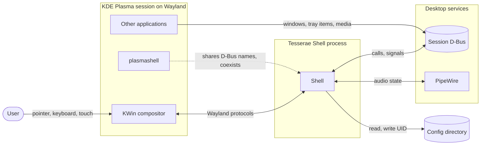

# System context

> [!summary]
> Tesserae Shell is one user-session process. It talks to the Wayland compositor (KWin) to place its surfaces and receive input, to the desktop's services over D-Bus and PipeWire to feed its modules, and to the user's configuration directory. It runs beside plasmashell and does not replace it. This note shows who the shell talks to; [[Layers and Components]] shows what is inside it.

## Diagram

## Who the shell talks to

| Actor | Interface | What for | Status |
|---|---|---|---|
| KWin | Wayland: `wlr-layer-shell` v5, `xdg_popup`, `wl_output`, text input, relative pointer, clipboard (data control) | Place Bars, Frames, Panels and Popups; hot-plug; input | Provided by tre ([[TRE-REQ-001 Layer Surface Window]]); tested on KWin 6.8.1 and sway 1.12 |
| plasmashell | Shared D-Bus names, optionally its panels | Coexist: take nothing it holds ([[ADR-0004 Plasma Coexistence]]) | Names observed on one session: [Observed D-Bus names](#observed-d-bus-names) |
| Session D-Bus | Services below | Data for modules | See modules |
| PipeWire | Audio state | Audio module | #needs-verification: access path (D-Bus, `wpctl`, library) |
| Config directory | `$HOME/.config/tesserae-shell/` | Shell files, modules, registry, themes, styles | [[ADR-0007 Shell UI Layer#Config directory and registry (2026-10-25)]] |
| KDE global shortcuts | `org.kde.KGlobalAccel` over D-Bus | Launcher shortcut | [[ADR-0005 Global Shortcuts]]; Wayland behaviour untested |
| Other applications | Tray items, media players | Tray and Media modules | Via D-Bus |

## Services for the v1 modules

Each is a candidate source for a module ([[V1 Scope#Modules in the default shell]]). All are unverified unless noted.

| Module | Candidate source | Notes |
|---|---|---|
| Clock | System time | No external service |
| Workspaces | KWin virtual desktops (`org.kde.KWin`, `/VirtualDesktopManager`: `current`, `desktops`, `currentChanged`) | Present on the observed session (Plasma 6.8.1): `current` (string), `desktops` (`a(iss)`), `currentChanged` (string signal) |
| Tasks | KWin window list | Mechanism not chosen (foreign-toplevel, KWin D-Bus, scripting) #needs-verification |
| System tray | StatusNotifierItem | On the observed session `kded6` owns `org.kde.StatusNotifierWatcher` and plasmashell is one host, so a second host can register ([[ADR-0004 Plasma Coexistence]]) |
| Audio | PipeWire | Access path open |
| Network | NetworkManager D-Bus (system bus) | `org.freedesktop.NetworkManager` present on the observed session's system bus; methods not checked |
| Battery | UPower D-Bus (system bus) | `org.freedesktop.UPower` and `org.freedesktop.UPower.PowerProfiles` present on the system bus; methods not checked |
| Media | MPRIS D-Bus (session bus) | `org.mpris.MediaPlayer2.*` names present (a browser and the Plasma browser integration); properties not checked |
| Applications (launcher) | Freedesktop desktop entries | #needs-verification |

## Observed D-Bus names

Read-only checks with `busctl` on the maintainer's machine on 2026-10-26: plasmashell 6.8.1, KWin 6.8.1. Other distributions and versions may differ. #needs-verification elsewhere.

| Name or object | Held by | What it means for the shell |
|---|---|---|
| `org.freedesktop.Notifications` (session) | plasmashell | A notification centre would need to replace this name; outside v1 ([[V1 Scope#After v1]]) |
| `org.kde.StatusNotifierWatcher` (session) | `kded6` | Not plasmashell. The watcher exists independently of the panel. `IsStatusNotifierHostRegistered` is true; `RegisterStatusNotifierHost` and `RegisteredStatusNotifierItems` are present |
| `org.kde.StatusNotifierHost-<pid>` | plasmashell | plasmashell is one tray host. A second host registers its own name |
| `org.kde.kglobalaccel` (session) | `kwin_wayland` | The global shortcut service runs inside KWin's process here ([[ADR-0005 Global Shortcuts]]) |
| `org.kde.KWin`, `/VirtualDesktopManager` | `kwin_wayland` | Source for the Workspaces module |
| `org.freedesktop.ScreenSaver` | `kwin_wayland` | Not needed by v1 |
| `org.kde.plasmashell`, `org.kde.JobViewServer` | plasmashell | Left alone |
| `org.freedesktop.portal.Desktop`, `org.freedesktop.impl.portal.desktop.kde` | xdg-desktop-portal, its KDE backend | Portals available |
| `org.mpris.MediaPlayer2.*` | the players | Media module source |
| `org.freedesktop.NetworkManager`, `org.freedesktop.UPower` (system bus) | NetworkManager, upowerd | Network and Battery module sources |
| PipeWire clients | `wireplumber`, `pipewire-pulse` | Audio module source; access path open |

## Boundaries

- The shell does not own the compositor, the session or other applications' windows ([[Goals and Non-Goals]] N1).
- Nothing in tre, TEL or the shell's UI layer talks to a service. Only modules and the shell runtime do ([[Layers and Components]]).
- Platform: Linux Wayland, KWin first; wlroots compositors best effort; no X11 or GNOME in v1 ([[V1 Scope#Target environment]]).

## Open questions

- [x] The D-Bus names plasmashell holds on a live Plasma 6 session: observed above, for [[ADR-0004 Plasma Coexistence]]. Re-check on other distributions.
- [ ] The access path for each service above; one `Integration` spec per service ([[40 Specifications]]).
- [x] Which D-Bus client library: `dbus-fast` on a shared asyncio service thread ([[ADR-0009 D-Bus Client Library]], decided 2026-10-26).

## Links

- [[20 Architecture]] · [[Layers and Components]] · [[Process Model and Threading]] · [[Data Flow]]
