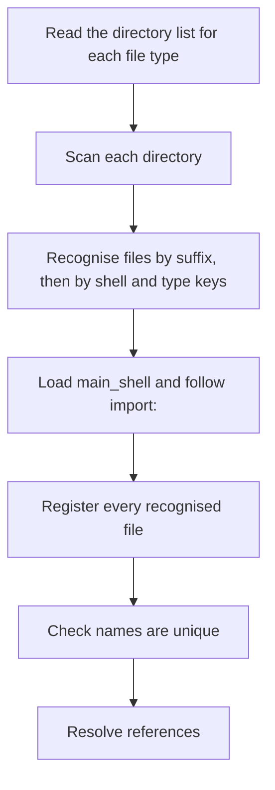

# Config discovery and registry

> [!summary]
> How the shell finds its files, decides which are loaded, gives each a stable identity, and keeps that identity in `registry.json`. Decided already: the config directory layout, the search order and fallback, `settings.yaml` before the registry, UIDs made with `uuid.uuid7()`, the registry as a JSON file, the UID written into the file below `shell:`, reference errors at load, and rebuilding the registry from file UIDs ([[ADR-0007 Shell UI Layer#Config directory and registry (2026-10-25)]], [[Settings File]]). This note adds the rules that make those work, as proposals with recommendations.

## Purpose and scope

- Define discovery, file recognition, name uniqueness, the registry file and its operations, the UID write, and reference resolution.
- Not in this note: what a shell, module, style, theme or stylesheet file contains ([[41 YAML Reference]]), how errors are reported ([[Validation and Errors]]), watching for changes ([[Hot Reload]]), and the order of start-up ([[Shell Start and Stop]]).

## Behaviour

### Where files are

The folders and `settings.yaml` are in [[Settings File#The config directory]]: `Shells/`, `Modules/<module_name>/`, `Styles/`, `Themes/`, `Stylesheets/` and `schemas/` under the config directory. A configured directory in `settings.yaml` is searched first and the default folder is the fallback ([[Settings File]], decided 2026-10-27). Shipped modules come from the package and are registry-only; a user module of the same name overrides one ([[ADR-0007 Shell UI Layer#Modules, styles, themes and stylesheets live in the config directory (2026-10-27)]]).

### Discovery



- **What is scanned.** Each directory is scanned recursively for files that end in a shell suffix (`_Shell.yaml`, `_Module.yaml`, `_Style.yaml`, `_Theme.yaml`, `_Stylesheet.yaml`). Dot files, `schemas/`, `logs/` and editor temporary files (names starting with a dot or ending in `~`, `.swp`, `.tmp` or `.bak`) are skipped. Recursive, not one level, so a user can sort Styles into folders; a module is still one folder `Modules/<module_name>/` ([[AGENTS#9. Naming in the designed system]]). Proposed.
- **What is a shell file.** A file is recognised by its suffix and by a top-level `shell:` key, and its `type:` must agree with the suffix ([[ADR-0007 Shell UI Layer#Recognising a shell file and importing (2026-10-25)]], [[Common Keys and Conventions#Keys every file has]]). A file with a shell suffix and no `shell:` key is refused with an error naming it. A file with another name is ignored, and a note is logged at info level.
- **What is loaded.** The top-level shell file is `main_shell` from `settings.yaml` (default `Main_Shell.yaml`) in the shells directory, and every file reachable through `import:` from it ([[Shell File]]). A `_Shell.yaml` in `Shells/` that nothing imports is not loaded and is logged at info level (proposed). Modules, styles, themes and stylesheets are all registered, whether used or not, so that a name used as a key resolves.
- **Imports** are paths relative to the importing file and nest ([[Common Keys and Conventions#Structure keys]]). A cycle is an error naming the chain; a missing file is an error with the paths tried.
- **Parsing** uses a loader that rejects duplicate mapping keys, because PyYAML keeps the last of two equal keys silently: a test on 2026-10-28 loaded two `Clock:` entries and got one. The error names both lines ([[Validation and Errors#Parsing]]).

### Names

- A `name` is unique across the shell, in every file ([[Common Keys and Conventions#Keys every file has]], decided 2026-10-26). A repeated use of one definition gets a path name (proposed).
- A name found twice in one tier is an error naming both files. The same name in a configured directory and in the default folder uses the configured one, with an info notice ([[Settings File]]). A user module overrides a shipped one of the same name.
- A module is called by its name as the key ([[Module File#Using a module]]). The name is looked up in the registry; an unknown key that is neither a block name nor a registered module is an error with the nearest names ([[Validation and Errors#Semantic checks]]).

### Identity and UIDs

- A UID is a `uuid.uuid7()` ([[ADR-0007 Shell UI Layer#UIDs and the registry (2026-10-25)]]). A file carries its own UID in the file, as `UID:` directly below `shell:`; it travels with the file when the file is moved or renamed.
- Named entries inside a file (a surface, a module use, a popup) get registry-only UIDs, keyed by the file's UID and the entry's name path. The files themselves are not edited for these. Proposed; the decided text says anything with a unique name gets a UID and the file holds its own.
- Shipped modules have stable, registry-only UIDs (decided 2026-10-26).
- **Identity** compares the entry's values other than the UID, with `name` and `location`. If they agree, the entry is the same; a mismatch means a new entry and the old one is treated as removed ([[ADR-0007 Shell UI Layer#UIDs and the registry (2026-10-25)]]).
- **A copied file.** Two files that carry the same UID is an error naming both: the user deleted the `UID:` line in neither copy. The shell does not choose one. Recommendation; the alternative is to give the later file a new UID, which can silently change which copy keeps state.

### The registry file

`registry.json` is at the configured path, default `registry.json` in the config directory ([[Settings File]]). A JSON file, not a database (decided 2026-10-25). Proposed shape:

```json
{
  "registry": 1,
  "entries": {
    "0192f4a0-7c3e-7000-8a1b-3f2c9d4e5a60": {
      "type": "Module",
      "name": "Clock",
      "file": "Modules/Clock/Clock_Module.yaml",
      "state": {}
    },
    "0192f4a0-8d11-7000-9c2d-1b4e6f7a8c91": {
      "kind": "panel",
      "name": "clock_widget",
      "file": "Shells/Main_Shell.yaml",
      "owner": "0192f4a0-7c3e-7000-8a1b-3f2c9d4e5a60",
      "state": {"margin": [40, 0, 0, 40]}
    }
  }
}
```

| Field | Meaning |
|---|---|
| `registry` | The format version of the file; a newer version than the shell knows is an error |
| `type` or `kind` | A file's type, or a surface's kind |
| `name` | The unique name |
| `file` | Relative to the config directory when inside it, otherwise absolute |
| `owner` | For a named entry inside a file, the file's UID |
| `state` | What the shell saves: a floating Panel's position ([[Panel#Position and attachment]]); other state is added as it is found |

- **Reading.** At start, on the main thread before the loop runs ([[Shell Start and Stop]]). A file that is not valid JSON is an error and stops the shell; the shell does not overwrite it. A missing file is created empty (decided 2026-10-27).
- **Writing.** A single writer thread collects changes and writes at most once every 500 ms, and once at stop. It writes to a temporary file in the same directory, flushes it, and replaces the registry atomically (`os.replace`), so a crash leaves the old file whole. Recommendation; this settles the open question about registry I/O on the loop ([[ADR-0007 Shell UI Layer#Open items]]).
- **A moved or empty registry.** If the registry is new, empty or moved and the files already carry UIDs, the shell logs a warning and rebuilds each record from the UID in its file instead of issuing new ones (decided 2026-10-27, [[Settings File]]). What a rebuilt record holds is name, kind or type, and file, found by scanning; the saved `state` is lost. Open question 4.
- **Removed entries.** When a file or entry is gone, its record is kept for 30 days and then dropped (proposed), so that renaming a file and back does not lose a Panel's position. Open question 3.

### Writing the UID into a file

The shell edits a file the user wrote, so it is careful (risk R-06 in the [[Risk Register]]).

1. Before the first write to a file, copy it to a backups folder under the config directory (proposed `backups/`, ignored by version control like `schemas/`).
2. Insert the line `UID: <uuid7>` directly below the `shell:` line by editing the text, not by loading and dumping YAML, so comments, order and quoting survive. Keep the file's line endings.
3. Check that the file did not change since it was read (content hash); if it did, skip and retry on the next load.
4. Write a temporary file in the same directory, then replace the original atomically; keep the file's permissions.
5. Tell the watcher this write is the shell's own, so the change does not trigger a reload ([[Hot Reload#The shell's own writes]]).
6. If the file cannot be written (read-only, not owned), log a warning and keep its identity in the registry only.

### References

- A reference is by name: `attach_to`, `anchor_to`, a module call key, `import:` paths for files. The registry resolves it ([[Common Keys and Conventions#Names and references]]).
- An unresolved reference is an error at load naming the file, the entry and the name. A target that disappears while running is a warning and the referring surface stays hidden until it returns ([[ADR-0007 Shell UI Layer#Config directory and registry (2026-10-25)]], [[Panel#Failure modes and recovery]]).
- Python reaches a file's YAML by file name, unique name or UID through `ctx.yaml(ref)` ([[Module Context]]); the registry resolves it.

## Configuration

`settings.yaml` keys: `directories`, `registry`, `main_shell` ([[Settings File]]). Proposed addition: `registry_retention` (days an orphaned record is kept, default 30). No other key.

## Python contract

A module receives its own UID and name in the context and can read other YAML through the registry ([[Module Context]]). It never reads or writes the registry.

## Integration

- Files: read through the standard library; YAML through PyYAML with the duplicate-key loader; JSON through the standard library.
- Threads: discovery and parsing may run on the config watcher thread; the registry and the model are updated on the loop with a finished result ([[Process Model and Threading#Threads]]). One writer thread for the registry.
- Platform: `os.replace` is atomic on one filesystem; the temporary file is in the registry's own directory for that reason.

## Design

None.

## Accessibility

None directly. Error messages follow [[Validation and Errors]].

## Performance budget

- Discovery scans a few dozen files; parsing dominates. With the validation cache an unchanged file is not re-validated ([[JSON Schema and Editor Support#The `jsonschema` dependency runtime, not only development]]).
- A registry write is off the loop and bounded by one write per 500 ms.
- Budgets are set in `60 Quality/`.

## Failure modes and recovery

| Failure | Result |
|---|---|
| `registry.json` is not valid JSON | Error naming the file; the shell stops and does not overwrite it |
| The registry is newer than the shell knows | Error naming the version; the shell stops |
| Two files carry the same UID | Error naming both |
| A name defined twice | Error naming both files and lines |
| A shell-suffix file with no `shell:` key | Error naming the file |
| A configured directory is missing or unreadable | Error naming the key and the path ([[Settings File#Errors specific to this file]]) |
| The UID write fails | Warning; the file keeps a registry-only identity |
| A file changes during the UID write | The write is skipped and retried |
| The registry write fails (disk full) | Logged; the old file stays whole; retried at the next change and at stop |

## Open questions

1. **Scan depth:** recursive for all types (recommended), or one level.
2. **A copied file with a duplicate UID:** an error naming both (recommended), or a new UID for the later file.
3. **Retention of removed records:** 30 days (recommended), or drop at once.
4. **What a rebuilt record holds:** name, kind or type and file from the scan; saved state is lost (recommended).
5. **Named entries:** registry-only UIDs for entries inside a file (recommended), or UIDs written into the entries too.
6. **A `backups/` folder** under the config directory for the first UID write (recommended), or no backup.
7. **Unimported shell files.** A `_Shell.yaml` in `Shells/` that nothing imports: ignored with an info notice (recommended), or loaded as a second root source.

## Acceptance criteria

- [ ] With the default folders and no `settings.yaml`, the shell finds `Shells/Main_Shell.yaml` and registers every module, style, theme and stylesheet.
- [ ] A `directories.modules` path is searched before `Modules/`; a module found only in `Modules/` still loads.
- [ ] Two entries with the same name fail the load and the error names both files and lines.
- [ ] Two `Clock:` keys in one `children:` mapping fail the load with both lines named.
- [ ] A shell-suffix file with no `shell:` key is refused by name.
- [ ] The first load writes `UID:` below `shell:` in each file, keeping comments and line endings, and a backup exists first.
- [ ] A file moved to another folder keeps its UID and its saved state.
- [ ] Deleting `registry.json` and starting rebuilds records from the files' UIDs with a warning, and creates the file.
- [ ] A crash during a registry write leaves the previous registry readable.
- [ ] A reference to a missing name fails the load; removing a target while running hides its Panel and logs a warning.

## Links

- [[Runtime]] · [[Settings File]] · [[Shell File]] · [[Common Keys and Conventions]] · [[Validation and Errors]] · [[Hot Reload]] · [[Shell Start and Stop]]
