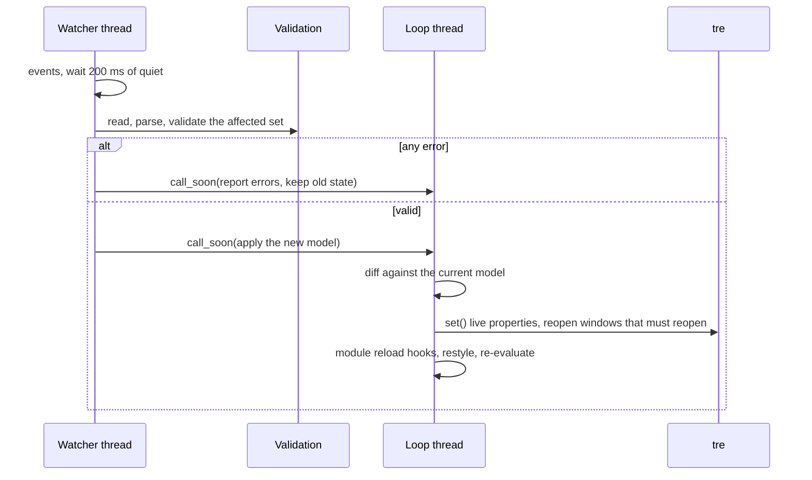

# Hot reload

> [!summary]
> The shell watches its files and applies a change to the running shell without a restart. A watcher thread notices a change, reads, parses and validates it, and hands a finished result to the loop, which applies the difference: it changes live properties in place and reopens a window only when a property cannot change live. A bad file leaves the old state running. Decided: hot reload exists, a bad file keeps the old state, a changed module `.py` reloads at runtime, `settings.yaml` applies `logging` at once and needs a restart for `directories` and `main_shell`, and the shell's own UID write must not cause a loop ([[Data Flow#Hot reload]], [[ADR-0007 Shell UI Layer#Events and module reload (2026-10-26)]], [[Settings File]]). The mechanics below are proposals with recommendations.

## Purpose and scope

- Define what is watched, how changes are noticed and coalesced, how a change is validated and diffed, what is applied live and what reopens a window, what state survives, and how a failure is handled.
- Not in this note: the error format ([[Validation and Errors]]), the registry ([[Config Discovery and Registry]]), and the module's own `reload()` hook ([[Module Contract#Lifecycle]]).

## Behaviour

### What is watched

- Every directory that can hold a shell file: the config directory's `Shells/`, `Modules/` (and the module folders in it), `Styles/`, `Themes/`, `Stylesheets/`, the directories `settings.yaml` names, and `settings.yaml` itself ([[Settings File]]). `schemas/`, `logs/` and `backups/` are not watched.
- A change to an imported file is a change to every file that imports it: the shell keeps a map from each file to its importers and reloads the whole affected set together.
- Watching is on by default. A key `hot_reload: false` in `settings.yaml` turns it off; a manual reload still works (proposed, [[Settings File]] keys are deferred to the build).

### How a change is noticed

- **Library.** inotify, through `inotify_simple` (recommended). A spike on 2026-10-28 installed `inotify_simple` 2.0.1 (BSD-2-Clause, no dependencies, released 2025-08-25) and ran on Python 3.14.8. A plain write produced create, modify and close-write events. An editor's atomic save (write a temporary file, then rename it over the target) produced create, modify and close-write on the temporary file and then a moved-to event on the real name. So the watcher listens for close-write and moved-to on a directory, and ignores names that start with a dot or end in `~`, `.swp`, `.tmp` or `.bak`.
- **Alternatives.** `watchfiles` 1.3.0 (MIT, 2026-09-21, Python 3.14 classifier; a Rust extension and one dependency) has debouncing built in; `watchdog` 6.0.0 was last released 2024-11-01 and has no 3.14 classifier; `pyinotify` was last released in 2015. The shell is Linux-only, so inotify's limits do not matter. Recommendation: `inotify_simple` with the shell's own debounce, for the smallest surface; `watchfiles` if a built-in debounce is preferred. #needs-verification on a target distribution.
- **Debounce.** A change is acted on 200 ms after the last event for it (proposed), so an editor's burst of events, or a multi-file save, becomes one reload.
- **inotify limits.** The number of watches is limited by `fs.inotify.max_user_watches`. Watches are per directory, a few dozen in all, so the limit is not close. If adding a watch fails, the shell logs a warning and runs without hot reload; a manual reload still works.
- **Manual triggers.** `SIGHUP` and a `reload` command on the control socket reload everything (the IPC and CLI note, to write). Proposed.

### The shell's own writes

The shell writes the registry and the `UID:` line into files ([[Config Discovery and Registry#Writing the UID into a file]]). A write it makes must not cause a reload. The writer records the content hash it wrote; when the watcher sees an event whose file now has that hash, it drops the event. A change by anyone else has a different hash and passes. This settles the open item about a reload loop ([[ADR-0007 Shell UI Layer#Open items]]).

### The reload pipeline

- Reading, parsing and validating run on the watcher thread. Only a finished model or a finished report crosses into the loop ([[Process Model and Threading#The rules]]). tre nodes belong to the loop thread, so the new nodes are built there. #needs-verification whether TEL compilation is safe on a worker thread; if not it runs on the loop.
- **Atomic.** The new model is built completely and validated before anything changes. A file that fails stages 1 to 7 changes nothing ([[Validation and Errors#The pipeline]]).
- **A reload is one turn of the loop for the diff,** so a view never shows a half-applied change. Proposed budget: the apply step stays within a few frames on a normal shell; measured in testing.

### The diff

The new model is compared with the current one to decide what to change. Recommendation: match by identity, then by name, then by position.

- **By identity.** A file by its UID; a named entry (a surface, a module use, a popup) by its unique name within its file ([[Config Discovery and Registry#Identity and UIDs]]).
- **By position.** A list item without a `name:` is named from its position (`Label_1`) ([[ADR-0007 Shell UI Layer#Open items]]), so reordering unnamed items looks like changes. The note says so and suggests naming items that must survive a reorder. Open question 1.
- An entry that is new is created; one that is gone is closed; one that matches is compared property by property.

### What is applied live and what reopens

| Change | Result |
|---|---|
| A tre layer-window property: `layer`, `anchor`, `size`, `exclusive_zone`, `exclusive_edge`, `margin`, `keyboard`, `input_region` | Set live in one commit ([[TRE-REQ-001 Layer Surface Window#Proposed API]]) |
| `namespace` or `output` (the monitor) | The window is closed and created again; they are constructor-only |
| A node property, a style value, a token, a theme | Set on the nodes; tre redraws only what changed |
| A module's YAML only | The module's layout is rebuilt; the module's `reload()` hook runs and the instance stays ([[Module Contract#Lifecycle]]) |
| A module's `.py` | Code reload: import the new code and check it has the class, then `stop` the old instance and join its threads, purge the module's own modules from `sys.modules`, create the new instance and `start` it; a failed import keeps the old instance ([[ADR-0007 Shell UI Layer#Events and module reload (2026-10-26)]]) |
| A change to a Popup entry | An open Popup is closed; the next open uses the new definition ([[Popup]]) |
| `settings.yaml`: `logging` | Applied at once |
| `settings.yaml`: `directories`, `main_shell`, `registry` | Reported as needing a restart; nothing changes until then ([[Settings File]]) |

### State that survives

- A module instance survives a YAML-only change, and its last sent values stay in the value store until the new instance sends ([[Data Flow#Hot reload]]).
- A Panel's visibility (shown, hidden, collapsed) survives by name; a floating Panel's position is in the registry and survives ([[Panel#Position and attachment]]).
- An open Popup does not survive a reload that touches it.
- Animations in progress finish or jump to their end state (proposed); a reload is not animated.
- A surface that was hidden stays hidden.

### Failure and recovery

- A file that fails validation: the old state keeps running and the errors are reported, with a desktop notification (opt-out) ([[Validation and Errors#Where it goes]]).
- A failure while applying (a tre error on one window): the shell logs it and tries to bring the affected window back to the old definition; if that also fails the window is closed and the rest continues. tre calls cannot be rolled back, so validation before applying is the protection. Open question 4.
- A module whose new code fails to import keeps its old instance ([[Process Model and Threading#Failure and recovery]]).

## Configuration

`settings.yaml`: `hot_reload` (default true), `reload_debounce` (milliseconds, default 200). Both proposed; the global settings list is built while the shell is built ([[Settings File]]).

## Python contract

`reload()` is for a changed YAML configuration and does not restart the module ([[Module Contract]]). A module never watches files itself for its own config; it reads `self.ctx.config` again in `reload()`.

## Integration

- The watcher thread and its place among the threads: [[Process Model and Threading#Threads]].
- tre: `set()` for live properties; closing and recreating a window for constructor-only ones ([[TRE-REQ-001 Layer Surface Window]]).
- The registry and the UID write: [[Config Discovery and Registry]].

## Design

None. A reload can show a short, optional notice that it applied (proposed, off by default); the shell does not animate a reload.

## Accessibility

A reload that fails is announced by the notification as well as the log ([[Validation and Errors#Accessibility]]). A reload never moves keyboard focus.

## Performance budget

- Idle cost of the watcher: it blocks in a read and wakes only on a file event ([[Goals and Non-Goals]] G4). Measured in testing.
- Apply step: proposed to stay within a few frames; the build of new nodes is the cost.
- A debounce of 200 ms means a change appears about a fifth of a second after the save.

## Failure modes and recovery

| Failure | Result |
|---|---|
| A bad file | Old state kept; errors reported |
| A file removed that something imports | Error naming the importer; old state kept |
| The inotify watch limit is reached | Warning; no automatic reload; manual reload works |
| An event storm (a build tool writes many files) | One reload after 200 ms of quiet |
| A reload while another is running | Queued; the second runs after the first with the newest files |
| A module's new code fails to import | The old instance keeps running; the error is logged |
| A change to `directories` in `settings.yaml` | Reported as needing a restart |

## Open questions

1. **The diff key:** by identity then name then position (recommended). Naming list items that must survive a reorder is the author's job.
2. **Watcher library:** `inotify_simple` with a 200 ms debounce (recommended), or `watchfiles`.
3. **Panel state across a reload:** shown, hidden and collapsed survive by name (recommended).
4. **A failed apply:** try to restore the window, then close it and continue (recommended).
5. **A notice when a reload applies:** off by default (recommended).
6. **Settings keys.** `hot_reload` and `reload_debounce` (recommended; the settings list is deferred).
7. **TEL compile on a worker thread:** whether TEL is safe off the loop.

## Acceptance criteria

- [ ] Saving a changed style file from an editor that saves atomically updates the running surface within about 300 ms, with one reload.
- [ ] Saving a file with a YAML error leaves the shell unchanged and reports `file:line:column`.
- [ ] Changing a Bar's `thickness` changes its reserved zone live, with one reflow of windows.
- [ ] Changing a Panel's `monitor` closes and recreates its window.
- [ ] Changing an imported file reloads every file that imports it, once.
- [ ] A module's YAML change calls its `reload()` and keeps the instance; a `.py` change replaces the instance; a `.py` with a syntax error keeps the old instance.
- [ ] The shell's own UID write does not trigger a reload.
- [ ] A change to `directories` in `settings.yaml` is reported as needing a restart and changes nothing else.
- [ ] With the watch limit exhausted, the shell warns and still reloads on `SIGHUP`.
- [ ] A reload applies in one turn: no frame shows half the change.
- [ ] An open Popup whose definition changed is closed.

## Links

- [[Runtime]] · [[Data Flow]] · [[Process Model and Threading]] · [[Validation and Errors]] · [[Config Discovery and Registry]] · [[Settings File]] · [[Shell Start and Stop]]
