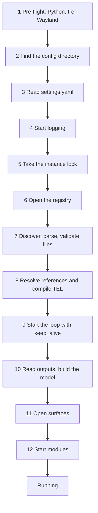

# Shell start and stop

> [!summary]
> The order in which the shell starts, what stops it from starting, how it runs with no windows, and how it stops. It is the runtime view of what [[Process Model and Threading]] and [[Data Flow]] sketch. Decided: one process and one tre loop ([[ADR-0003 Process Model]]), `settings.yaml` read first and a bad one stops the shell ([[Settings File]]), `run(keep_alive=True)` and `LoopHandle.stop()` ([[TRE-REQ-005 Keep-Alive and Loop Stop]]), stay idle with no windows. Everything else here is proposed, with a recommendation.

## Purpose and scope

- Define the start sequence, the failure rule at each step, the running state, the stop sequence, and the process rules that surround them: one instance, signals, exit codes.
- Not in this note: how files are found and the registry works ([[Config Discovery and Registry]]), how errors are worded ([[Validation and Errors]]), reloading a running shell ([[Hot Reload]]), the command line and the control socket (IPC and CLI, to write), and how the shell is launched at login (`70 Delivery`, to write).

## Behaviour

### Process rules

- **One process, one loop.** The shell is one Python process; tre's `App.run()` owns the main thread; everything that touches a window or node runs there ([[Process Model and Threading#The rules]]).
- **One instance per session** (proposed). Two shells would fight over the registry, the D-Bus names the shell owns and the same surfaces. The shell takes a lock in `$XDG_RUNTIME_DIR/tesserae-shell/` on start. A second start finds the lock, prints that a shell is already running with its process id, and exits with code 4. The same socket carries the control commands of the IPC and CLI note. Recommendation; the alternative is to let a second start ask the first to reload. #needs-verification how `XDG_RUNTIME_DIR` is set on the target session.
- **Wayland only.** No Wayland compositor, or one without the layer shell, is an environment error: tre raises `UnsupportedPlatform` ([[TRE-REQ-001 Layer Surface Window#Delivered (tre #195 closed)]]) and the shell exits with code 2 naming it. X11 is not supported ([[V1 Scope#Target environment]]).

### Start sequence

| Step | What happens | Source | If it fails |
|---|---|---|---|
| 1. Pre-flight | Python 3.14 or later; tre 0.5.9 or later (the Frame needs `hit_shape`); a Wayland session | [[Frame#Failure modes and recovery]], [[Surface Types]] | Stop, code 2, a message naming the missing version or the environment |
| 2. Config directory | `$XDG_CONFIG_HOME/tesserae-shell/` if set, non-empty and absolute, else `$HOME/.config/tesserae-shell/` | [[Settings File#The config directory]] | If it does not exist, create it with the default folders (proposed) |
| 3. Settings | Read `settings.yaml`; expand `~` and variables; check paths | [[Settings File]] | Stop, code 1, error on the console and in the default log directory |
| 4. Logging | Start Loguru with the `logging` keys, or the defaults | [[Settings File#Log files]] | Fall back to the console only and say so; do not stop |
| 5. Lock | Take the instance lock | This note | Another shell runs: stop, code 4 |
| 6. Registry | Open `registry.json` at the configured path; create an empty one if missing; rebuild records from file UIDs when needed | [[Config Discovery and Registry]] | A registry that cannot be read or written: stop, code 1 |
| 7. Discover, parse, validate | Find files, parse YAML, check the schema and the semantic rules, follow `import:` | [[Validation and Errors]] | Collect every error, then stop, code 1 |
| 8. Resolve and compile | Resolve name references through the registry; compile TEL expressions | [[ADR-0008 Tesserae Expression Language]] | Stop, code 1 |
| 9. Loop | `App.run(keep_alive=True)` starts the loop with zero windows; output events and `call_soon` work | [[TRE-REQ-005 Keep-Alive and Loop Stop]] | tre older than 0.5.9: caught in step 1 |
| 10. Model | Read `App.outputs()`, match `monitor:` entries, build the shell model | [[V1 Scope#Multi-monitor]], [[Data Flow#Monitor hot-plug]] | A root that matches no monitor is ignored |
| 11. Surfaces | Create one window per surface per monitor, from a callback on the loop | [[Surfaces]] | A surface that fails (a bad layer, tre `failed`) is logged and skipped; the others open |
| 12. Modules | Create each module class once and call `start()` | [[Module Contract#Lifecycle]] | A module whose `start` raises is marked failed and logged; the others continue |

- Steps 1 to 8 run before the loop and may block; the user sees an error and no surfaces. From step 9 on, the loop runs and nothing blocks it ([[Process Model and Threading#The rules]]).
- The loop starts before the windows exist because tre can now run with none, and a window is added from a callback ([[TRE-REQ-005 Keep-Alive and Loop Stop]]). Modules start after the model is built, so a value sent before its surface exists is kept in the store ([[Process Model and Threading#Lifecycle (proposed)]]).
- Threads start where they are first needed: the config watcher after step 8, the D-Bus service thread when the first module asks for D-Bus, the signal watcher at step 9, the watchdog after step 12 ([[Process Model and Threading#Threads]]).

### Running

- **No windows: stay idle** (decided 2026-10-26). If every monitor is set to none, or no output is present, the shell keeps running and waits for `output_added` ([[Data Flow#Monitor hot-plug]]).
- Monitors come and go: windows close with `output_removed` and are created again when the output returns; a dead window is never reused.
- An unhandled exception in a callback is logged by tre and does not stop the loop ([[Process Model and Threading#What tre guarantees]]).
- The shell reports a ready state once step 12 finishes (a log line, and a `READY` notice on the control socket; whether it also notifies systemd is a delivery item).

### Stop sequence

Triggers: SIGTERM or SIGINT, a quit command on the control socket, the session ending. SIGHUP reloads (proposed, [[Hot Reload]]). Python signal handlers do not run on an idle loop, so a watcher thread reads a socketpair fed by `signal.set_wakeup_fd` and calls `LoopHandle.stop()` ([[TRE-REQ-005 Keep-Alive and Loop Stop]], [[Process Model and Threading#Lifecycle (proposed)]]).

1. Set the state to Stopping; ignore file changes and reload requests.
2. `LoopHandle.stop()`: every window closes without a veto (each hears `closed`, reason `"stopped"`), and `App.run()` returns.
3. Stop modules in reverse start order: call `stop()`, join the module's threads. A module gets 3 seconds; the whole step gets 10 seconds (proposed values; measured in testing).
4. Stop the D-Bus service thread, the watcher and the watchdog.
5. Write the registry once, atomically ([[Config Discovery and Registry#The registry file]]).
6. Flush logs, release the instance lock, exit with code 0.

- A second SIGTERM or SIGINT during stopping ends the process at once with code 130 after flushing logs.
- A step that overruns its timeout is logged by name (the module and the thread) and skipped; the process still exits.
- Floating Panel positions are saved when the Panel's `moved` event fires, not only at stop, so a killed shell loses nothing ([[Panel#Position and attachment]]).

### Exit codes (proposed)

| Code | Meaning |
|---|---|
| 0 | Normal stop |
| 1 | Configuration error: settings, a file, the registry |
| 2 | Environment error: no Wayland or layer shell, tre or Python too old |
| 4 | Another shell is already running |
| 70 | An internal error: an unhandled exception outside a callback |
| 130 | Forced stop by a second signal |

Codes 3 and 5 to 69 are left free for later use.

## Configuration

Start and stop read `settings.yaml` keys only: `directories`, `registry`, `logging`, `validation`, `main_shell` ([[Settings File]]). Proposed additions, to settle while building: `stop_timeout` (default 10 seconds) and `module_stop_timeout` (default 3 seconds). No other key.

## Python contract

None. A module sees `start()` after the model exists and `stop()` at shutdown ([[Module Contract#Lifecycle]]). The shell never calls a module before step 12.

## Integration

- tre: `App.run(keep_alive=True)`, `App.thread_handle()`, `LoopHandle.stop()` and `call_soon`, `App.outputs()` ([[TRE-REQ-005 Keep-Alive and Loop Stop]]). The shell requires 0.5.9 or later.
- Signals: `signal.set_wakeup_fd` on a socketpair and a watcher thread ([[Process Model and Threading#Threads]]).
- Wayland and KWin: the session must provide `wlr-layer-shell`; the surface specs list what else is used ([[Surfaces]]).
- A supervisor (restart on a hard hang) is a later item ([[Process Model and Threading#Failure and recovery]]); the exit codes let one tell a crash from a configuration error.

## Design

None. Start and stop have no visual design; a failed start prints to the console and the log, and a running shell shows its errors the way [[Validation and Errors]] says.

## Accessibility

A failure that stops the shell must also be readable without a console: the shell may be launched from a session with none. Recommendation: the same error is sent as a desktop notification through `org.freedesktop.Notifications` when one is available (the shell calls it as a client; it does not own the server, [[ADR-0004 Plasma Coexistence]]). Open question 3.

## Performance budget

- Start is dominated by file parsing, validation and window creation. With a warm validation cache `jsonschema` is never imported ([[JSON Schema and Editor Support#The `jsonschema` dependency runtime, not only development]]).
- Budgets (time to first surface, time to ready, stop time) are set in `60 Quality/` and measured on this machine; none is measured yet.
- Stop is bounded: 10 seconds in total (proposed).

## Failure modes and recovery

| Failure | Result |
|---|---|
| A step before the loop fails | The shell prints every error found at that step, exits with the code above, and opens no surface |
| A module raises in `start` | That module is marked failed and logged; surfaces keep default values; other modules run |
| A surface fails to open | Logged and skipped; the rest open |
| The Wayland connection is lost | tre's windows close, the loop ends, the process exits; a supervisor restarts it |
| The loop hangs | The watchdog logs the stall; only a supervisor can recover ([[Process Model and Threading#Failure and recovery]]) |
| The process is killed | Nothing is written at stop; the lock is released by the kernel when the process dies if it is a file lock (proposed) |
| A stale lock with no process | A file lock held by `flock` dies with the process, so there is none to clear (proposed) |

## Open questions

1. **One instance:** a lock and refuse a second start (recommended), or let a second start trigger a reload.
2. **Exit codes:** the table above.
3. **Failure notice:** also send a desktop notification when the shell stops at start or fails a reload (recommended, opt-out).
4. **Config directory creation:** create it with the default folders when missing (recommended), or stop.
5. **Timeouts:** 3 seconds per module and 10 seconds in total.
6. **Ready notice:** whether the shell notifies systemd (delivery).
7. **A hidden lock path:** the lock in `$XDG_RUNTIME_DIR` against the config directory.

## Acceptance criteria

- [ ] With no `settings.yaml`, the shell starts from the default folders and the surfaces open.
- [ ] With an invalid `settings.yaml`, the shell exits with code 1, prints the error with `file:line:column` and writes it to `logs/`, and opens no surface.
- [ ] With tre older than 0.5.9, the shell exits with code 2 and names the required version.
- [ ] A second start while one runs exits with code 4 and names the first's process id.
- [ ] With every output removed, the shell keeps running and reopens surfaces when an output returns.
- [ ] SIGTERM on an idle shell stops it in under 10 seconds with code 0, after each module's `stop` ran and the registry was written.
- [ ] A module whose `stop` hangs delays the stop by at most 3 seconds, is named in the log, and the shell still exits.
- [ ] A second SIGINT during stop ends the process with code 130.
- [ ] A module whose `start` raises does not prevent the others from starting.

## Links

- [[Runtime]] · [[Process Model and Threading]] · [[Data Flow]] · [[Settings File]] · [[Config Discovery and Registry]] · [[Validation and Errors]] · [[Hot Reload]]
