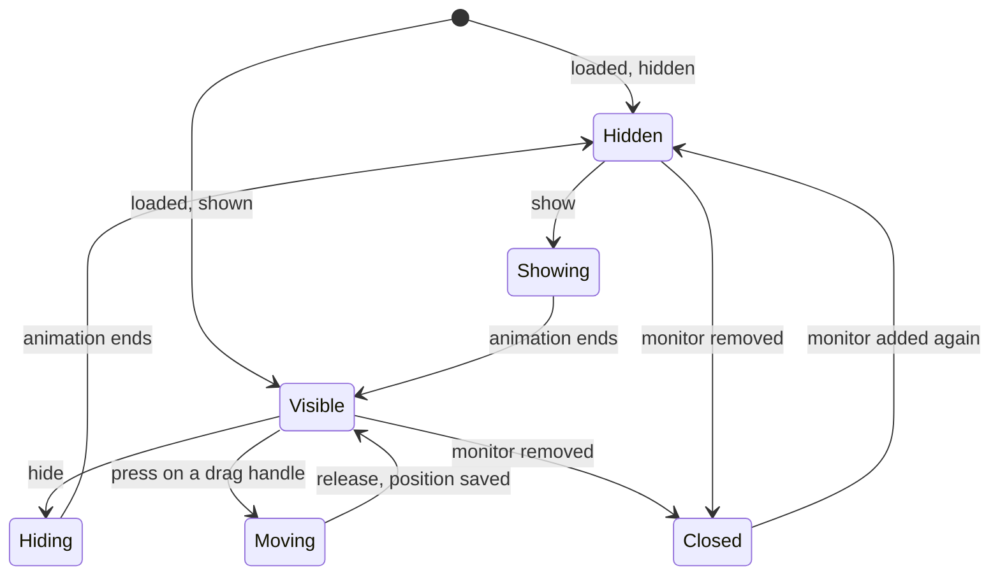

# Panel

> [!summary]
> The Panel (`kind: panel`) is the multi-purpose surface. It can attach to the Frame, a Bar or another surface by naming it, or float free. It can be moved with the mouse, anchored, hidden and animated, and it can sit on the Bottom, Top or Overlay layer. The OSD, the desktop widget, the launcher and the slide-in panel are all Panels. A Panel is a tre `LayerWindow`; it may become the baseline other kinds build on. The decisions are the maintainer's ([[Surface Types]], [[ADR-0007 Shell UI Layer]]); key names marked proposed mirror tre's settings. YAML is illustration.

## Purpose and scope

- One kind that covers four v1 uses ([[V1 Scope#Surfaces]]): the OSD, the desktop widget, the launcher and the slide-in panel, plus an overlay popup panel (a Panel on the overlay layer, [[Surface Types#Overlay]]).
- Not in this note: the Bar and Frame (their own specs), the Popup (menus and flyouts anchored to a surface, [[Surface Types#Special cases]]), and what a Panel contains (blocks, containers and modules, [[Building Blocks]]).

## Behaviour

### States



- Show, hide and toggle are shell actions a module or an event can call; a Panel can also hide itself after a time (an OSD).
- Moving is done by the engine: the surface follows the pointer by changing its margins, with no Python in the loop. On release the Panel's `moved` event gives the final margins, which the shell saves ([[TRE-REQ-001 Layer Surface Window#Margin drag]]).
- A closed Panel is dead; the shell creates a new window when the monitor returns ([[Data Flow#Monitor hot-plug]]).

### Position and attachment

| Mode | How it is written (proposed) | How it is built on tre |
|---|---|---|
| Anchored to an edge or corner | `anchor: [top, right]` with `margin` | `anchor` and `margin` settings |
| Floating | no `anchor` | The compositor centres it; a `margin` offset places it |
| Movable | `movable: true` | A node with `window_region="drag_margin"`; the engine changes the margins |
| Attached to a target | `attach_to: top_bar`, `attach: left`, `gap: 10`, `align: start` | The shell computes margins from the target's geometry (below) |

- **Attaching is by naming the surface** (decided, [[ADR-0007 Shell UI Layer#Open items]]). It is a reference, not nesting. The registry resolves the name; an unresolved name is an error at load, and a target that disappears while running is a warning and the Panel stays hidden until it returns.
- layer-shell has no way to place one surface relative to another, so the shell computes the margins itself and recomputes them when the target moves or animates. Two separate surfaces animating together can differ by up to a frame on screen ([[TRE-REQ-001 Layer Surface Window#Animation]]).
- Dragging clamps the Panel to its output. It does not cross to another monitor (no cross-monitor dragging for now; a later item), and other surfaces' reserved zones do not limit it.
- **Only a floating Panel has a persistent position** (decided 2026-10-27). An attached or anchored Panel is placed by its target or its anchor, so nothing is saved for it. The floating Panel's position is saved in the registry, which already holds a unique identity for it (proposed key: the final margins from `moved`).

### Attachment geometry (decided 2026-10-27)

`attach_to` names the target. Three keys say where the Panel sits against it:

| Key | Values | Meaning |
|---|---|---|
| `attach` | `left`, `right`, `top`, `bottom` | Which edge of the target the Panel meets |
| `gap` | An integer, in pixels | The space between the Panel and the target |
| `align` | `start`, `center`, `end` | How the Panel lines up along the shared edge |

- `attach: left` puts the Panel's right edge against the target's left edge. `attach: right` puts the Panel's left edge against the target's right edge. `attach: top` puts the Panel's bottom edge against the target's top edge. `attach: bottom` puts the Panel's top edge against the target's bottom edge.
- `gap` is the true visible gap, borders included: the distance between the Panel's outer border edge and the target's outer edge. A Panel with a 2 px border and a target with none, with `gap: 10`, has exactly 10 px between them. The shell subtracts the border from the offset it computes, and ignores a shadow margin, which is transparent ([[ADR-0010 Surface Shadows]]).
- `align` runs along the edge: for `attach: left` or `right`, `start` lines up the top edges, `center` the middles and `end` the bottom edges; for `attach: top` or `bottom`, `start` lines up the left edges and `end` the right edges (the second half is by analogy).

```yaml
attach_to: top_bar
attach: left
align: start
gap: 10
```

This attaches the Panel's right edge to the target's left edge, lines up their top edges, and leaves 10 px between the Panel's right edge and the target's left edge.

**Following the target (decided 2026-10-27).**

- The Panel follows a target that animates (slides, expands, contracts).
- If the target is hidden while the Panel is open, the Panel hides ("hides or closes"; hidden, not closed, see Hide and show).
- If the target has peeking on and peeks while the Panel is open, the Panel follows the peek animation and stays open.
- Opened by a keyboard shortcut while the target is hidden: if the target has peeking enabled, the Panel opens; if not, it does not open until the target is visible.

**One Panel, one target (decided 2026-10-27).** A target has one attached Panel. A second Panel attaches to the first Panel (a chain). Opening the second from the first is opt-in: either the origin target opens both (proposed key `open_with_target`, default off), or the first Panel has its own way to open the second.

**A module as the target (decided 2026-10-27).** The target can be a module inside a Bar. Then `attach` and `align` are computed against the module's geometry, not the Bar's, while the gap respects the parent Bar, so the Panel does not overlap it. A Bar can therefore carry several Panels, one per module. A Panel can be attached to a Bar itself and open when the Bar becomes visible, for a stylised application menu. How the shell reads a module's geometry, and what "the gap respects the parent Bar" means exactly (the gap measured from the Bar's edge), are open. #needs-verification

### Hide and show (decided 2026-10-27)

Hide and show mean hidden, not closed. A hidden Panel keeps its identity and its place in the tree; it does not reload, and a Panel that is shown again returns where it was. The window mechanics (tre's `show_layer` is about node layers inside a window, per its layer-window reference, not surface visibility, so surface hiding may need another route) are open. #needs-verification

### Collapsed handle (decided 2026-10-27: use the Edge Shell as the example)

A Panel can collapse to a handle on its edge, as the maintainer's Edge Shell does ([design spec](file:///home/phil/Projects/pyDev/projects/myShell/docs/superpowers/specs/2026-10-11-edge-shell-design.md), [Shell_Specs](file:///home/phil/Projects/pyDev/projects/myShell/docs/Shell_Specs.md)). What it does, as written there:

| State | Visible | Enters when |
|---|---|---|
| Collapsed | The handle only; the Panel is hidden | Start-up default, a click on the handle while extended, a drag released below 50% |
| Peek | A short slide out (14 px in the Edge Shell); the handle brightens | The pointer enters the hover zone |
| Extended | Full depth | A click on the handle, or a drag released at 50% or more |

- The handle is three 3 px dots with 3 px gaps; its colour changes on hover. The Edge Shell lists per-panel properties for its shape, size, weight, offset, colour and hover colour, and for whether click, hover and drag act.
- The hover zone is an invisible strip beyond the edge (16 px in the Edge Shell) that wakes a collapsed Panel.
- A press that moves under 4 px is a click; a longer press moves the depth along the panel's axis and snaps at 50% on release.
- The handle is a focusable button with an accessible name such as "Expand dock".
- Proposed keys, from the Edge Shell names: `state` (`collapsed`, `extended`), `peek` (pixels), `hover_zone` (pixels), `handle` (a mapping for shape, size, weight, offset, colour and hover colour), `click`, `hover` and `drag` (booleans). These are proposals; the maintainer chose the Edge Shell as the model, not the key names.

### Layers

A Panel may use `bottom`, `top` or `overlay`. It may reserve space only on `top` (an `exclusive_zone` elsewhere is a load error, [[Surface Types#Layers per kind]]).

- The protocol leaves the order of surfaces on one layer undefined ([protocol](https://wayland.app/protocols/wlr-layer-shell-unstable-v1)). So a Panel that must draw over a Bar needs a higher layer than the Bar (a Bar on `top`, the Panel on `overlay`), or it must not overlap it.
- `background` is not offered to any kind.

### Keyboard and focus

- `keyboard: none` is the default; a Panel with a text field needs `on_demand`; the launcher uses `exclusive` on the overlay layer.
- A popup a Panel calls inherits the Panel's keyboard setting ([protocol](https://wayland.app/protocols/wlr-layer-shell-unstable-v1)).

### Input region

By default a Panel takes input over its whole surface. A Panel with a non-rectangular shape, a transparent margin for a shadow, or a click-through OSD sets the input region: the whole surface, nothing, rectangles, or `auto` (the union of the drawn shapes). The OSD uses nothing so clicks pass through. Shape-aware `auto` for curved and concave shapes uses `hit_shape="painted"` on path nodes, released in tre 0.5.9 ([[Hit Testing for Concave Corners]]).

## Configuration

Keys of a Panel entry. Decided keys are from [[Common Keys and Conventions]]; proposed ones mirror tre ([[Shell File#Surface keys]]).

| Key | Meaning | Status |
|---|---|---|
| `kind: panel` | The kind | Decided |
| `layer` | `bottom`, `top` or `overlay` | Decided |
| `children` | Blocks, containers and modules | Decided |
| `style` | A style file or inline values | Decided |
| `attach_to` | The name of the target: a surface, a module in a Bar, or another Panel | Decided that attachment is by name; key proposed |
| `attach` | `left`, `right`, `top`, `bottom`: the target's edge the Panel meets | Decided (2026-10-27) |
| `gap` | Pixels between the Panel and its target, borders included | Decided (2026-10-27) |
| `align` | `start`, `center`, `end` along the shared edge | Decided (2026-10-27) |
| `open_with_target` | Opening the target also opens this Panel; default off | Opt-in decided (2026-10-27); key proposed |
| `meld` | With `attach_to` a Frame: draw the Panel inside the Frame's surface, so it grows out of the frame with no seam | Proposed; the mechanism is decided ([[Frame#Hosted melding (decided 2026-10-27)]]) |
| `anchor` | `top`, `bottom`, `left`, `right` (one or a list) | Proposed |
| `size` | `[width, height]` | Proposed |
| `margin` | Four-sided offset, clockwise from the top | Proposed; order decided |
| `keyboard` | `none`, `on_demand`, `exclusive` | Proposed |
| `input_region` | Whole, nothing, rectangles or `auto` | Proposed |
| `exclusive_zone` | Space to reserve; only on `top` | Rule decided; key proposed |
| `movable` | The mouse can move it; the position is saved. Floating Panels only | Proposed; saved in the registry (decided 2026-10-27) |
| `hidden` | Start hidden | Proposed |
| `hide_after` | Hide itself after a time, for an OSD; the default is a reasonable value the user can set, and the caller resets the timer when it re-shows the Panel | Decided (2026-10-27); the default value is open |
| `animation` | Slide, fade or none, with a duration | Proposed |

### The four uses

```yaml
children:
    volume_osd:                       # OSD: brief, click-through, on the overlay layer
        kind: panel
        layer: overlay
        anchor: [bottom]
        margin: [0, 0, 80, 0]
        size: [260, 60]
        input_region: []
        hide_after: 1500
        children:
            - ProgressBar:
                value: "{{ volume }}"
    clock_widget:                     # desktop widget: movable, position saved
        kind: panel
        layer: bottom
        anchor: [top, left]
        margin: [40, 0, 0, 40]
        movable: true
        children:
            - Clock:
    launcher:                         # launcher: overlay layer, exclusive keyboard
        kind: panel
        layer: overlay
        keyboard: exclusive
        size: [600, 400]
        hidden: true
        children:
            - TextInput:
            - List:
    side_panel:                       # slide-in panel attached to a bar
        kind: panel
        layer: top
        attach_to: top_bar
        attach: bottom
        align: end
        gap: 8
        hidden: true
        animation: {type: slide, duration: 200}
        children:
            - Slider:
```

An illustration only: the module params (`value`, a Slider's params) and the expression syntax are not designed here.

## Python contract

A Panel has no Python of its own. A module reaches it through shell actions: show, hide, toggle, move. A module is told when a use appears or goes away ([[Module Context#Uses]]). The position the user dragged to is shell state, not module state.

## Integration

- tre: a `LayerWindow` with `layer`, `anchor`, `size`, `margin`, `keyboard`, `input_region`, `exclusive_zone` (live through `set()`), margin animation with `animate`, `window_region="drag_margin"` and the `moved` event ([[TRE-REQ-001 Layer Surface Window]]). `namespace` and `output` are constructor-only, so a change means reopening the window.
- Threads: window operations on the loop thread; no worker thread ([[Process Model and Threading]]).
- Saved position: only a floating Panel has one. The registry holds each entry's state ([[ADR-0007 Shell UI Layer#Config directory and registry (2026-10-25)]]); the final margins from `moved` are written there (decided 2026-10-27, key proposed). On a monitor change the saved position is clamped to the output.
- Memory: a surface costs about 18 MiB for a 1280 x 32 bar and 31 MiB for a 200 x 100 window on tre 0.5.8, and a full-screen 4K overlay about 177 MiB ([[TRE-REQ-001 Layer Surface Window#Delivered (tre #195 closed)]]). A launcher should be a sized panel, not full-screen, unless a dimmed backdrop is wanted.

## Design

- A Panel's look is a style file, a stylesheet or inline `style:` over a Box or FlexBox; shape, border, radius, shadow and background are style properties ([[Style, Theme and Stylesheet Files#Rules]]).
- Shadows: as [[ADR-0010 Surface Shadows]] defines them: a larger transparent surface, the input region on the body, and the shadow keys `elevation`, `shadow` and `shadow_bleed` ([[Style Schema#Shadow keys]]). Shadows are excluded from the hit shape.
- A visual meld with a Bar or the Frame is drawn with Path blocks and a shared colour, on separate surfaces ([[Surface Types#Risks]]).

## Accessibility

- The Panel's window is published as one window of the application, with the nodes' roles, labels and states set in the shell file. A hidden Panel is not in the tab order.
- The launcher takes the keyboard exclusively on open; Escape closes it.
- The screen reader gets the tree but no screen position for a layer surface ([[TRE-REQ-001 Layer Surface Window#Delivered (tre #195 closed)]]).
- Reduced motion: show and hide are instant, no slide or fade ([[Goals and Non-Goals]] G7).
- A collapsed or auto-hidden Panel needs a keyboard-reachable way to open it.

## Performance budget

- A hidden Panel with `hidden: true` should not hold a surface if the compositor allows; whether the window is created hidden or destroyed and recreated is open.
- Moving is done in the engine, with one commit per input frame and no Python in the loop.
- A slide uses margin animation, one small commit per step with no buffer change. Size and `exclusive_zone` changes are not animated (a configure round trip each).
- Budgets are set in `60 Quality/`.

## Failure modes and recovery

| Failure | Result |
|---|---|
| `attach_to` never resolves | Error at load naming the file, the Panel and the name |
| The target disappears while running | Warning; the Panel stays hidden until the target returns |
| A size of 0 on an axis without both opposite anchors | Error before any request to the compositor (tre rejects it) |
| `exclusive_zone` on a layer other than `top` | Error at load |
| The saved position is off the output (a monitor changed) | Clamped to the output; if impossible, the configured default |
| The monitor is removed | The Panel closes (`output_removed`); it is created again when the monitor returns |
| The compositor closes the surface | The Panel is dead; the shell recreates it |
| Two Panels overlap on the same layer | Draw order undefined; use different layers |

## Open questions

- [x] Attachment geometry: `attach`, `gap` and `align`, and how `attach_to` treats a hidden or animating target (maintainer, 2026-10-27).
- [x] One Panel per target; further Panels chain to the previous Panel; opening both is opt-in. A module in a Bar can be the target (maintainer, 2026-10-27).
- [x] Hide and show: hidden, not closed (maintainer, 2026-10-27). Open: the window mechanics and the first-show flash.
- [x] Where the position is saved: the registry, for floating Panels only (maintainer, 2026-10-27). Open: the key that turns saving on.
- [x] A collapsed handle: as the Edge Shell does it (maintainer, 2026-10-27). Open: the key names and the hover zone's size.
- [x] Dragging across monitors: not now, something to look into later (maintainer, 2026-10-27).
- [x] Auto-hide timing for an OSD: a reasonable default the user can set; the caller controls the reset (maintainer, 2026-10-27). Open: the default value.
- [x] Shadow keys: as ADR-0010 defines them (maintainer, 2026-10-27).
- [x] Keys the kind adds, and the baseline for other kinds: no additions at this time (maintainer, 2026-10-27).
- [ ] How the shell reads a module's geometry for a module target, and what the gap against the parent Bar means exactly.

## Acceptance criteria

- [ ] A Panel with `layer: bottom`, an anchor and a margin appears at that place on its monitor and above the wallpaper.
- [ ] A movable Panel follows the mouse, stays on its output, and its final margins are saved and used on the next start.
- [ ] A Panel with `attach_to` appears next to its named target; with the target removed from the file, loading reports the missing name; with the target hidden while running, a warning is logged and the Panel hides.
- [ ] A Panel on the overlay layer with `keyboard: exclusive` takes the keyboard and Escape closes it.
- [ ] An OSD with `input_region: []` lets clicks pass through and hides itself after `hide_after`.
- [ ] A slide-in Panel moves by margin animation and, with reduced motion on, appears instantly.
- [ ] An `exclusive_zone` on a Panel that is not on `top` is a load error.
- [ ] After the monitor is unplugged and plugged back, the Panel is created again where it was saved.
- [ ] `attach: left`, `align: start`, `gap: 10` puts the Panel's right edge 10 px from the target's left edge with their top edges level; a 2 px Panel border is inside the 10.
- [ ] A Panel follows an animating target; it hides when the target hides, and stays open and follows when the target peeks.
- [ ] A keyboard shortcut opens the Panel while its target is hidden only if the target has peeking.
- [ ] A second Panel attached to the first follows it; `open_with_target` opens both from the target.
- [ ] A hidden Panel is not closed: showing it returns it to the same state and place.
- [ ] A collapsed Panel shows its handle; hover peeks, a click or a drag past 50% extends it.
- [ ] Only a floating Panel's position is written to the registry.

## Links

- [[Surfaces]] · [[Surface Types]] · [[Shell File]] · [[Building Blocks]] · [[Shell Structure]]
