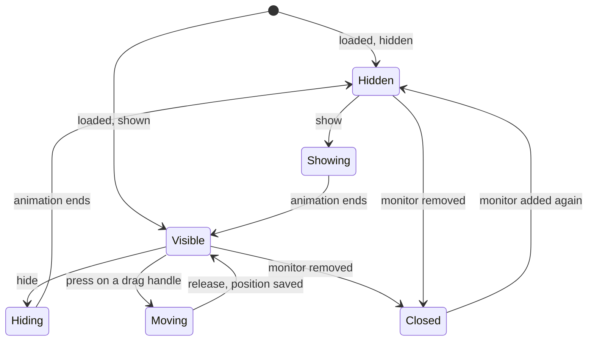

# Panel

> [!summary]
> The Panel (`kind: panel`) is the multi-purpose surface. It can attach to the Frame, a Bar or another surface by naming it, or float free. It can be moved with the mouse, anchored, hidden and animated, and it can sit on the Bottom, Top or Overlay layer. The OSD, the desktop widget, the launcher and the slide-in panel are all Panels. A Panel is a tre `LayerWindow`; it may become the baseline other kinds build on. The decisions are the maintainer's ([[Surface Types]], [[ADR-0007 Shell UI Layer]]); key names marked proposed mirror tre's settings. YAML is illustration.

## Purpose and scope

- One kind that covers four v1 uses ([[V1 Scope#Surfaces]]): the OSD, the desktop widget, the launcher and the slide-in panel, plus an overlay popup panel (a Panel on the overlay layer, [[Surface Types#Overlay]]).
- Not in this note: the Bar and Frame (their own specs), the Popup (menus and flyouts anchored to a surface, [[Surface Types#Special cases]]), and what a Panel contains (blocks, containers and modules, [[Building Blocks]]).

## Behaviour

### States



- Show, hide and toggle are shell actions a module or an event can call; a Panel can also hide itself after a time (an OSD).
- Moving is done by the engine: the surface follows the pointer by changing its margins, with no Python in the loop. On release the Panel's `moved` event gives the final margins, which the shell saves ([[TRE-REQ-001 Layer Surface Window#Margin drag]]).
- A closed Panel is dead; the shell creates a new window when the monitor returns ([[Data Flow#Monitor hot-plug]]).

### Position and attachment

| Mode | How it is written (proposed) | How it is built on tre |
|---|---|---|
| Anchored to an edge or corner | `anchor: [top, right]` with `margin` | `anchor` and `margin` settings |
| Floating | no `anchor` | The compositor centres it; a `margin` offset places it |
| Movable | `movable: true` | A node with `window_region="drag_margin"`; the engine changes the margins |
| Attached to another surface | `attach_to: top_bar` | The shell computes margins from the target's geometry |

- **Attaching is by naming the surface** (decided, [[ADR-0007 Shell UI Layer#Open items]]). It is a reference, not nesting. The registry resolves the name; an unresolved name is an error at load, and a target that disappears while running is a warning and the Panel stays hidden until it returns.
- layer-shell has no way to place one surface relative to another, so the shell computes the margins itself and recomputes them when the target moves or animates. Two separate surfaces animating together can differ by up to a frame on screen ([[TRE-REQ-001 Layer Surface Window#Animation]]).
- Dragging clamps the Panel to its output. It does not cross to another monitor, and other surfaces' reserved zones do not limit it.

### Layers

A Panel may use `bottom`, `top` or `overlay`. It may reserve space only on `top` (an `exclusive_zone` elsewhere is a load error, [[Surface Types#Layers per kind]]).

- The protocol leaves the order of surfaces on one layer undefined ([protocol](https://wayland.app/protocols/wlr-layer-shell-unstable-v1)). So a Panel that must draw over a Bar needs a higher layer than the Bar (a Bar on `top`, the Panel on `overlay`), or it must not overlap it.
- `background` is not offered to any kind.

### Keyboard and focus

- `keyboard: none` is the default; a Panel with a text field needs `on_demand`; the launcher uses `exclusive` on the overlay layer.
- A popup a Panel calls inherits the Panel's keyboard setting ([protocol](https://wayland.app/protocols/wlr-layer-shell-unstable-v1)).

### Input region

By default a Panel takes input over its whole surface. A Panel with a non-rectangular shape, a transparent margin for a shadow, or a click-through OSD sets the input region: the whole surface, nothing, rectangles, or `auto` (the union of the drawn shapes). The OSD uses nothing so clicks pass through. Shape-aware `auto` for curved and concave shapes uses `hit_shape="painted"` on path nodes, released in tre 0.5.9 ([[Hit Testing for Concave Corners]]).

## Configuration

Keys of a Panel entry. Decided keys are from [[Common Keys and Conventions]]; proposed ones mirror tre ([[Shell File#Surface keys]]).

| Key | Meaning | Status |
|---|---|---|
| `kind: panel` | The kind | Decided |
| `layer` | `bottom`, `top` or `overlay` | Decided |
| `children` | Blocks, containers and modules | Decided |
| `style` | A style file or inline values | Decided |
| `attach_to` | The name of the surface to attach to | Decided that attachment is by name; key proposed |
| `anchor` | `top`, `bottom`, `left`, `right` (one or a list) | Proposed |
| `size` | `[width, height]` | Proposed |
| `margin` | Four-sided offset, clockwise from the top | Proposed; order decided |
| `keyboard` | `none`, `on_demand`, `exclusive` | Proposed |
| `input_region` | Whole, nothing, rectangles or `auto` | Proposed |
| `exclusive_zone` | Space to reserve; only on `top` | Rule decided; key proposed |
| `movable` | The mouse can move it; the position is saved | Proposed |
| `hidden` | Start hidden | Proposed |
| `hide_after` | Hide itself after a time, for an OSD | Proposed |
| `animation` | Slide, fade or none, with a duration | Proposed |

### The four uses

```yaml
children:
    volume_osd:                       # OSD: brief, click-through, on the overlay layer
        kind: panel
        layer: overlay
        anchor: [bottom]
        margin: [0, 0, 80, 0]
        size: [260, 60]
        input_region: []
        hide_after: 1500
        children:
            - ProgressBar:
                value: "{{ volume }}"
    clock_widget:                     # desktop widget: movable, position saved
        kind: panel
        layer: bottom
        anchor: [top, left]
        margin: [40, 0, 0, 40]
        movable: true
        children:
            - Clock:
    launcher:                         # launcher: overlay layer, exclusive keyboard
        kind: panel
        layer: overlay
        keyboard: exclusive
        size: [600, 400]
        hidden: true
        children:
            - TextInput:
            - List:
    side_panel:                       # slide-in panel attached to a bar
        kind: panel
        layer: top
        attach_to: top_bar
        hidden: true
        animation: {type: slide, duration: 200}
        children:
            - Slider:
```

An illustration only: the module params (`value`, a Slider's params) and the expression syntax are not designed here.

## Python contract

A Panel has no Python of its own. A module reaches it through shell actions: show, hide, toggle, move. A module is told when a use appears or goes away ([[Module Context#Uses]]). The position the user dragged to is shell state, not module state.

## Integration

- tre: a `LayerWindow` with `layer`, `anchor`, `size`, `margin`, `keyboard`, `input_region`, `exclusive_zone` (live through `set()`), margin animation with `animate`, `window_region="drag_margin"` and the `moved` event ([[TRE-REQ-001 Layer Surface Window]]). `namespace` and `output` are constructor-only, so a change means reopening the window.
- Threads: window operations on the loop thread; no worker thread ([[Process Model and Threading]]).
- Saved position: the registry holds each entry's state ([[ADR-0007 Shell UI Layer#Config directory and registry (2026-10-25)]]); the final margins from `moved` are written there (proposed). On a monitor change the saved position is clamped to the output.
- Memory: a surface costs about 18 MiB for a 1280 x 32 bar and 31 MiB for a 200 x 100 window on tre 0.5.8, and a full-screen 4K overlay about 177 MiB ([[TRE-REQ-001 Layer Surface Window#Delivered (tre #195 closed)]]). A launcher should be a sized panel, not full-screen, unless a dimmed backdrop is wanted.

## Design

- A Panel's look is a style file, a stylesheet or inline `style:` over a Box or FlexBox; shape, border, radius, shadow and background are style properties ([[Style, Theme and Stylesheet Files#Rules]]).
- Shadows: a surface cannot draw outside its own bounds, so a Panel with a shadow needs either a larger transparent surface or a compositor-drawn shadow. Open ([[Shadows on Layer Surfaces]]).
- A visual meld with a Bar or the Frame is drawn with Path blocks and a shared colour, on separate surfaces ([[Surface Types#Risks]]).

## Accessibility

- The Panel's window is published as one window of the application, with the nodes' roles, labels and states set in the shell file. A hidden Panel is not in the tab order.
- The launcher takes the keyboard exclusively on open; Escape closes it.
- The screen reader gets the tree but no screen position for a layer surface ([[TRE-REQ-001 Layer Surface Window#Delivered (tre #195 closed)]]).
- Reduced motion: show and hide are instant, no slide or fade ([[Goals and Non-Goals]] G7).
- A collapsed or auto-hidden Panel needs a keyboard-reachable way to open it.

## Performance budget

- A hidden Panel with `hidden: true` should not hold a surface if the compositor allows; whether the window is created hidden or destroyed and recreated is open.
- Moving is done in the engine, with one commit per input frame and no Python in the loop.
- A slide uses margin animation, one small commit per step with no buffer change. Size and `exclusive_zone` changes are not animated (a configure round trip each).
- Budgets are set in `60 Quality/`.

## Failure modes and recovery

| Failure | Result |
|---|---|
| `attach_to` never resolves | Error at load naming the file, the Panel and the name |
| The target disappears while running | Warning; the Panel stays hidden until the target returns |
| A size of 0 on an axis without both opposite anchors | Error before any request to the compositor (tre rejects it) |
| `exclusive_zone` on a layer other than `top` | Error at load |
| The saved position is off the output (a monitor changed) | Clamped to the output; if impossible, the configured default |
| The monitor is removed | The Panel closes (`output_removed`); it is created again when the monitor returns |
| The compositor closes the surface | The Panel is dead; the shell recreates it |
| Two Panels overlap on the same layer | Draw order undefined; use different layers |

## Open questions

- [ ] **Attachment geometry.** Which side or corner of the target, what gap, and what alignment: keys such as `attach_side`, `gap` and `align`. How `attach_to` handles a target that is hidden or animating (follow, hide, stay).
- [ ] **Several Panels on one target,** and a Panel attached to a Panel.
- [ ] **Hide and show.** Whether hidden means the window is closed or kept with an empty input region; how the first show avoids a flash.
- [ ] **Where the position is saved,** and the key that turns saving on.
- [ ] **A collapsed handle** (a strip that stays when the Panel is collapsed, as in the Edge Shell design) and its hover zone.
- [ ] **Dragging across monitors.** tre clamps a drag to one output.
- [ ] **Auto-hide timing** for an OSD, and who resets it when a new value arrives (a module re-shows the Panel).
- [ ] **Shadows** (the two routes in [[Shadows on Layer Surfaces]]).
- [ ] **Keys the kind adds** beyond the table, and how a Panel becomes the baseline for other kinds.

## Acceptance criteria

- [ ] A Panel with `layer: bottom`, an anchor and a margin appears at that place on its monitor and above the wallpaper.
- [ ] A movable Panel follows the mouse, stays on its output, and its final margins are saved and used on the next start.
- [ ] A Panel with `attach_to` appears next to its named target; with the target removed from the file, loading reports the missing name; with the target hidden while running, a warning is logged and the Panel hides.
- [ ] A Panel on the overlay layer with `keyboard: exclusive` takes the keyboard and Escape closes it.
- [ ] An OSD with `input_region: []` lets clicks pass through and hides itself after `hide_after`.
- [ ] A slide-in Panel moves by margin animation and, with reduced motion on, appears instantly.
- [ ] An `exclusive_zone` on a Panel that is not on `top` is a load error.
- [ ] After the monitor is unplugged and plugged back, the Panel is created again where it was saved.

## Links

- [[Surfaces]] · [[Surface Types]] · [[Shell File]] · [[Building Blocks]] · [[Shell Structure]]
