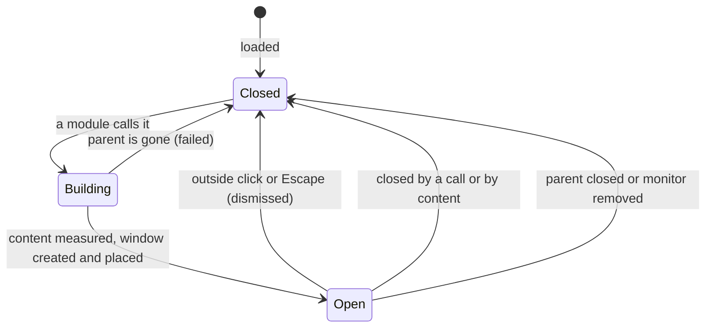

# Popup

> [!summary]
> The Popup (the `Popup` block) is a menu, flyout or tooltip that hangs off a rectangle of another shell surface. A module calls it, usually from a click; the shell builds it, tre's `PopupWindow` shows it, and the compositor places it beside the rectangle and keeps it on screen. It holds containers, modules and blocks, knows what called it, takes the keyboard and pointer by default, and closes on an outside click or Escape. Decisions below are the maintainer's ([[Surface Types#Special cases]], [[ADR-0007 Shell UI Layer]], and the answers of 2026-10-28); key names are proposed. The examples are TDL illustrations ([[ADR-0014 Shell File Language]]).

## Purpose and Scope

- The v1 uses: a tray icon's menu, a clock's calendar later, a context menu, a flyout from a Bar module, and a tooltip ([[V1 Scope#Surfaces]]).
- Not in this note: the Panel (a surface that attaches or floats and stays open, [[Panel]]); the Notification window, a surface type of its own that is not v1 ([[Surface Types#Special cases]]); the Menu, Tooltip and Revealer modules that fill popups ([[V1 Widgets]]).
- A Popup is not a child in the shell file's tree: it is its own entry, and what it hangs off is a reference ([[Surface Types#Popup]]).

## Behaviour

### States



- A Popup exists only while open (decided 2026-10-28). Each open builds the content and creates a new tre `PopupWindow`; each close destroys it. tre fixes a popup's size and settings at creation and a closed popup is dead ([tre reference](https://mindderivative.github.io/tre/reference/layer-window/#popupwindow)), so there is nothing to reuse. A module's own state lives in the module, not in the popup. Measuring the open cost is for the testing phase.
- Only one Popup is open at a time, except a submenu with its parent (decided 2026-10-28). Opening another closes the first.
- Calling an open Popup closes it (a toggle). With focus on, the click that closes it lands on the popup's grab, so the icon that opened it does not reopen it ([tre reference](https://mindderivative.github.io/tre/reference/layer-window/#popupwindow): "the click is the popup's").

### Parent and Anchor

- The parent is the surface that holds the calling use (decided, [[Module Context#Calling a popup]]), so a Popup opens on that surface's monitor only and is never anchored across monitors ([[Surface Types#Open questions]]). tre requires the parent to be an open `LayerWindow` or `PopupWindow` ([tre reference](https://mindderivative.github.io/tre/reference/layer-window/#popupwindow)); a Popup called from a hosted Frame strip or a melded entry hangs off the Frame's painter window.
- The caller passes the anchor rectangle: the clicked icon, in its surface's coordinates (decided, [[Module Context#Calling a popup]]).
- A submenu is a Popup called from a module inside a Popup; its parent is that Popup. Closing the parent closes the submenus (tre).
- `Anchor_To` names a parent in the file. Decided 2026-10-28: the caller decides the parent, so `Anchor_To` is needed only for a Popup opened without a module caller, and is optional otherwise.

### Placement

The compositor places the popup against the anchor rectangle and keeps it on screen. The shell offers the same words as a Panel's attachment ([[Panel#Attachment geometry (decided 2026-10-27)]]), decided 2026-10-28, and maps them to tre's arguments:

| `Attach` and `Align` | tre `anchor`   | tre `gravity`  |
|----------------------|----------------|----------------|
| `bottom`, `start`    | `bottom_left`  | `bottom_right` |
| `bottom`, `center`   | `bottom`       | `bottom`       |
| `bottom`, `end`      | `bottom_right` | `bottom_left`  |
| `top`, `start`       | `top_left`     | `top_right`    |
| `top`, `center`      | `top`          | `top`          |
| `top`, `end`         | `top_right`    | `top_left`     |
| `right`, `start`     | `top_right`    | `bottom_right` |
| `right`, `center`    | `right`        | `right`        |
| `right`, `end`       | `bottom_right` | `top_right`    |
| `left`, `start`      | `top_left`     | `bottom_left`  |
| `left`, `center`     | `left`         | `left`         |
| `left`, `end`        | `bottom_left`  | `top_left`     |

- `Attach: bottom` puts the popup's top edge against the anchor's bottom edge, as in the Panel. `Gap` becomes tre's `offset` away from the anchor (positive for the attached side).
- The default is `Attach: bottom`, `Align: start` (the first row, which is tre's own example), with tre's default adjustment `("flip_y", "slide_x")`: the compositor flips the popup above the anchor when there is no room below, and slides it sideways to stay on screen ([tre reference](https://mindderivative.github.io/tre/reference/layer-window/#popupwindow)). A popup under a bottom bar therefore opens upward with no setting.
- The mapping follows the protocol's words: a corner anchor puts the anchor point at that corner, and a corner gravity places the popup towards that corner ([xdg-shell](https://wayland.app/protocols/xdg-shell)). #needs-verification against a running KWin 6.8.1.
- `configure` reports where the compositor put it, so a flip is visible to the shell ([tre reference](https://mindderivative.github.io/tre/reference/layer-window/#popupwindow)); the content can react (an arrow on the other side).
- **The visual shape is what is placed (decided 2026-10-28).** The shape the compositor uses for placement is the popup's border plus its body size. A transparent margin for a shadow is ignored and is not part of the popup's size, so `Attach: bottom` with `Gap: 4` leaves 4 px between the anchor and the body, margin or not. tre today sets the window geometry to the whole surface, margin included (`set_window_geometry(0, 0, width, height)`, `crates/engine-platform/src/layer.rs`, read 2026-10-28), so the compositor would place the margin. Until tre can name the body ([[TRE-REQ-007 Popup Body Geometry]], draft, not filed), the shell enlarges the popup by the margin and shifts tre's `offset` by it; the compositor's flip and slide then use the larger rectangle, so a popup near a screen edge can flip up to one margin early. #needs-verification on KWin 6.8.1.

### Size (Proposed)

tre fixes a popup's size at creation. A tray menu's height depends on its items, so the shell measures first. A throwaway test on tre 0.5.8 showed it works without a display: a headless `Window` with a content tree of three text lines, a layout pass (`advance`), and `get("layout_width")` / `get("layout_height")` returned 126 by 72 for a box with `fit-content` sizes (2026-10-28, scratch script in /tmp). Proposed flow on open:

1. Build the content in a headless window at the largest size allowed (`Max_Size`), run layout, read the content's laid-out size.
2. Create the `PopupWindow` with that size, then build the content again in it.

Costs: the content is built twice per open. `Size: auto` is the default; a fixed `Size: [w, h]` skips the measurement. `Max_Size: [width, height]` defaults to `[300, 400]` (decided 2026-10-28). Content larger than `Max_Size` is clamped to it and scrolls (decided 2026-10-28). A change in content size while open (an item appears) cannot resize the popup: it closes and reopens, or the content scrolls.

### Focus and Dismissal (Decided)

- **Focus is on by default** (maintainer, 2026-10-26): an open Popup takes the keyboard and pointer itself, with nothing passed at call time, and closes on an outside click or Escape. It maps to tre's `grab=True` ([tre reference](https://mindderivative.github.io/tre/reference/layer-window/#popupwindow)). One flag, `Focus`.
- **Tooltip-like Popups opt out** (`Focus: false`) and close when the pointer leaves (decided 2026-10-26). They map to `grab=False`. See Tooltips below.
- **Clicks on other shell surfaces** (decided 2026-10-28). tre delivers a click on another window of the same application to that window, not as a dismissal, so a Popup that should close on it must listen and close ([tre reference](https://mindderivative.github.io/tre/reference/layer-window/#popupwindow)). The shell does this for every focused Popup: a click on any of its own surfaces closes it.
- **A grab needs a user action.** `xdg_popup.grab` "must be used in response to some sort of user action like a button press, key press, or touch down event", with that event's serial; a denied grab dismisses the popup at once ([xdg-shell](https://wayland.app/protocols/xdg-shell)). So a focused Popup opens in response to input on a shell surface (decided 2026-10-28). A global shortcut or IPC command has no such serial. tre passes the last input serial it saw to the grab (`popup.xdg_popup().grab(&seat, self.last_serial)`, `layer.rs`, read 2026-10-28), so an open without fresh input uses a stale serial and the compositor may deny it. A launcher or menu opened by shortcut is a Panel on the overlay layer with exclusive keyboard ([[Panel#Keyboard and focus]]), not a Popup. #needs-verification what KWin does with a stale serial.

### Tooltips (Decided 2026-10-28)

A tooltip is a Popup that opens when the pointer enters its caller and closes when it leaves. Two parts: the Popup says it is a tooltip, and the thing hovered says which tooltip it has.

**On the Popup entry** (`Tooltip: true | false`, default false). `Tooltip: true` makes the Popup a tooltip: it sets `Focus: false`, `Open_On_Enter: true` and `Close_On_Exit: true`, with the default delays. An explicit key on the entry overrides each default. Four keys give the behaviour:

| Key             | Meaning                                                               |
|-----------------|-----------------------------------------------------------------------|
| `Open_On_Enter` | Open when the pointer enters the caller                               |
| `Enter_Delay`   | Milliseconds the pointer must stay before it opens                    |
| `Close_On_Exit` | Close when the pointer leaves the caller and the popup                |
| `Exit_Delay`    | Milliseconds to wait before closing, so the pointer can cross the gap |

**On the thing hovered** (`Tooltip`). On a module use the key is `Tooltip: <file>` or an inline Popup:

```
Clock { Tooltip: Clock_Tooltip.tdl }    # a file that holds the Popup

Clock {
    Tooltip {                           # or an inline popup
        Children {
            Label { Text: {{ caller.data.text }} }
        }
    }
}
```

- **The caller is the thing hovered.** For a module use that is the module's rectangle; it is the Popup's anchor and its `caller` record.
- **Opt-in for all modules, built-in and custom** (maintainer, 2026-10-28): the `Tooltip` key is available on every module use, provided by the shell, with no module code.
- **Manual use** on a block, a surface or anything that is not a module works the same way as on a module, unless the author customises it (maintainer, 2026-10-28; this replaces my earlier note that a hand-written handler was needed). The author writes the same key where they want one.
- The value forms: a file name (a shell file holding the Popup, found like any shell file), an inline Popup block, and, proposed, the unique name of a `Popup` block resolved through the registry.
- Defaults for the delays (decided 2026-10-28): `Enter_Delay: 500` and `Exit_Delay: 200` milliseconds. The user can change them; testing may tune them.
- A tooltip is not focusable and takes no keyboard.

### Layers

A Popup is not on a layer-shell layer: it is an `xdg_popup` stacked by the compositor above its parent ([[Surface Types#Layers per kind]]). Whether KWin draws it above a fullscreen window is not an issue, because a fullscreen window hides the parent surface and closes its popups ([[Surface Types#Fullscreen and maximised windows (decided 2026-10-27)]]).

### What the Popup Knows

The caller's record is available to the Popup's modules and expressions (decided, [[Module Context#Calling a popup]]): the calling module's name and UID, the use (name, monitor, params), the anchor rectangle, and an optional `data` mapping the module passes. Expressions read `caller.<field>`; a tray menu shows the items of the icon that was clicked. A Popup is built fresh on each open, so it sees the record of that call.

## Configuration

| Key                                                            | Meaning                                                                                                           | Status                                                                                  |
|----------------------------------------------------------------|-------------------------------------------------------------------------------------------------------------------|-----------------------------------------------------------------------------------------|
| `Popup` (the head)                                             | The type; there is no `Kind:` key                                                                                                        | Decided                                                                                 |
| `Children`                                                     | Containers, modules and blocks                                                                                    | Decided                                                                                 |
| `Style`                                                        | A style file or inline values                                                                                     | Decided                                                                                 |
| `Anchor_To`                                                    | A default parent by name; optional                                                                                | Key proposed in [[Shell File]]; optional, decided (2026-10-28) |
| `Attach`, `Align`, `Gap`                                       | Placement against the anchor rectangle, as for a Panel                                                            | Decided (2026-10-28)                                                                    |
| `Adjust`                                                       | What the compositor may do to keep it on screen: `flip_x`, `flip_y`, `slide_x`, `slide_y`, `resize_x`, `resize_y` | Decided (key name accepted 2026-10-29); default `[flip_y, slide_x]` (tre's default)    |
| `Size`                                                         | `auto` or `[width, height]`                                                                                       | Decided (2026-10-28); default `auto`                                                    |
| `Max_Size`                                                     | `[width, height]`: the largest `auto` may reach; content beyond it scrolls                                        | Decided; default `[300, 400]` (2026-10-28)                                              |
| `Focus`                                                        | Take the keyboard and pointer; default true                                                                       | Decided (2026-10-26)                                                                    |
| `Tooltip` (on a Popup)                                         | `true` makes the Popup a tooltip: `Focus: false`, `Open_On_Enter`, `Close_On_Exit`; default false                 | Decided (2026-10-28)                                                                    |
| `Open_On_Enter`                                                | Open when the pointer enters the caller (a tooltip)                                                               | Key decided (2026-10-28)                                                                |
| `Enter_Delay`                                                  | Milliseconds before it opens                                                                                      | Decided; default 500 (2026-10-28)                                                       |
| `Close_On_Exit`                                                | Close when the pointer leaves the caller and the popup                                                            | Key decided (2026-10-28)                                                                |
| `Exit_Delay`                                                   | Milliseconds before it closes                                                                                     | Decided; default 200 (2026-10-28)                                                       |
| `Tooltip` (on a module use, or manually on a block or surface) | A Popup file or an inline Popup, opened as that thing's tooltip                                                   | Key and forms decided (2026-10-28); the unique-name form is proposed                    |
| `Animation`                                                    | Fade or none; no slide (the compositor places it)                                                                 | Decided (key name accepted 2026-10-29)                                                 |

```
Popup {
    Name: tray_menu
    Attach: bottom
    Align: start
    Gap: 4
    Children {
        Menu { Items: {{ caller.data.items }} }
    }
}

Popup {
    Name: clock_tooltip
    Tooltip: true                    # focus off, opens on enter, closes on exit
    Enter_Delay: 500
    Exit_Delay: 200
    Attach: bottom
    Align: center
    Children {
        Label { Text: {{ caller.data.text }} }
    }
}
```

An illustration only. `Menu` and `Label` are modules from [[V1 Widgets]]; the expression syntax is TEL's. The `true` in `Tooltip: true` assumes a boolean literal, which ADR-0014 does not yet define (open); a module use is written with the module's name as the head ([[Module File#Using a Module]]).

## Python Contract

A Popup has no Python of its own. A module opens it from an action with `self.ctx.popup(popup_name)`, and the shell supplies the calling use ([[Module Context#Calling a popup]], decided 2026-10-26); the module may pass `data` and read nothing back. A module can also close it. The popup's modules receive `use` records and the `caller` record like any other modules ([[Module Context#Uses]]). Whether the call is a method on the context or an action the shell file declares is open ([[Module Context#Calling a popup]]).

## Integration

- tre: `PopupWindow(parent, size, anchor_rect, anchor, gravity, constraint_adjustment, offset, grab)`; `configure` carries the placed `x`, `y`; `closed` carries the reason (`dismissed`, `failed`, and others); settings cannot change after creation ([tre reference](https://mindderivative.github.io/tre/reference/layer-window/#popupwindow)). It is menu-sized and costs a bar's worth of memory, not an output's.
- Wayland: `xdg_popup` with a positioner and, for `Focus`, a grab; "nested popups must be destroyed in the reverse order they were created in" ([xdg-shell](https://wayland.app/protocols/xdg-shell)); tre handles the order.
- Threads: window operations on the loop thread ([[Process Model and Threading]]). Measuring and building the content is on the loop thread; a slow expression does not belong in it.
- The overlay route is an alternative tre documents: a transparent output-sized `LayerWindow` that holds a menu drawn with `show_layer`. It costs hundreds of MB while open and covers the output, so a Popup is the default; the route stays available for a menu that must span outputs ([tre guide](https://mindderivative.github.io/tre/guide/menus-from-a-bar/)).

## Design

- The look is a style file, stylesheet or an inline `Style` block ([[Style, Theme and Stylesheet Files#Rules]]): background, border, radii, shadow. A Popup uses the same tokens and keys as the other surfaces ([[Style Schema]]), and elevation level 3 is a sensible default for a menu (proposed, token values in `50 Design System/`).
- Shadows: a popup's surface cannot draw outside itself, so a shadow needs a transparent margin ([[ADR-0010 Surface Shadows]]). The margin is ignored for placement (decided 2026-10-28, see Placement); the input region follows the body. Test a popup with a margin and a shadow on KWin 6.8.1.
- The Menu module owns arrow-key navigation and item layout; the Popup provides focus and dismissal.

## Accessibility

- A Popup is one more window of the application for a screen reader ([[TRE-REQ-001 Layer Surface Window#Delivered (tre #195 closed)]]). Its nodes declare roles and labels in the file.
- With focus on, keyboard focus moves into the Popup on open and returns to the element that opened it on close; Escape closes. #needs-verification how tre moves and restores focus.
- A tooltip (`Focus: false`) is not focusable; its text is also available as the anchor's description ([[Clock Module#Accessibility]]).
- Reduced motion: fade is off ([[Goals and Non-Goals]] G7).

## Performance Budget

- An open Popup draws no frames while nothing changes (tre's idle rule).
- Open cost: two builds of the content (measure, then show) plus a window creation. Not measured; tre measured about 140 ms for the overlay route, which is a larger surface ([tre guide](https://mindderivative.github.io/tre/guide/menus-from-a-bar/)). Target to set in `60 Quality/`: a menu on screen within one or two frames of the click on this machine's hardware, to be measured.
- A closed Popup holds nothing.

## Failure Modes and Recovery

| Failure                                                                  | Result                                                                                              |
|--------------------------------------------------------------------------|-----------------------------------------------------------------------------------------------------|
| The parent is gone or not open                                           | tre closes the popup with reason `failed`; the shell logs the Popup name and the caller             |
| A Popup is called with a name that does not exist                        | Error at the call, naming the module and the name                                                   |
| The compositor denies the grab (no valid user action, or a stale serial) | The popup is dismissed at once; the shell logs it and, for a `Focus: true` Popup, reports the cause |
| The monitor is removed                                                   | The parent closes, so the Popup closes                                                              |
| The content is larger than `Max_Size`                                    | Clamped to `Max_Size`; the content scrolls (decided 2026-10-28)                                     |
| A module's content expression fails                                      | The Popup opens with the failing node empty and the error is logged, as in any view                 |
| A second Popup is called while one is open                               | The first closes, unless the second is a submenu                                                    |

## Open Questions

All nine were answered on 2026-10-28.

1. [x] **Parent:** the caller's surface; `Anchor_To` optional (maintainer, as recommended).
2. [x] **Placement words:** `Attach`, `Align`, `Gap`, as the Panel (as recommended).
3. [x] **Size:** `auto` by a headless measuring pass, a fixed `Size`, `Max_Size`; a content change while open closes and reopens (as recommended).
4. [x] **Opening without input:** a Popup opens in response to input; a shortcut-opened menu is an overlay Panel (as recommended).
5. [x] **One open at a time,** except submenus (as recommended).
6. [x] **Create on open, destroy on close** (as recommended).
7. [x] **Clicks on other shell surfaces** close a focused Popup (as recommended).
8. [x] **Tooltip behaviour:** keys `Close_On_Exit`, `Exit_Delay`, `Enter_Delay` and `Open_On_Enter`; the caller is the hovered module; a `Tooltip` key is opt-in for every module, built-in and custom; the same key works by hand on blocks and surfaces (maintainer, 2026-10-28). The key names were settled the same day (below). Open: how the shell reads a module's rectangle.
9. [x] **Shadows:** the visual shape (border plus body size) is what the compositor places; the transparent shadow margin is ignored and is not part of the popup's size. tre sets the geometry to the whole surface today, so this is a workaround now and [[TRE-REQ-007 Popup Body Geometry]] later (maintainer, 2026-10-28).
- [x] Content larger than `Max_Size`: clamp and scroll (maintainer, 2026-10-28).
- [x] The default `Max_Size`: `[300, 400]` (maintainer, 2026-10-28).
- [x] The tooltip key: `Tooltip: true | false` on a Popup; `Tooltip: <file>` or an inline Popup on a module, and the same on a block or surface when written by hand (maintainer, 2026-10-28).
- [x] The default delays: `Enter_Delay` 500 ms and `Exit_Delay` 200 ms (maintainer, 2026-10-28).

## Acceptance Criteria

- [ ] A click on a tray icon opens its menu beside the icon, on the icon's monitor only; the menu shows the items of that icon.
- [ ] Under a bottom Bar, the menu opens upward with no setting; under a top Bar, downward.
- [ ] A menu near the right edge slides left to stay on screen.
- [ ] An outside click or Escape closes a focused Popup; the dismissing click does not also open it again.
- [ ] A click on another shell surface closes a focused Popup.
- [ ] A Popup with `Focus: false` takes no keyboard and closes after `Exit_Delay` once the pointer leaves it and its caller.
- [ ] A module use with `Tooltip: Clock_Tooltip.tdl` opens that Popup after `Enter_Delay` when the pointer enters the module, and closes it after `Exit_Delay` on leaving; an inline `Tooltip` block does the same.
- [ ] A Popup with content taller than 400 px is 400 px tall and scrolls.
- [ ] A Popup with a 12 px shadow margin and `Gap: 4` has its visible body 4 px from the anchor, the same as one without a margin.
- [ ] A submenu opens beside its item; closing the parent closes it.
- [ ] A Popup called while another is open closes the first.
- [ ] After removing the parent surface, the Popup closes and the shell logs a `failed` reason.
- [ ] The Popup's size matches its content within 1 px with `Size: auto`.

## Links

- [[Surfaces]] · [[Surface Types]] · [[Bar]] · [[Panel]] · [[Module Context]] · [[Shell File]] · [[V1 Widgets]]
