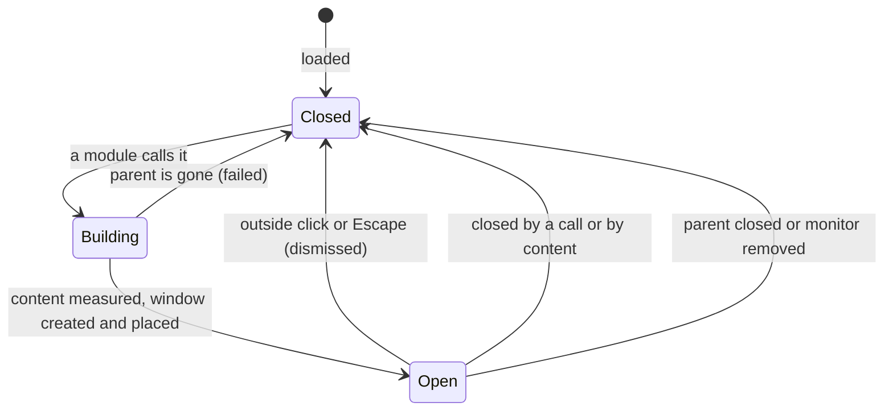

# Popup

> [!summary]
> The Popup (`kind: popup`) is a menu, flyout or tooltip that hangs off a rectangle of another shell surface. A module calls it, usually from a click; the shell builds it, tre's `PopupWindow` shows it, and the compositor places it beside the rectangle and keeps it on screen. It holds containers, modules and blocks, knows what called it, takes the keyboard and pointer by default, and closes on an outside click or Escape. Decisions below are the maintainer's ([[Surface Types#Special cases]], [[ADR-0007 Shell UI Layer]]); everything else is a proposal with a recommendation. YAML is illustration.

## Purpose and scope

- The v1 uses: a tray icon's menu, a clock's calendar later, a context menu, a flyout from a Bar module, and a tooltip ([[V1 Scope#Surfaces]]).
- Not in this note: the Panel (a surface that attaches or floats and stays open, [[Panel]]); the Notification window, a kind of its own that is not v1 ([[Surface Types#Special cases]]); the Menu, Tooltip and Revealer modules that fill popups ([[V1 Widgets]]).
- A Popup is not a child in the shell file's tree: it is its own entry, and what it hangs off is a reference ([[Surface Types#Popup]]).

## Behaviour

### States



- A Popup exists only while open. Each open builds the content and creates a new tre `PopupWindow`; each close destroys it. tre fixes a popup's size and settings at creation and a closed popup is dead ([tre reference](https://mindderivative.github.io/tre/reference/layer-window/#popupwindow)), so there is nothing to reuse. A module's own state lives in the module, not in the popup. Recommendation; measuring the open cost is open.
- Only one Popup is open at a time, except a submenu with its parent (proposed). Opening another closes the first.
- Calling an open Popup closes it (a toggle). With focus on, the click that closes it lands on the popup's grab, so the icon that opened it does not reopen it ([tre reference](https://mindderivative.github.io/tre/reference/layer-window/#popupwindow): "the click is the popup's").

### Parent and anchor

- The parent is the surface that holds the calling use (decided, [[Module Context#Calling a popup]]), so a Popup opens on that surface's monitor only and is never anchored across monitors ([[Surface Types#Open questions]]). tre requires the parent to be an open `LayerWindow` or `PopupWindow` ([tre reference](https://mindderivative.github.io/tre/reference/layer-window/#popupwindow)); a Popup called from a hosted Frame strip or a melded entry hangs off the Frame's painter window.
- The caller passes the anchor rectangle: the clicked icon, in its surface's coordinates (decided, [[Module Context#Calling a popup]]).
- A submenu is a Popup called from a module inside a Popup; its parent is that Popup. Closing the parent closes the submenus (tre).
- `anchor_to` names a parent in the file. Recommendation: the caller decides the parent, so `anchor_to` is needed only for a Popup opened without a module caller, and is optional otherwise. Open question 1.

### Placement

The compositor places the popup against the anchor rectangle and keeps it on screen. The shell offers the same words as a Panel's attachment ([[Panel#Attachment geometry (decided 2026-10-27)]]) and maps them to tre's arguments:

| `attach` and `align` | tre `anchor` | tre `gravity` |
|---|---|---|
| `bottom`, `start` | `bottom_left` | `bottom_right` |
| `bottom`, `center` | `bottom` | `bottom` |
| `bottom`, `end` | `bottom_right` | `bottom_left` |
| `top`, `start` | `top_left` | `top_right` |
| `top`, `center` | `top` | `top` |
| `top`, `end` | `top_right` | `top_left` |
| `right`, `start` | `top_right` | `bottom_right` |
| `right`, `center` | `right` | `right` |
| `right`, `end` | `bottom_right` | `top_right` |
| `left`, `start` | `top_left` | `bottom_left` |
| `left`, `center` | `left` | `left` |
| `left`, `end` | `bottom_left` | `top_left` |

- `attach: bottom` puts the popup's top edge against the anchor's bottom edge, as in the Panel. `gap` becomes tre's `offset` away from the anchor (positive for the attached side).
- The default is `attach: bottom`, `align: start` (the first row, which is tre's own example), with tre's default adjustment `("flip_y", "slide_x")`: the compositor flips the popup above the anchor when there is no room below, and slides it sideways to stay on screen ([tre reference](https://mindderivative.github.io/tre/reference/layer-window/#popupwindow)). A popup under a bottom bar therefore opens upward with no setting.
- The mapping follows the protocol's words: a corner anchor puts the anchor point at that corner, and a corner gravity places the popup towards that corner ([xdg-shell](https://wayland.app/protocols/xdg-shell)). #needs-verification against a running KWin 6.8.1.
- `configure` reports where the compositor put it, so a flip is visible to the shell ([tre reference](https://mindderivative.github.io/tre/reference/layer-window/#popupwindow)); the content can react (an arrow on the other side).

### Size (proposed)

tre fixes a popup's size at creation. A tray menu's height depends on its items, so the shell measures first. A throwaway test on tre 0.5.8 showed it works without a display: a headless `Window` with a content tree of three text lines, a layout pass (`advance`), and `get("layout_width")` / `get("layout_height")` returned 126 by 72 for a box with `fit-content` sizes (2026-10-28, scratch script in /tmp). Proposed flow on open:

1. Build the content in a headless window at the largest size allowed (`max_size`), run layout, read the content's laid-out size.
2. Create the `PopupWindow` with that size, then build the content again in it.

Costs: the content is built twice per open. `size: auto` is the default; a fixed `size: [w, h]` skips the measurement; `max_size` defaults to the output size minus a margin (proposed). A change in content size while open (an item appears) cannot resize the popup: it closes and reopens, or the content scrolls. Open question 3.

### Focus and dismissal (decided)

- **Focus is on by default** (maintainer, 2026-10-26): an open Popup takes the keyboard and pointer itself, with nothing passed at call time, and closes on an outside click or Escape. It maps to tre's `grab=True` ([tre reference](https://mindderivative.github.io/tre/reference/layer-window/#popupwindow)). One flag, `focus`.
- **Tooltip-like Popups opt out** (`focus: false`) and close when the pointer leaves (decided 2026-10-26). They map to `grab=False`. How "pointer leaves" is detected and the delay are proposed ([[#Configuration]]).
- **Clicks on other shell surfaces.** tre delivers a click on another window of the same application to that window, not as a dismissal, so a Popup that should close on it must listen and close ([tre reference](https://mindderivative.github.io/tre/reference/layer-window/#popupwindow)). The shell does this for every focused Popup: a click on any of its own surfaces closes it. Proposed.
- **A grab needs a user action.** `xdg_popup.grab` "must be used in response to some sort of user action like a button press, key press, or touch down event", with that event's serial; a denied grab dismisses the popup at once ([xdg-shell](https://wayland.app/protocols/xdg-shell)). So a focused Popup opens in response to input on a shell surface. A global shortcut or IPC command has no such serial; whether tre can still open a grabbing popup then is unverified. Recommendation: a launcher or menu opened by shortcut is a Panel on the overlay layer with exclusive keyboard ([[Panel#Keyboard and focus]]), not a Popup. Open question 4. #needs-verification

### Layers

A Popup is not on a layer-shell layer: it is an `xdg_popup` stacked by the compositor above its parent ([[Surface Types#Layers per kind]]). Whether KWin draws it above a fullscreen window is not an issue, because a fullscreen window hides the parent surface and closes its popups ([[Surface Types#Fullscreen and maximised windows (decided 2026-10-27)]]).

### What the Popup knows

The caller's record is available to the Popup's modules and expressions (decided, [[Module Context#Calling a popup]]): the calling module's name and UID, the use (name, monitor, params), the anchor rectangle, and an optional `data` mapping the module passes. Expressions read `caller.<field>`; a tray menu shows the items of the icon that was clicked. A Popup is built fresh on each open, so it sees the record of that call.

## Configuration

| Key | Meaning | Status |
|---|---|---|
| `kind: popup` | The kind | Decided |
| `children` | Containers, modules and blocks | Decided |
| `style` | A style file or inline values | Decided |
| `anchor_to` | A default parent by name; optional | Key proposed in [[Shell File]]; need open |
| `attach`, `align`, `gap` | Placement against the anchor rectangle, as for a Panel | Proposed (reuse of decided Panel words) |
| `adjust` | What the compositor may do to keep it on screen: `flip_x`, `flip_y`, `slide_x`, `slide_y`, `resize_x`, `resize_y` | Proposed; default `[flip_y, slide_x]` (tre's default) |
| `size` | `auto` or `[width, height]` | Proposed; default `auto` |
| `max_size` | The largest `auto` may reach | Proposed |
| `focus` | Take the keyboard and pointer; default true | Decided (2026-10-26) |
| `close_on_leave` | Close when the pointer leaves; implied by `focus: false` | Proposed |
| `leave_delay` | Milliseconds to wait before closing on leave | Proposed; a reasonable default the user can set |
| `animation` | Fade or none; no slide (the compositor places it) | Proposed |

```yaml
children:
    tray_menu:
        kind: popup
        attach: bottom
        align: start
        gap: 4
        children:
            - Menu:
                items: "{{ caller.data.items }}"
    clock_tooltip:
        kind: popup
        focus: false
        attach: bottom
        align: center
        leave_delay: 300
        children:
            - Label:
                text: "{{ caller.data.text }}"
```

An illustration only. `Menu` and `Label` are modules from [[V1 Widgets]]; the expression syntax is TEL's.

## Python contract

A Popup has no Python of its own. A module opens it from an action with `self.ctx.popup(popup_name)`, and the shell supplies the calling use ([[Module Context#Calling a popup]], decided 2026-10-26); the module may pass `data` and read nothing back. A module can also close it. The popup's modules receive `use` records and the `caller` record like any other modules ([[Module Context#Uses]]). Whether the call is a method on the context or an action the shell file declares is open ([[Module Context#Calling a popup]]).

## Integration

- tre: `PopupWindow(parent, size, anchor_rect, anchor, gravity, constraint_adjustment, offset, grab)`; `configure` carries the placed `x`, `y`; `closed` carries the reason (`dismissed`, `failed`, and others); settings cannot change after creation ([tre reference](https://mindderivative.github.io/tre/reference/layer-window/#popupwindow)). It is menu-sized and costs a bar's worth of memory, not an output's.
- Wayland: `xdg_popup` with a positioner and, for `focus`, a grab; "nested popups must be destroyed in the reverse order they were created in" ([xdg-shell](https://wayland.app/protocols/xdg-shell)); tre handles the order.
- Threads: window operations on the loop thread ([[Process Model and Threading]]). Measuring and building the content is on the loop thread; a slow expression does not belong in it.
- The overlay route is an alternative tre documents: a transparent output-sized `LayerWindow` that holds a menu drawn with `show_layer`. It costs hundreds of MB while open and covers the output, so a Popup is the default; the route stays available for a menu that must span outputs ([tre guide](https://mindderivative.github.io/tre/guide/menus-from-a-bar/)).

## Design

- The look is a style file, stylesheet or inline `style:` ([[Style, Theme and Stylesheet Files#Rules]]): background, border, radii, shadow. A Popup uses the same tokens and keys as the other surfaces ([[Style Schema]]), and elevation level 3 is a sensible default for a menu (proposed, token values in `50 Design System/`).
- Shadows: a popup's surface cannot draw outside itself, so a shadow needs a transparent margin ([[ADR-0010 Surface Shadows]]). For a `PopupWindow` the compositor places the window geometry, so whether the margin is part of the geometry (and so shifts the placement) is not verified. #needs-verification: test a popup with a margin and a shadow on KWin 6.8.1.
- The Menu module owns arrow-key navigation and item layout; the Popup provides focus and dismissal.

## Accessibility

- A Popup is one more window of the application for a screen reader ([[TRE-REQ-001 Layer Surface Window#Delivered (tre #195 closed)]]). Its nodes declare roles and labels in the file.
- With focus on, keyboard focus moves into the Popup on open and returns to the element that opened it on close; Escape closes. #needs-verification how tre moves and restores focus.
- A tooltip (`focus: false`) is not focusable; its text is also available as the anchor's description ([[Clock Module#Accessibility]]).
- Reduced motion: fade is off ([[Goals and Non-Goals]] G7).

## Performance budget

- An open Popup draws no frames while nothing changes (tre's idle rule).
- Open cost: two builds of the content (measure, then show) plus a window creation. Not measured; tre measured about 140 ms for the overlay route, which is a larger surface ([tre guide](https://mindderivative.github.io/tre/guide/menus-from-a-bar/)). Target to set in `60 Quality/`: a menu on screen within one or two frames of the click on this machine's hardware, to be measured.
- A closed Popup holds nothing.

## Failure modes and recovery

| Failure | Result |
|---|---|
| The parent is gone or not open | tre closes the popup with reason `failed`; the shell logs the Popup name and the caller |
| A Popup is called with a name that does not exist | Error at the call, naming the module and the name |
| The compositor denies the grab (no valid user action) | The popup is dismissed at once; the shell logs it and, for a `focus: true` Popup, reports the cause |
| The monitor is removed | The parent closes, so the Popup closes |
| The content is larger than `max_size` | Clamped to `max_size`; the content scrolls or clips (open) |
| A module's content expression fails | The Popup opens with the failing node empty and the error is logged, as in any view |
| A second Popup is called while one is open | The first closes, unless the second is a submenu |

## Open questions

1. **Parent.** Recommendation: the caller's surface; `anchor_to` optional and needed only for openers that are not module calls. Alternative: always require `anchor_to` in the file.
2. **Placement words.** Recommendation: reuse `attach`, `align`, `gap` as the Panel does, mapped to tre's `anchor` and `gravity`. Alternative: tre's own words.
3. **Size.** Recommendation: `auto` by a headless measuring pass, a fixed `size` to skip it, and `max_size`; a content change while open closes and reopens. Alternative: a fixed size only.
4. **Opening without input.** Recommendation: a Popup opens in response to input on a shell surface; a shortcut-opened menu or launcher is an overlay Panel. Alternative: allow `focus: false` popups from a shortcut.
5. **One open at a time.** Recommendation: yes, except submenus.
6. **Create on open, destroy on close.** Recommendation: yes; measure the open latency in testing.
7. **Clicks on other shell surfaces.** Recommendation: they close a focused Popup.
8. **Tooltip behaviour.** The keys `close_on_leave` and `leave_delay`, and who owns the hover delay before a tooltip opens (the Tooltip module).
9. **Popup shadows.** How the transparent margin interacts with the compositor's placement.

## Acceptance criteria

- [ ] A click on a tray icon opens its menu beside the icon, on the icon's monitor only; the menu shows the items of that icon.
- [ ] Under a bottom Bar, the menu opens upward with no setting; under a top Bar, downward.
- [ ] A menu near the right edge slides left to stay on screen.
- [ ] An outside click or Escape closes a focused Popup; the dismissing click does not also open it again.
- [ ] A click on another shell surface closes a focused Popup.
- [ ] A Popup with `focus: false` takes no keyboard and closes after `leave_delay` once the pointer leaves it and its anchor.
- [ ] A submenu opens beside its item; closing the parent closes it.
- [ ] A Popup called while another is open closes the first.
- [ ] After removing the parent surface, the Popup closes and the shell logs a `failed` reason.
- [ ] The Popup's size matches its content within 1 px with `size: auto`.
- [ ] A Popup with a shadow is placed where the same Popup without one is placed.

## Links

- [[Surfaces]] · [[Surface Types]] · [[Bar]] · [[Panel]] · [[Module Context]] · [[Shell File]] · [[V1 Widgets]]
