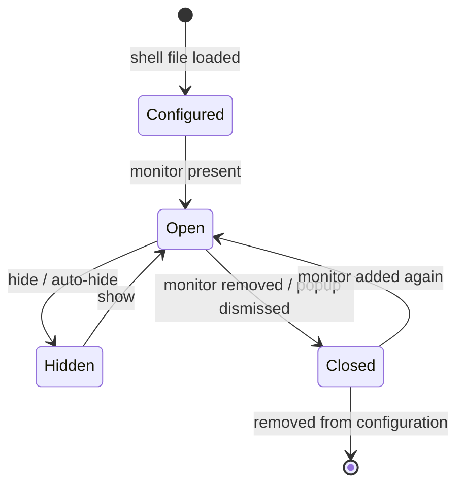

# Surface types

> [!summary]
> The shell has four surface types: **Bar**, **Frame**, **Panel** and **Popup**. A Bar attaches to an edge and reserves space. A Frame surrounds the screen and reserves space on every side. A Panel is the multi-purpose window: attached to a frame, a bar, another surface, or floating. A Popup anchors to a shell surface. Each is built from the tre 0.5.8 types `LayerWindow` and `PopupWindow`. Written from the maintainer's description of 2026-10-25.

## Purpose and scope

These are the values of `kind:` on a surface in a shell file ([[ADR-0007 Shell UI Layer#Surface types (2026-10-25)]]). Names, files and the full YAML are in `41 YAML Reference/`. A dock, top bar or side bar is a Bar. An OSD, launcher or desktop widget is built as a Panel or a Popup ([[V1 Scope#Surfaces]]).

## The four types

| Type | Attaches to | Reserves space | Built on |
|---|---|---|---|
| Bar | One edge; may span edge to edge, touching three edges | Yes | `LayerWindow`, anchor to one edge or to one edge and both edges across it, positive `exclusive_zone` |
| Frame | All four edges and corners | Yes, per side | One painter `LayerWindow` plus up to four reserver `LayerWindow`s |
| Panel | A frame, a bar, another surface, or floating | Optional | `LayerWindow`; moved with `drag_margin` |
| Popup | A shell surface | No | `PopupWindow` parented to a layer or popup window |

### Bar

Attached to an edge. It can span the whole edge, which makes it touch three edges (its own edge and the two edges across it). It reserves space so maximised windows stop short of it. It can be a dock, a top bar, a side bar or anything else anchored to an edge.

Highly customisable: width, height, position, animation, hidden state, background, text, borders, rounded corners, shadows with elevation and colour, transparency and so on.

### Frame

Attached to all four edges and corners as a frame around the screen. It reserves space.

- Thickness is uniform or differs by side.
- Corners are rounded, convex and concave.
- Borders, with background and border colours.
- It can be visually melded into other surfaces, so they look as if they grow out of the frame, with rounded connections and borders.
- Shadows with elevation and colour (this applies to every surface type).
- A Frame can be only the ring, can have Bars and Panels melded into it, or can have one or more thicker edges that act as a bar, a strip along that side; all four edges can have a strip, or none (maintainer, 2026-10-27). See [[Frame]]. The Frame stays on `top`; melded Bars and Panels are drawn inside the Frame's own surface (hosted melding, decided 2026-10-27), so no separate layer is needed for melds and Overlay stays free.

### Panel

The full spec is [[Panel]].

The multi-purpose window. It attaches to the frame, a bar, another surface type, or floats. It can be moved with the mouse, anchored, hidden and so on. Ideally it works almost anywhere, and it may be the baseline the other surface types build on. As with the Bar, it is highly customisable.

A Panel is not a child of the surface it attaches to. It may render on top of a bar or the frame, but each is its own surface and its own entry in the shell file; the attachment is a reference, not a parent/child relationship.

### Popup

Anchored to anything, and rendered like an overlay. It is not a child in the shell file's tree: the file says what it is anchored to by reference, and the popup is its own entry. The parent that tre's `PopupWindow` needs ([[TRE-REQ-001 Layer Surface Window]]) is a Wayland protocol detail the shell handles, not a nesting the author writes. "Anything" is a shell surface: tre requires a layer window or another popup as the protocol parent (see Integration).

## Layers per kind

From the flow diagram ([[Shell Structure]], 2026-10-26). `layer:` takes the four layer-shell values.

| Kind | Layers it may use | May reserve space |
|---|---|---|
| Bar | `bottom`, `top`, `overlay` | Only on `top` |
| Panel | `bottom`, `top`, `overlay` | Only on `top` |
| Frame | `top` only | Yes (it is on `top`) |
| Popup | `overlay` (it hangs off a layer surface and the compositor stacks it above its parent) | No |

`background` (Layer 0) is for wallpapers only, for now (maintainer, 2026-10-26); no kind uses it, and the shell does not draw wallpapers in v1 ([[V1 Scope]]). The maintainer can see it used later for window tiling or as a base layer for a desktop dashboard. In the flow diagram the Popup is in a Special Cases group: a module calls it, and it holds modules and containers ([[Shell Structure]]).

Reserved space is enforced to the `top` layer (maintainer, 2026-10-26). The layer-shell protocol ties exclusive zones to no layer, so this is the shell's rule, chosen to reduce confusion and because Top-layer reservation is the case known to work on KWin ([[Shell Structure#What does not match, or needs a decision]]). An `exclusive_zone` on a surface not on `top` is a load error (decided, maintainer, 2026-10-26).

## Fullscreen and maximised windows (decided 2026-10-27)

- A fullscreen window covers every shell element: Bars, Frame, Panels and Popups, whatever their layer. A maximised window does not: it stops at the reserved space of the Bar and the Frame, and the shell draws above it as usual.
- **KWin's stacking layers (read from the source, 2026-10-27, not tested live).** KWin orders its layers: Desktop, Below, Normal, Above, Notification, Active (an active fullscreen window or dialog), Popup, CriticalNotification, OnScreenDisplay, Overlay ([KWin `effect/globals.h`](https://invent.kde.org/plasma/kwin/-/raw/master/src/effect/globals.h)). A layer-shell surface maps Background to Desktop, Bottom to Below, Top to Above and Overlay to Overlay ([`layershellv1window.cpp`](https://invent.kde.org/plasma/kwin/-/raw/master/src/layershellv1window.cpp)). A Plasma panel is a dock window, and a dock window belongs to the Above layer too, as does any keep-above window ([`window.cpp`](https://invent.kde.org/plasma/kwin/-/raw/master/src/window.cpp), `belongsToLayer`).
- **What that means.** A `top` surface and a Plasma panel share KWin's Above layer, so their order is not fixed by the layer; an `overlay` surface is above everything. An active fullscreen window is in the Active layer: above Above (so it covers `top` surfaces and Plasma panels) and below Overlay (so an `overlay` surface can still show over it). #needs-verification on KWin 6.8.1 with a test.
- Required behaviour: while a fullscreen window is active on a monitor, the shell hides or lowers its surfaces on that monitor, and restores them when the window leaves fullscreen. The reserved space is released and restored with them. Whether a surface can opt out (an OSD that should show over a game) is open.
- Plasma panels: a Bar wins over a Plasma panel on the same edge unless the Plasma panel is set to always on top, or a fullscreen window is active, which beats all shell rendering (maintainer, 2026-10-27). The two share KWin's Above layer, so the shell cannot rely on layer order alone. The maintainer named five ways to keep the shell's windows above Plasma panels (2026-10-27: KWin window rules, layers above Normal, a persistent KWin script, PyGObject with KWindowSystem, and writing `kwinrulesrc`). [[ADR-0012 Keeping the Shell Above Plasma Panels]] compares them; the maintainer accepted its recommendation (2026-10-27): no reliance on stacking for v1, a KWin script for fullscreen detection, and an opt-in KWin rule for users who want the Bar to win. #needs-verification

## Special cases

The flow diagram ([[Shell Structure]]) groups the Popup under **Special Cases** (maintainer, 2026-10-26).

- A Popup stays a `kind: popup` entry in the shell file and names the surface it hangs off, as before.
- **A module calls it.** The diagram's edge is "Calls": a module's code (an `@action`, for example a click on a tray icon) asks the shell to open the popup. How the call is written is proposed in [[Module Context#Calling a popup]].
- It holds modules, containers and blocks, like a layer window, and is drawn above its parent (confirmed on the flow diagram, 2026-10-27).
- **It knows what called it** (maintainer, 2026-10-26): the caller's record (module, use, params, anchor) is available to the popup's own modules and expressions, so a tray menu shows the items of the tray icon that was clicked.
- Focus is on by default (maintainer, 2026-10-26, replacing an earlier opt-in decision). An open popup takes the keyboard and mouse itself with nothing passed at call time, and closes on an outside click or Escape. Tooltip-like popups opt out and close when the pointer leaves. tre's `PopupWindow` has a `grab` flag that gives pointer and keyboard and closes the popup on an outside click or Escape, one flag for both; one flag, not two, as the maintainer chose. #needs-verification against tre.
- **The group exists for kinds like it.** A **Notification window** behaves like a popup but differs enough to need its own `kind:`. Not in v1: the notification server is outside v1 ([[V1 Scope#After v1]], [[ADR-0004 Plasma Coexistence]]).

## Overlay

The maintainer asked how an overlay is added in YAML and how modules are assigned to it (2026-10-26). In the layer-shell protocol, `overlay` is one of four stacking layers (`background`, `bottom`, `top`, `overlay`), and any layer surface sits on one of them. Today the four kinds each take a `layer:`, so an overlay is a surface on the overlay layer, not a fifth kind.

**Option A, an overlay is a Panel (or other kind) on the overlay layer (recommended).** Nothing new is needed; the launcher is already specified this way ([[V1 Scope#Surfaces]]):

```yaml
launcher:
    kind: panel
    layer: overlay
    keyboard: exclusive
    children:
        apps: Applications_Module.yaml
```

Modules are placed under `children:` as for any surface. A panel can be anchored, floating, movable, hidden or full-screen, so one kind covers a launcher, an OSD and a full-screen overlay.

Option B, add `kind: overlay`. A surface kind that is the size of the whole output, transparent, on the overlay layer, with its input region following what is drawn in it:

```yaml
screen_overlay:
    kind: overlay
    children:
        apps: Applications_Module.yaml
```

- For: one name for the "special" container the maintainer has in mind; it can host a launcher, OSD or dismissal layer without the author sizing a panel.
- Against: an output-sized surface costs more video memory (tre measured 177 MiB for a 4K overlay against 18 MiB for a bar, before later changes; [[TRE-REQ-001 Layer Surface Window#Delivered (tre #195 closed)]]), and tre's own advice is to build menus with `PopupWindow`, not an overlay. It duplicates what a full-screen panel can do.

Decided (maintainer, 2026-10-26): Option A, `layer: overlay`. The `layer:` key works like layers in a graphics editor: the highest layer shows first, which is familiar. The maintainer's picture: the Overlay is the shell-wide layer that puts something on top of everything else, and a Panel added to it makes an overlay popup panel. In the files that is a Panel with `layer: overlay`; the overlay is a `layer:` value, not a fifth kind, and surfaces still do not nest. Not to be confused with the **Popup** kind, which is a menu or flyout anchored to a surface and placed by the compositor; an overlay panel is an ordinary panel that sits above the rest. If the maintainer meant a container that holds panels inside it, tell me: that would contradict "surfaces do not nest" ([[ADR-0007 Shell UI Layer#Keys that say what a thing is (2026-10-26)]]).

## Behaviour

States and transitions are common to every type; the specs that follow list the differences.



- A surface exists only for a monitor named by its root ([[ADR-0007 Shell UI Layer#Monitors, names and errors (2026-10-25)]]). On hot-plug the shell creates new windows; a closed layer window is dead ([[TRE-REQ-001 Layer Surface Window#Lifecycle and events]]).

## Configuration

Every type shares the style keys (size, position, background, text, border, corner radii, shadow, transparency, animation, hidden). The type adds its own: edge and span for a Bar, side thicknesses and corner shapes for a Frame, the attachment target and mobility for a Panel, the anchor rectangle and gravity for a Popup. The YAML keys are collected in [[Shell File#Surface keys]] (decided keys, and proposed names that mirror tre's). #needs-verification

## Integration

How each type maps to tre 0.5.8 ([[TRE-REQ-001 Layer Surface Window]]):

| Type | Mapping | Notes |
|---|---|---|
| Bar | `LayerWindow(layer=..., anchor=<edge> or <edge + both across>, size=(0, N) or (N, 0), exclusive_zone=N, output=...)` | A positive zone counts only for one edge, or one edge plus both edges across it; any other anchor reserves nothing. |
| Frame | A painter `LayerWindow` (all four anchors, `size=(0, 0)`, `exclusive_zone=-1`, `layer="top"`, `input_region="auto"`, with the ring and corners drawn as `path` nodes with `hit_shape="painted"`, tre 0.5.9; see [[Hit Testing for Concave Corners]]) plus reservers: one edge and both edges across it, 1 px on the short axis, `layer="top"` (the Frame is Top only, [[Shell Structure]]), the side's thickness as `exclusive_zone`, `input_region=[]` | The layout from [[TRE-REQ-001 Layer Surface Window#Use case: screen frame]]. Different side thicknesses are different reserver zones. Rounded corners are filled paths in the painter. tre did not test the four reservers plus the painter together, nor a 4K frame with many joins. Full spec: [[Frame]]. |
| Panel | `LayerWindow`, floating (a corner or no anchor, positioned by margin) | Movable with `window_region="drag_margin"`; the engine moves it and fires `moved` on release. Margin animation covers slide in and out. Other surfaces' zones do not limit a drag. |
| Popup | `PopupWindow(parent, anchor_rect, anchor, gravity, constraint_adjustment, grab)` | Parent is a `LayerWindow` or `PopupWindow`. The compositor flips and slides it to stay on screen. Escape dismissal is untested in tre. |

## Design

Tokens and components come from the shell's own design system (`50 Design System/`, to write). Every surface type can have a shadow with elevation and colour; those are tokens. It is drawn inside the surface in a transparent margin ([[ADR-0010 Surface Shadows]]); research in [[Shadows on Layer Surfaces]].

## Accessibility

Each surface is published to screen readers as one more window of the application. A bar's window node has no accessible name yet in tre, and a screen reader gets the tree but no screen position for a layer surface ([[TRE-REQ-001 Layer Surface Window#Delivered (tre #195 closed)]]). Names are set per surface in the shell file. Reduced motion and high contrast follow the desktop.

## Performance budget

Per-surface video memory from tre 0.5.8: a 1280 x 32 bar about 18 MiB, a small window about 31 MiB, a 4K full-screen surface about 177 MiB. A Frame needs a full-screen painter, so it carries the large cost on each monitor, plus the reservers. Budgets are set in `60 Quality/`.

## Failure modes and recovery

- Monitor removed: the surfaces on it close with reason `"output_removed"`; they are created again when it returns.
- Unsupported compositor: `LayerWindow` raises `UnsupportedPlatform`.
- A Popup whose parent is gone fails (tre reason `"failed"`).

## Risks

> [!warning] Three things to check, not blockers
> - **Shadows.** Decided 2026-10-27: drawn inside the surface with a transparent margin ([[ADR-0010 Surface Shadows]]). Margin and token key names are open.
> - **Visual melding of a Panel into the Frame.** The meld is visual, not structural. It is one colour, drawn rounded joins, and repainting the frame strip under the panel, as in the maintainer's earlier Edge Shell design ([[Shadows on Layer Surfaces#The maintainer's earlier work]]). The surfaces stay separate. Wayland cannot commit two surfaces together, so a seam can show for up to a frame while both move (tre's documented limit, [[TRE-REQ-001 Layer Surface Window#Animation]]). Measure it in the testing phase. #needs-verification
> - **Placing a Panel against another surface.** layer-shell cannot place one surface relative to another. The shell computes the Panel's margins from the other surface's geometry and recomputes when it moves or animates. This is positioning, not nesting. #needs-verification

## Open questions

- [x] Which surface types are in v1: Bar, Frame, Panel and Popup (decided 2026-10-25; Frame is in v1).
- [x] Which uses are Panels: OSD and desktop widgets are Panels; the launcher is a Panel on the `overlay` layer with exclusive keyboard (decided 2026-10-25).
- [x] A Popup is exclusive to the monitor it is called on. It opens only on the monitor of the surface that called it, and is never anchored to a surface on another monitor (decided 2026-10-25).
- [x] **How a Panel's attachment to another surface is written.** A Panel is attached by **referencing the name of the surface** (decided 2026-10-25). It is a reference, not nesting. Left for the Panel spec and `41 YAML Reference/`: which side or corner and what gap; what the Panel does when the target hides, moves or animates; A name that is referenced from another file resolves **through the registry** (decided 2026-10-25): the registry tracks names, so it knows which surface a Panel means and knows when that name no longer exists. A reference that never resolves is an error at load; a target that disappears while the shell runs is a warning, and the Panel stays hidden until it returns ([[ADR-0007 Shell UI Layer#Config directory and registry (2026-10-25)]]). The one-frame skew between separate surfaces still applies ([[TRE-REQ-001 Layer Surface Window#Animation]]).
- [x] **Concave corners and join drawing: hit testing.** Settled: tre 0.5.9 (released 2026-10-27) ships `hit_shape="painted"` on path nodes and a region builder that keeps holes and concave notches, so the Frame uses `input_region="auto"` and no explicit-rectangle workaround. Findings and history: [[Hit Testing for Concave Corners]].

## Acceptance criteria

- [ ] A Bar anchored to one edge spanning the full length reserves its zone on KWin; a maximised window stops short of it.
- [ ] A Frame with different side thicknesses reserves each side separately, and clicks on the ring reach the shell while clicks in the interior reach the window below.
- [ ] A Panel can be dragged with the mouse, stays on its output, and reports its final margin on release.
- [ ] A Popup opens beside its anchor rectangle, flips at the screen edge, and closes on an outside click.
- [ ] A shadow around a Bar is fully visible and does not change the reserved space, with the in-surface margin ([[ADR-0010 Surface Shadows]]).
- [ ] A rounded join between a Panel and the Frame shows no seam while idle, and any seam while moving is measured and recorded.

## Links

- [[ADR-0007 Shell UI Layer]] · [[ADR-0001 Shell Surface Strategy]] · [[TRE-REQ-001 Layer Surface Window]] · [[V1 Scope]]
- [[Shadows on Layer Surfaces]] · [[Surfaces]] · [[40 Specifications]]
