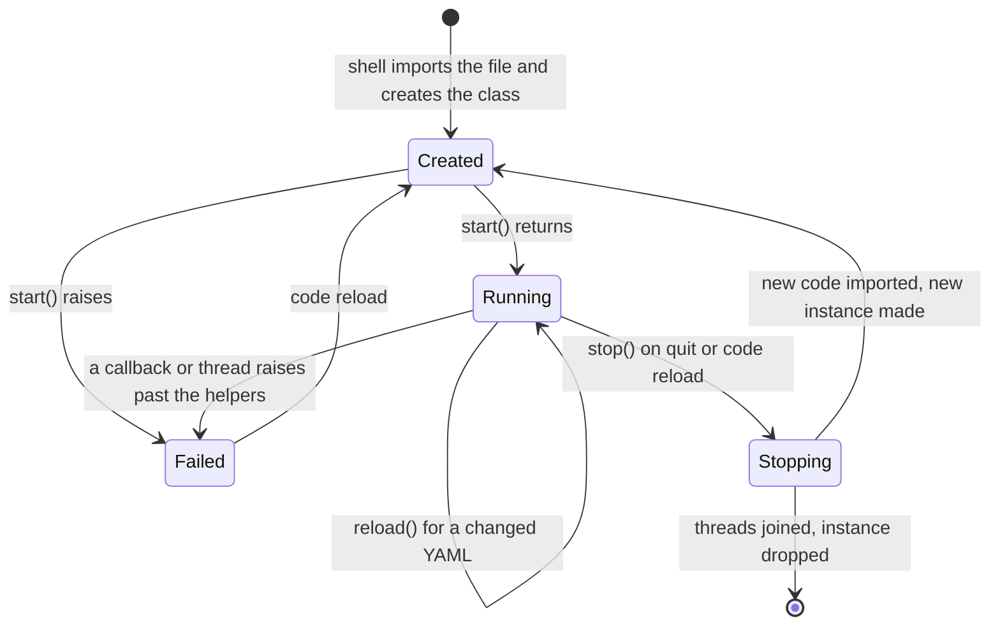

# Module contract

> [!summary]
> A module is a `<Name>_Module.yaml` file plus a `<Name>_Module.py` next to it, in a `Modules/<module_name>/` folder. The Python file holds one class that extends the shell's `Module` base. The shell creates it once, gives it a context, and calls `start`, `stop` and, for a changed configuration, `reload`. The module owns its data and its threads; it sends finished values to the shell, which renders them. **Decided** parts come from [[ADR-0007 Shell UI Layer]] and [[ADR-0009 D-Bus Client Library]]; names and signatures below are **proposed**. Short snippets are illustrations, not code to build.

## What is decided

| Decision | Source |
|---|---|
| A module is `<Name>_Module.yaml` plus a required matching `<Name>_Module.py`, next to each other, in `Modules/<module_name>/` with all supporting files | [[ADR-0007 Shell UI Layer#Modules (2026-10-25)]] |
| The shell imports the file, finds the class that extends a shell `Module` base, creates it once, and calls `start`, `stop` and an optional `reload` | [[ADR-0007 Shell UI Layer#Module Python (2026-10-25)]] |
| The module receives a context with its YAML values, its name and UID, a logger and the send entry point | same |
| One instance per module file, shared by every use; per-use differences are the module's job | [[ADR-0007 Shell UI Layer#Modules (2026-10-25)]] |
| The module's Python reaches its YAML by file name, unique name or UID | same |
| Modules send values to shell entry points; the shell converts what it can | [[ADR-0007 Shell UI Layer#Module data reaches the view through shell entry points (2026-10-25)]] |
| A module's Python can be reloaded at runtime | [[ADR-0007 Shell UI Layer#Events and module reload (2026-10-26)]] |
| Blocking work runs off the loop; D-Bus goes through the shared `dbus-fast` service thread | [[Process Model and Threading]], [[ADR-0009 D-Bus Client Library]] |

## The class (proposed)

```python
# Modules/Clock/Clock_Module.py   (illustration; the import path is not decided)
from tesserae_shell import Module

class Clock(Module):
    def start(self):
        self.ctx.every(1.0, self.tick)          # a timer the shell runs
        self.tick()

    def tick(self):
        self.ctx.send("time", "14:05")          # a plain value

    def stop(self):
        pass                                    # timers are cancelled by the shell
```

- **One class.** The file holds exactly one class extending `Module`. None or more than one is a load error naming the file ([[ADR-0007 Shell UI Layer#Monitors, names and errors (2026-10-25)]]).
- **No constructor arguments.** The base class sets `self.ctx` before `start()` is called.
- **Methods.** `start()`, `stop()`, and an optional `reload()`; the base class provides empty versions.
- **Actions.** A shell file can call a module method from an event (the shell, not TEL, maps events: [[ADR-0007 Shell UI Layer#Events and module reload (2026-10-26)]]). Decided (maintainer, 2026-10-26): only methods marked with an `@action` decorator can be called from a shell file, and a shell file cannot call anything else. Slow work in an action goes to a thread and the method returns at once.

## Lifecycle



| Method | Runs on | Called when | Must |
|---|---|---|---|
| `start()` | Loop thread | After the shell model is built ([[Process Model and Threading#Lifecycle (proposed)]]) | Return quickly. Start threads or timers for anything slow. Values sent before a surface exists are kept |
| `stop()` | Loop thread | On quit, or before a code reload | Stop its own threads and close connections, within a timeout. The shell joins threads started through `ctx.thread` |
| `reload()` | Loop thread | The module's YAML changed and the Python did not | Re-read `self.ctx.config`. No restart |

Code reload ([[ADR-0007 Shell UI Layer#Events and module reload (2026-10-26)]], mechanics proposed): the shell imports the new code first and checks it for the class; only then does it call `stop()` on the old instance, join its threads, purge the module's own modules from `sys.modules`, create the new instance and call `start()`. If the new code fails to import, the old instance keeps running and the error is logged with `file:line:column`. The value store keeps the last values until the new instance sends. #needs-verification: `importlib` with live threads, and supporting files in the module folder.

## Rules for the module author

1. **Never touch tre nodes.** Send values; the shell renders ([[Layers and Components#Dependency rules]]).
2. **Never block the loop.** `start`, `stop`, `reload` and actions return fast; blocking work uses `ctx.thread`, `ctx.dbus` or its own threads ([[Process Model and Threading#The rules]]).
3. **Own your data.** Read from your sources, keep your own files, JSON or database. The shell stores only the values you send, not your data.
4. **Catch your own thread errors**, or start threads through `ctx.thread`, which catches and logs them with the module's name.
5. **No heavy computation on the shared service thread.** D-Bus callbacks are short and never block, or they delay every D-Bus module ([[ADR-0009 D-Bus Client Library]]).
6. **Heavy CPU work leaves the process** (a subprocess or native code); the GIL is shared with the loop ([[Process Model and Threading#Performance notes]]).

## Integration

- **Threads.** Methods on the loop; module work on `ctx.thread`s; D-Bus callbacks on the shared service thread; values cross to the loop with `call_soon` through `ctx.send`.
- **Names.** The module's `name:` (required) is how expressions refer to its values, for example `clock.time`. #needs-verification: which name an expression uses when one module file is bound under several entries (see Open questions).
- **D-Bus.** `ctx.dbus` ([[Module Context]]).

## Failure modes and recovery

| Failure | Result |
|---|---|
| No class, or more than one | Load error naming the file |
| `<Name>_Module.py` missing | Load error naming both files |
| `start()` raises | Module marked failed; logged with name and UID; other modules continue; surfaces keep last values or defaults |
| An exception in a `ctx.thread` or `ctx.dbus` callback | Caught, logged with the module name; the module keeps running |
| A bad code reload | Old instance keeps running; error logged |
| `stop()` does not return within the timeout | Logged; the shell continues shutdown |

## Open questions

- [ ] Constructor versus `self.ctx` set by the base class (proposed above).
- [x] Only `@action`-marked methods are callable from a shell file (maintainer, 2026-10-26).
- [ ] The decorator's final name, and whether actions can return values.
- [ ] How a module file bound under several entries is named in expressions (the file's `name:` or the entry's key).
- [ ] The shell's package name and import path.
- [ ] Which timer helpers `ctx` offers (`every`, `after`) and which clock they use.
- [ ] Whether `reload()` is passed the changed keys.

## Acceptance criteria

- [ ] A module with one `Module` subclass and its matching YAML loads, starts and sends a value that a view shows.
- [ ] A missing `.py`, no class, or two classes each fail with a message naming the files.
- [ ] A module whose `start()` raises is marked failed and the other modules keep running.
- [ ] Editing the module's `.py` reloads it without restarting the shell; a bad edit keeps the old instance.
- [ ] Editing only its YAML calls `reload()`.
- [ ] `stop()` is called on quit, and its threads are joined within the timeout.
- [ ] A callback exception on `ctx.thread` or `ctx.dbus` is logged with the module name and does not stop the shell.

## Links

- [[42 Python API]] · [[Module Context]] · [[Value Types and Conversion]] · [[Process Model and Threading]] · [[ADR-0007 Shell UI Layer]]
