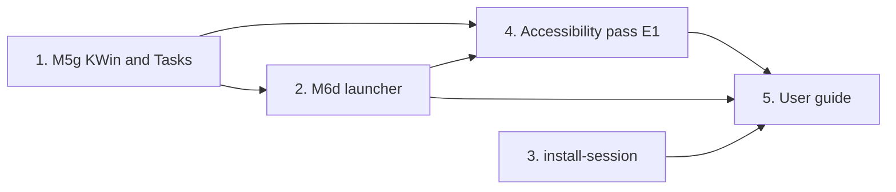

# Next Work Plan

> [!TIP]
> **Done on 2026-11-16 (code session's reports)**
> All five items and the portal follow-ups and the tre 0.6.8 kit are merged: PRs #28 (install-session), #30 (tre 0.6.8 kit), #31 (portal follow-ups), #33 (M5g), #35 (launcher), #37 (accessibility pass), #39 (user guide), #44 (self-running kits). `tesserae-shell` 0.1.2 is on PyPI. This note is the record of the plan.

> [!NOTE]
> What the `tess-shell` code session builds next, in order, with the spec each task follows and the proof that closes it. Written on 2026-11-16 at the maintainer's request ("plan as suggested and send the plans"), after the code session reported an empty queue. The specs are accepted and have no open questions; each task's acceptance criteria are in its spec. The maintainer decides what is merged; a code session follows its own `AGENTS.md` for pushes and merges.

## State this plan starts from

Read from `origin/main` of `tess-shell` and from PyPI on 2026-11-16, not run in the vault: version 0.1.1 is on PyPI and pure Python; M0 to M4, M5a to M5f, M5h, M6a, M6b, M6c and shortcut mode (M6d's first half) are merged; schema export 1.5; the shell requires `tesserae-engine` 0.6.8, `tesserae-dl` 0.2.0 and `tesserae-utils` 0.2.1.

## Order and dependencies

| # | Task | Branch | Spec | Closed when |
|---|---|---|---|---|
| 1 | M5g: the KWin script package and its run-time load, the window list and `ctx.windows`, the desktop-entry index and `ctx.icons.app_icon`, the Tasks module and `Task_Item`, the `kwin script` and `kwin rule` commands (G1 to G5 of [M5 Brief](M5%20Brief.md)) | `feat/m5g-kwin` | [Tasks Module](../40%20Specifications/Modules/Tasks%20Module.md), [KWin Integration](../40%20Specifications/Integration/KWin%20Integration.md) | The acceptance criteria of both specs that need no real KWin pass on a fake `/Scripting` and a fake script; `kwin rule install` and `remove` pass on a temporary copy of the rule file |
| 2 | M6d: the application index, `ctx.apps`, the Applications module and the shipped `Launcher` Panel (D2 of [M6 Brief](M6%20Brief.md)) | `feat/m6d-launcher` | [Applications Module](../40%20Specifications/Modules/Applications%20Module.md) | The criteria of the spec pass; the whole flow runs headless by key events only. Needs item 1's desktop-entry index |
| 3 | `install-session`: the desktop file, the systemd user unit, `--print`, `--enable`, `--remove`, the `status` warning for a stale `ExecStart` | `feat/install-session` | [Packaging and Session Start](../70%20Delivery/Packaging%20and%20Session%20Start.md) | The six acceptance criteria of the note pass with temporary XDG folders |
| 4 | The accessibility pass (E1 of [M6 Brief](M6%20Brief.md)): the announcements the Network, Media, Audio, Tasks and Applications specs left for it, names and roles of every shipped module | `feat/m6-accessibility` | [Accessibility](../60%20Quality/Accessibility.md) | Each announcement is asserted in a test through the accessibility tree. After items 1 and 2 |
| 5 | The user guide in `guide/` of the repository: installing and starting, the configuration folder, a first Bar, every surface type, every shipped module with its params, styling and themes, `settings.tdl`, shortcuts, the command line, troubleshooting | `feat/user-guide` | Written from the specs; examples are files under `guide/examples/` that a test runs through `check`; the module, key and token tables are generated from the schema export with a test that the committed tables are current | Last, so the tables cover every module |

Items 1 and 3 do not depend on each other and can run in two sessions at once, each in its own worktree.

## Also for the code session

- Confirm what of the schema additions for the configuration application (kinds for the unbuilt keys and tokens, a flag for keys valid only in a module file, groups of keys valid only together, kinds for names that must refer to something and for file paths, the stylesheet Rule `Text_Align` accepting no value) is built, and report the rest. `tesserae` re-records its fixture from the export.
- The M5h build log's decisions for the maintainer are `Open Questions` 3 to 11 of [Portals](../40%20Specifications/Integration/Portals.md); do not wait on them.
- Open from M6a: a `Text` with `Selectable` cannot show a focus ring.

## Rules that apply to all five

- No test touches the maintainer's real session, devices or data: fake services on private buses, a private headless compositor, temporary folders for every file the shell, `install-session` or `kwin rule` would write, no `/dev/uinput`, no real `systemctl`, no real `kwinrulesrc`, no script loaded into the real KWin.
- Every state-changing script has a guard in code and an environment built from scratch.
- A hand check only the maintainer can run gets a kit (`tests/kwin/prepare_*`) and a line in the build log; it never gates the merge.
- Build log entries go in [M5 Build Log](M5%20Build%20Log.md) and [M6 Build Log](M6%20Build%20Log.md); the vault session folds them into the specs.
- Every pull request needs `CI result`; a change under `docs/` only is checked by the docs build alone.

## Not in this plan

Release of `tesserae-shell` 0.2.0 (the maintainer's), the checks only the maintainer can run ([Home](Home.md), Waiting on you), and the vault's own work (the security model and the crash recovery notes).

## Links

[Home](Home.md) · [M5 Brief](M5%20Brief.md) · [M6 Brief](M6%20Brief.md) · [Development Readiness](Development%20Readiness.md) · [Packaging and Session Start](../70%20Delivery/Packaging%20and%20Session%20Start.md)
