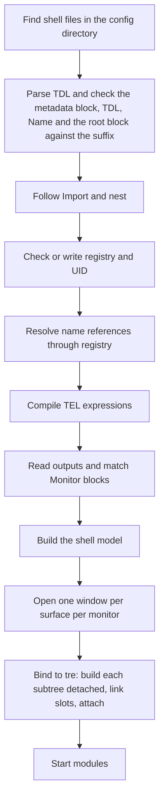
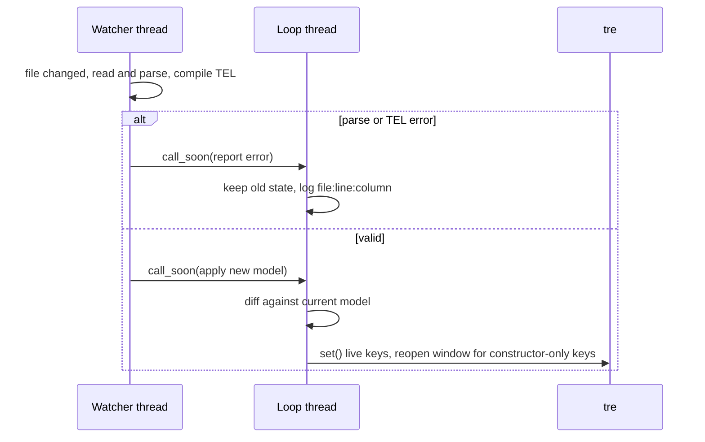
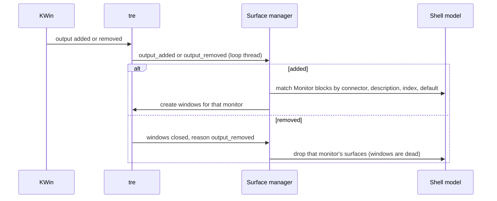

# Data Flow

> [!NOTE]
> Five flows carry data through the shell: loading a shell, live module data, hot reload, monitor hot-plug and user input. Each starts in a named component of [Layers and Components](Layers%20and%20Components.md), crosses threads only through `call_soon` ([Process Model and Threading](Process%20Model%20and%20Threading.md)), and ends in a tre node. The diagrams are proposals built on the accepted ADRs; where an ADR decides a step, the step cites it.

## Loading a Shell

| Step                         | Decided by                              | Failure                                                                               |
|------------------------------|-----------------------------------------|---------------------------------------------------------------------------------------|
| Files, metadata block, root block | [TDL Language > The Metadata Block](../41%20TDL%20Reference/TDL%20Language.md#the-metadata-block), [TDL Language > The Root Block](../41%20TDL%20Reference/TDL%20Language.md#the-root-block), [ADR-0014 Shell File Language > Second-Sketch Decisions (2026-10-30)](../30%20Decisions/ADR-0014%20Shell%20File%20Language.md#second-sketch-decisions-2026-10-30) | A file without the block, `TDL:`, `Name:` or exactly one root block is refused and named; a root block that disagrees with the suffix is a load error naming both |
| `Import` and nesting         | [ADR-0007 Shell UI Layer > Recognising a shell file and importing (2026-10-25)](../30%20Decisions/ADR-0007%20Shell%20UI%20Layer.md#recognising-a-shell-file-and-importing-2026-10-25) | Cycle, missing file or a name registered twice (a user module overrides a shipped one): load error with `file:line:column`         |
| Registry and UID             | [ADR-0007 Shell UI Layer > Config directory and registry (2026-10-25)](../30%20Decisions/ADR-0007%20Shell%20UI%20Layer.md#config-directory-and-registry-2026-10-25) | A mismatch registers a new entry; an unresolved reference is an error at load         |
| TEL compile                  | [ADR-0008 Tesserae Expression Language](../30%20Decisions/ADR-0008%20Tesserae%20Expression%20Language.md) | Error with file, line and column inside the TDL file                                  |
| `Monitor` matching           | [V1 Scope > Multi-monitor](../10%20Vision/V1%20Scope.md#multi-monitor), [TDL Language > Monitors (Shell Schema)](../41%20TDL%20Reference/TDL%20Language.md#monitors-shell-schema) | A `Monitor` with no selector is ignored; `Index: default` covers monitors no other `Monitor` names |
| Bind to tre                  | [ADR-0015 Render Binder](../30%20Decisions/ADR-0015%20Render%20Binder.md) (proposed) | A value tre refuses is reported with the `file:line:column` of the key; the surface stays empty and the others open |
| Module start                 | [ADR-0007 Shell UI Layer > Module Python (2026-10-25)](../30%20Decisions/ADR-0007%20Shell%20UI%20Layer.md#module-python-2026-10-25) | A module with no matching `.py` is a load error naming both files                     |

## Live Module Data

The hand-off is decided ([ADR-0007 Shell UI Layer > Module data reaches the view through shell entry points (2026-10-25)](../30%20Decisions/ADR-0007%20Shell%20UI%20Layer.md#module-data-reaches-the-view-through-shell-entry-points-2026-10-25)): the module sends values to shell entry points, the shell converts what it can, and the renderer updates. The sequence diagram is in [Process Model and Threading > Handing a value to the loop (proposed)](Process%20Model%20and%20Threading.md#handing-a-value-to-the-loop-proposed).

What the diagram adds to the ADR (proposals):

- A **value store** holds the latest value per module and key.
- TEL **records the names** each expression read, so a changed value re-runs only the expressions that read it.
- A re-evaluated expression sets a node property with `node.set(...)`; tre redraws only what changed.
- Static expressions (no live names) are evaluated once at load.

## Hot Reload

- tre's layer window takes `layer`, `anchor`, `size`, `exclusive_zone`, `exclusive_edge`, `margin`, `keyboard` and `input_region` live through `set()` in one commit. `namespace` and `output` are constructor-only, so changing them means closing and recreating the window ([TRE-REQ-001 Layer Surface Window > Proposed API](../80%20Requests/TRE-REQ-001%20Layer%20Surface%20Window.md#proposed-api)).
- A bad file leaves the old state ([Process Model and Threading > Lifecycle (proposed)](Process%20Model%20and%20Threading.md#lifecycle-proposed)).
- The shell's own UID write must not trigger a reload loop: it patches the file text at the node's position and the watcher drops the event by content hash (D10, [ADR-0014 Shell File Language > Decisions on the Open Items (2026-10-30)](../30%20Decisions/ADR-0014%20Shell%20File%20Language.md#decisions-on-the-open-items-2026-10-30); [Hot Reload > The Shell's Own Writes](../40%20Specifications/Runtime/Hot%20Reload.md#the-shells-own-writes)).
- A changed module `.py` is reloaded at runtime (decided 2026-10-26, [ADR-0007 Shell UI Layer > Events and module reload (2026-10-26)](../30%20Decisions/ADR-0007%20Shell%20UI%20Layer.md#events-and-module-reload-2026-10-26)). Proposed order: import the new code and check it has the module class; then `stop` the old instance and join its threads; purge the module's own modules from `sys.modules`; create the new instance and `start` it. A failed import keeps the old instance. The value store keeps the last values until the new instance sends. The `reload` hook handles a TDL-only change. #needs-verification

## Monitor Hot-plug

- tre fires `output_added`, `output_removed` and `output_updated` with the `Output` ([Outputs](https://mindderivative.github.io/tre/reference/outputs/)). A removed output closes its layer windows with reason `"output_removed"`, and a dead window is never reused.
- `output_updated` keeps the surfaces and re-evaluates only the match rules ([V1 Scope > Multi-monitor](../10%20Vision/V1%20Scope.md#multi-monitor)).
- A Popup is exclusive to the monitor of its caller ([Surface Types > Open questions](../40%20Specifications/Surfaces/Surface%20Types.md#open-questions)).
- **No windows: stay idle** (decided 2026-10-26). The shell keeps running and waits for `output_added`. tre has no keep-alive today; options are in [Process Model and Threading > No windows: what tre offers](Process%20Model%20and%20Threading.md#no-windows-what-tre-offers).

## User Input

A pointer or key event reaches a tre node on the loop thread. **Events belong to the shell, not to TEL** (decided 2026-10-26, [ADR-0007 Shell UI Layer > Events and module reload (2026-10-26)](../30%20Decisions/ADR-0007%20Shell%20UI%20Layer.md#events-and-module-reload-2026-10-26)). A shell file maps an event to a module method or a shell action. TEL only evaluates the argument expressions when the event fires (for example a value taken from the event). The vocabulary is set in the TDL reference (folder `41 TDL Reference/`).

- A module method that does slow work hands it to the module's thread and returns at once.
- Window actions (close, dismiss a popup) are shell-provided.
- A handler may set a value in the shell's store (a local state) or call a module method.

## Open Questions

- [ ] Where the value store sits and how a module's last value is kept across a reload.
- [ ] The handler vocabulary for input: the shell's, in the TDL reference (folder `41 TDL Reference/`), not TEL's.
- [x] A module's `.py` can be reloaded at runtime (maintainer, 2026-10-26). Mechanics are proposed above.
- [x] How the diff of a reload works: by identity (file UID), then name, then position (proposed in [Hot Reload > The diff](../40%20Specifications/Runtime/Hot%20Reload.md#the-diff)).
- [ ] What `output_updated` does to surfaces whose size depends on the output.

## Links

- [20 Architecture](20%20Architecture.md) · [Layers and Components](Layers%20and%20Components.md) · [Process Model and Threading](Process%20Model%20and%20Threading.md) · [System Context](System%20Context.md)
