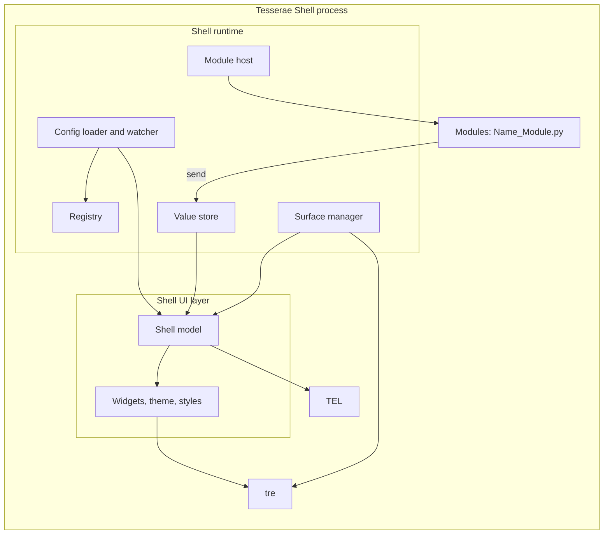

# Layers and Components

> [!NOTE]
> The shell is one process built on three libraries and one runtime. tre draws and places surfaces. TEL evaluates expressions (values). The shell's UI layer turns a shell file into a tree of surfaces and widgets. The shell runtime loads configuration, keeps the registry, hosts modules and manages monitors. Modules feed data in. Dependencies point one way: modules and the runtime use the UI layer; the UI layer uses TEL and tre; TEL and tre know nothing of the shell. Components marked "proposed" are this note's suggestion; nothing here is accepted beyond the ADRs it cites.

## Diagram

## Libraries

| Layer | Owns                                                                                            | Never owns                                     | Spec                                    |
|-------|-------------------------------------------------------------------------------------------------|------------------------------------------------|-----------------------------------------|
| tre   | Frames, layout, paint, animation, input, layer surfaces, outputs, hit testing                   | Widgets, themes, file formats, shell meaning   | [TRE-REQ-001 Layer Surface Window](../80%20Engine%20Requests/TRE-REQ-001%20Layer%20Surface%20Window.md) |
| TEL   | Expression syntax, evaluation, limits, name tracking, expression-level conditionals and comprehensions, error positions | Surfaces, modules, files, the registry, any UI | [Expression Language Requirements](../40%20Specifications/Runtime/Expression%20Language%20Requirements.md) |

## Shell Components (Proposed)

| Component                 | Responsibility                                                                                                                                                                           | Thread                                                           |
|---------------------------|------------------------------------------------------------------------------------------------------------------------------------------------------------------------------------------|------------------------------------------------------------------|
| Config loader and watcher | Finds shell files in the config directory and its Modules, Styles, Themes and Stylesheets folders, parses TDL with the shell's own parser (an ordered list of entries that keeps repeated names, [ADR-0014 Shell File Language](../30%20Decisions/ADR-0014%20Shell%20File%20Language.md), D12), checks the metadata block (`TDL`, `Name`, the version pins) and the root block against the suffix ([TDL Language > The Root Block](../41%20TDL%20Reference/TDL%20Language.md#the-root-block)), follows `Import`, reports errors with `file:line:column`, watches files | Watching on a worker; applying on the loop                       |
| Registry                  | `registry.json`: UIDs, names, kinds, locations; one registry of names for blocks, surface types and modules ([TDL Language > Names and the Registry](../41%20TDL%20Reference/TDL%20Language.md#names-and-the-registry)); writes the `UID:` into the metadata block of files by patching the text at the node's position (D10); resolves cross-file references                                                                             | Loop (file I/O on a worker for large writes) #needs-verification |
| Shell model               | The tree built from a shell file: `Monitor` blocks, surfaces, widgets, modules, with TEL expressions compiled; builds and rebuilds the `If` and `For` branches, evaluating the condition or iterable through TEL (D11)                                                                                       | Loop                                                             |
| Widgets, theme, styles    | The widget set in [V1 Widgets](../50%20Design%20System/V1%20Widgets.md), tokens from theme files, style files and stylesheets                                                                          | Loop                                                             |
| Surface manager           | Reads outputs, creates and closes a `LayerWindow` or `PopupWindow` per surface and monitor, handles hot-plug and `Monitor` matching                                                     | Loop                                                             |
| Module host               | Imports `<Name>_Module.py`, creates the module class once, calls `start`, `stop`, `reload`; gives it a context                                                                           | Loop for calls; module work on module threads                    |
| Value store               | Holds the latest values modules sent, by module and key; the scope TEL reads names from; records which names an expression read                                                          | Written from the loop, via `call_soon`                           |
| Modules                   | A module is a layout TDL file (widgets, expressions, params), a style TDL file and a Python class ([ADR-0007 Shell UI Layer > What a module is (2026-10-26)](../30%20Decisions/ADR-0007%20Shell%20UI%20Layer.md#what-a-module-is-2026-10-26)); the class owns the module's data and threads        | Module threads                                                   |

The store is this note's addition. The ADR says a module sends data to shell entry points and the shell passes it to the renderer ([ADR-0007 Shell UI Layer > Module data reaches the view through shell entry points (2026-10-25)](../30%20Decisions/ADR-0007%20Shell%20UI%20Layer.md#module-data-reaches-the-view-through-shell-entry-points-2026-10-25)); the store is where that data lives so that TEL can read it and re-evaluate what changed.

## Dependency Rules

1. tre and TEL do not import the shell. The shell imports both ([ADR-0008 Tesserae Expression Language](../30%20Decisions/ADR-0008%20Tesserae%20Expression%20Language.md)).
2. The UI layer does not talk to D-Bus, files or sockets. Only modules and the runtime do.
3. Modules do not touch tre nodes. They send values; the shell renders.
4. Python never runs in layout or paint (AGENTS > 3. Layering principle). Expressions and module callbacks run between frames on the loop thread.
5. Tesserae UI is not imported anywhere ([ADR-0006 Shell Independent of Tesserae UI](../30%20Decisions/ADR-0006%20Shell%20Independent%20of%20Tesserae%20UI.md)).

## Where Each Existing Decision Lands

| Decision                                                                                                  | Component                                     |
|-----------------------------------------------------------------------------------------------------------|-----------------------------------------------|
| One process, one loop ([ADR-0003 Process Model](../30%20Decisions/ADR-0003%20Process%20Model.md))                                           | The whole process; the loop is tre's `App`    |
| Surface types ([Surface Types](../40%20Specifications/Surfaces/Surface%20Types.md))                                                   | Surface manager, shell model                  |
| Registry, UID, names ([ADR-0007 Shell UI Layer](../30%20Decisions/ADR-0007%20Shell%20UI%20Layer.md))                                            | Registry, loader                              |
| Monitors, `Index: default` ([V1 Scope > Multi-monitor](../10%20Vision/V1%20Scope.md#multi-monitor))                                    | Surface manager                               |
| Module contract ([ADR-0007 Shell UI Layer > Module Python (2026-10-25)](../30%20Decisions/ADR-0007%20Shell%20UI%20Layer.md#module-python-2026-10-25))                                                 | Module host                                   |
| Coexistence, shortcuts ([ADR-0004 Plasma Coexistence](../30%20Decisions/ADR-0004%20Plasma%20Coexistence.md), [ADR-0005 Global Shortcuts](../30%20Decisions/ADR-0005%20Global%20Shortcuts.md)) | Modules and a shortcut service in the runtime |

## Open Questions

- [ ] Is the value store a component of its own, or part of the shell model?
- [x] How a widget event (a click) reaches a module: the shell maps the event to a module method or a shell action; TEL only evaluates argument expressions ([ADR-0007 Shell UI Layer > Events and module reload (2026-10-26)](../30%20Decisions/ADR-0007%20Shell%20UI%20Layer.md#events-and-module-reload-2026-10-26)). The key names are set in the TDL reference (folder `41 TDL Reference/`).
- [ ] Where theme changes (light/dark, high contrast, reduced motion following the desktop) are read and pushed ([Goals and Non-Goals](../10%20Vision/Goals%20and%20Non-Goals.md) G7).
- [ ] The global shortcut service: a runtime component or a module.
- [x] Which component builds and rebuilds the `If` and `For` branches: the shell model builder, which evaluates the condition or iterable through TEL and rebuilds that branch or entry. TEL evaluates expressions (values) only (D11, [ADR-0014 Shell File Language > Decisions on the Open Items (2026-10-30)](../30%20Decisions/ADR-0014%20Shell%20File%20Language.md#decisions-on-the-open-items-2026-10-30)).

## Links

- [20 Architecture](20%20Architecture.md) · [System Context](System%20Context.md) · [Process Model and Threading](Process%20Model%20and%20Threading.md) · [Data Flow](Data%20Flow.md)
