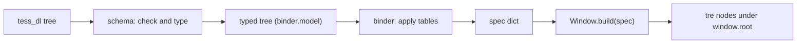

# Render Binder Design

> [!NOTE]
> The design of the binder that [ADR-0015 Render Binder](../30%20Decisions/ADR-0015%20Render%20Binder.md) accepted: the typed tree it takes, the two tables it applies, the converters, the calls it makes to tre, how errors get back to a file position, and what is built at M1 and what waits for M2. It is a proposal for the maintainer. The tre property names and value forms in the tables were tested against tre 0.5.10 on 2026-11-03 (see [What tre Accepts (Tested 2026-11-03)](#what-tre-accepts-tested-2026-11-03)); several differ from what [Block Reference](../41%20TDL%20Reference/Block%20Reference.md) says.

## Purpose and Scope

- Fix the binder's input, tables, converters, output and errors so M1 can build the first Bar through it.
- In scope for M1: build once from a typed tree. Designed here for M2: slot links, update and keyed rebuild.
- Not in scope: reading files (`tess_dl`), checking keys against the schema (the `schema` package), theme tokens, modules, and window creation (the surface manager).

## Where It Sits



The `schema` package turns the `tess_dl` tree into the binder's own typed classes, so the binder needs nothing from the shell or from `tess_dl` ([Shell Package Layout > The Binder Is Independent](Shell%20Package%20Layout.md#the-binder-is-independent)). The import table gains one allowed edge: `schema` may import `binder.model` (the classes only).

## The Typed Tree

Defined in `binder/model.py` as small immutable classes. Illustrative:

```python
@dataclass(frozen=True)
class Origin:  file: str; line: int; column: int

@dataclass(frozen=True)
class Node:
    kind: str                 # the block word: "Text", "FlexBox", "Rectangle"
    name: str | None          # the Name: value, or None
    props: Mapping[str, Value]   # typed values by TDL key (Capitalised)
    style: Mapping[str, Value]   # the inline Style block, typed
    children: tuple["Node | IfNode | ForNode", ...]
    origin: Origin
```

`Value` is a union of typed values: `Length(px)`, `Percent(n)`, `Auto`, `Expand`, `Color(r, g, b, a)`, `Enum(name)`, `Bool`, `Number`, `Text`, `Sides(left, top, right, bottom)`, `Seq(items)`, and `SlotValue(compiled)` (M2). Each carries its `Origin`. `IfNode` and `ForNode` exist from M1 so the types are stable; at M1 the binder refuses them with a clear error.

## The Tables

Two tables, both plain Python data in `binder/tables.py`.

| Table | Row | Fields |
|---|---|---|
| Block table | One per TDL block word | `tre_kind`, `fixed` (properties always set), `keys` (the TDL keys the block accepts), `children_ok`, `needs` (props tre requires on create, such as `text` for a text node) |
| Key table | One per TDL key and block it applies to | `tre` (one name, or several for a four-sided key), `convert` (a converter name), `default` |

The key table holds both property keys and style keys; a style key and a property key of the same meaning share a row, as [Block Reference](../41%20TDL%20Reference/Block%20Reference.md) rule R2 says. The Block Reference's "tre" columns are the documentation of these tables, and a test compares them ([Testing Strategy](../60%20Quality/Testing%20Strategy.md)).

## Converters

| Converter | TDL value | tre value |
|---|---|---|
| `length` | `16`, `50%`, `AUTO`, `EXPAND` | a number; a string like `"50%"`; `AUTO` and `EXPAND` map to tre's `auto` and flex rules (see the Block Reference sizes) |
| `color` | `"#RRGGBB"`, `"#RRGGBBAA"`, `rgba(r g b a)` | an `(r, g, b, a)` tuple of 0 to 255 ints (alpha 0.0 to 1.0 becomes 0 to 255) |
| `enum` | `HORIZONTAL`, `SPACE_BETWEEN` | the lower-case tre word: `"horizontal"`, `"space_between"` |
| `sides` (padding, margin) | one number, four items, named sides | four properties: `padding_top`, `padding_right`, `padding_bottom`, `padding_left` (the shell reorders left, top, right, bottom to tre's order) |
| `radius` | one number, or four from the top-left clockwise | a number, or a `(top_left, top_right, bottom_right, bottom_left)` tuple |
| `number`, `bool`, `text` | as written | as is |
| `font_family` | an ordered list | tre's `font_family` form (to confirm) |

A converter returns the tre value or raises `BindError` with the key's origin. Converters are pure functions, tested alone, with no import outside the standard library, so they can move to a shared package unchanged ([ADR-0017 Shared Utilities](../30%20Decisions/ADR-0017%20Shared%20Utilities.md)). tre takes one form for each kind of value and the framework converts ([ADR-0018 One Entry Form in tre](../30%20Decisions/ADR-0018%20One%20Entry%20Form%20in%20tre.md)), so the `color` converter handles every TDL colour form.

## Building

1. Walk the typed tree and, for each node, look up its block row and the key rows of its props and style. Collect every error (`BindError`) with its origin; if there is any, stop and report them all, so a surface never half-builds.
2. Build one nested spec for the surface: `{kind, props, children, id}` per node, with an `id` for each node that has a `Name` or (from M2) a slot link.
3. Keep a parallel index from each spec path (`spec.children[2].props`) to the `Origin` of the TDL key. tre's `ValueError` names the path of a bad entry; the binder translates it to `file:line:column`.
4. Call `window.build(spec)`; `parent.add_child(root)` once. The result is the detached root and a mapping from `id` to node, held in a `View` object.

tre's `build` is not faster than per-node calls (5.3 ms against 4.9 ms for 3,100 nodes, tre's measurement); the gain is the all-or-nothing check and one place where errors surface ([TRE-REQ-009 Batch and Tree Building > tre's Reply (2026-11-02)](../80%20Requests/TRE-REQ-009%20Batch%20and%20Tree%20Building.md#tres-reply-2026-11-02)).

## The View and the Later Operations

| Operation | M1 | M2 |
|---|---|---|
| `binder.build(nodes, window, scope=None) -> View` | Yes | Yes |
| `view.update(changed)`: apply new values for the slot links whose paths changed, through `window.apply([(node, props), ...])` | No | Yes |
| `view.rebuild(new_nodes)`: diff by key against the old tree; set what changed, add and remove the rest with `set_children` | No | Yes |
| `view.dispose()`: remove the subtree | Yes | Yes |

A link records: the tracked paths of a slot, the node id, the tre property and the converter. TEL's `evaluate_tracked` gives the paths ([Expression Language Requirements](../40%20Specifications/Runtime/Expression%20Language%20Requirements.md), T20); `For` entries use TEL's entry names ([ADR-0014 Shell File Language](../30%20Decisions/ADR-0014%20Shell%20File%20Language.md) D65).

## What tre Accepts (Tested 2026-11-03)

On tre 0.5.10, calling `Window.create` with each form. #needs-verification again on tre 0.6.0, which only renames the package.

| Need | tre accepts | The Block Reference says |
|---|---|---|
| Background of a box | `fill`, as an `(r, g, b, a)` tuple of 0 to 255 ints, or a `Gradient`; a string is refused | A colour string; mapping not given for `Background` |
| Text colour | The tuple form of `fill` (also refused as a string); whether `fill` colours text was not drawn-tested | `Foreground` is a style key |
| Border | `stroke_color` (tuple) and `stroke_width` | `Border_Color`, `Border_Width` |
| Corner radius | A number, or `(top_left, top_right, bottom_right, bottom_left)` | `Corner_Radius` |
| Padding and margin | `padding`, `margin`: a number or a percentage only; four sides need `padding_top`, `padding_right`, `padding_bottom`, `padding_left` (and the same for margin) | `padding` is shown as four-sided: this is wrong |
| Direction | `flex_direction`: `"horizontal"` or `"vertical"` | `HORIZONTAL`, `VERTICAL` |
| Alignment | `justify_content`, `align_items`: `start`, `end`, `flex_start`, `flex_end`, `center`, `stretch`, `space_between` and others | Upper-case enums |
| Sizes | `width`, `height`: a number or `"50%"` | `Width`, `Height` |
| Spacing | `gap`, `row_gap`, `column_gap` | `Spacing` |
| Text | `text`, `font_size`, `font_weight`, `font_family`, `line_height`, `text_align`, `wrap`, `max_lines`, `overflow` | As listed |
| Layer window | `LayerWindow(namespace, *, layer='top', anchor=None, size=None, exclusive_zone=None, exclusive_edge=None, margin=None, keyboard='none', output=None, input_region=None, click_through=None)` | As in [Bar > Mapping to tre](../40%20Specifications/Surfaces/Bar.md#mapping-to-tre) |

The first M1 task that touches the tables is a test that builds a node for every table row on a headless tre window, so a wrong name or form is found by the test and not by a user.

## Threading and Failure

- The binder runs on the loop thread only, in a callback between frames ([Process Model and Threading](Process%20Model%20and%20Threading.md)). It makes no blocking call.
- A bind error leaves the surface empty and logs every error with its position; other surfaces open ([Shell Start and Stop > Start Sequence](../40%20Specifications/Runtime/Shell%20Start%20and%20Stop.md#start-sequence), step 11).
- A converter or table bug is a test failure, not a runtime state.

## Configuration

None.

## Open Questions

1. [ ] Whether `font_family` takes a list or a string in tre; test it.
2. [ ] How `AUTO` and `EXPAND` map in tre for each block ([Block Reference](../41%20TDL%20Reference/Block%20Reference.md) sizes).
3. [ ] Whether `fill` colours text in tre, by a snapshot test.
4. [ ] Whether the binder resolves theme tokens itself (`$color.surface`) or the shell resolves them before binding (recommendation: the shell, so the binder sees literal values; tokens arrive with M2).
5. [ ] The shape of `View` for `If` and `For` branches (M2).
6. [ ] Whether the key table is hand-written or generated from the Block Reference with the test as a guard (recommendation: hand-written, guarded).

## Acceptance Criteria

- [ ] Every block row and key row builds a node on a headless `tess_re` window without error.
- [ ] A bad value reports the `file:line:column` of its key, through the spec-path index.
- [ ] A typed tree of 3,100 nodes binds in a few milliseconds ([Performance Budgets](../60%20Quality/Performance%20Budgets.md)).
- [ ] The binder imports only `tess_re` and the standard library.
- [ ] A tree with an `If` or `For` is refused at M1 with a clear message.

## Links

- [ADR-0015 Render Binder](../30%20Decisions/ADR-0015%20Render%20Binder.md) · [Layers and Components](Layers%20and%20Components.md) · [Data Flow](Data%20Flow.md) · [Block Reference](../41%20TDL%20Reference/Block%20Reference.md) · [Shell Package Layout](Shell%20Package%20Layout.md) · [M1 Brief](../00%20Home/M1%20Brief.md)
