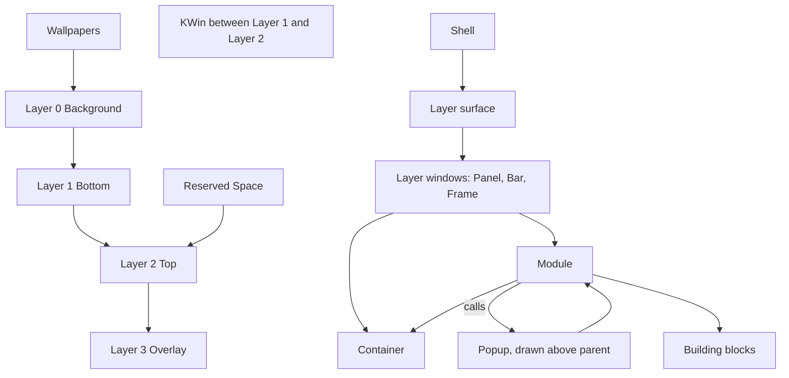

# Shell Structure

> [!NOTE]
> The maintainer's flow diagram ([Shell Flow Diagram.canvas](Shell%20Flow%20Diagram.canvas), fifth version, 2026-10-26, now in this folder) shows what a shell is made of, from the desktop environment down to building blocks. This note puts it in words, checks it against the rest of the vault and the layer-shell protocol, and lists what is still open. The diagram is the maintainer's design.

> [!NOTE]
> This is an Obsidian view of `Shell Flow Diagram.canvas` and is not shown on GitHub.

## What the Diagram Shows

| Group               | Contents                                                                                                                                                                                                                  |
|---------------------|---------------------------------------------------------------------------------------------------------------------------------------------------------------------------------------------------------------------------|
| Desktop Environment | The layer surface (Layer 0 Background, Layer 1 Bottom, Layer 2 Top, Layer 3 Overlay), KWin between Layer 1 and Layer 2, Wallpapers on Layer 0, Reserved Space on Layer 2                                                  |
| Layer Windows       | Panel (Bottom, Top or Overlay), Bar (Bottom, Top or Overlay), Frame (Top)                                                                                                                                                 |
| Special Cases       | Popup, drawn above its parent. A module calls it, and it holds containers and modules                                                                                                                                     |
| Modules (Nestable)  | Spacer, List, Toggle, Label, Slider, Marquee text, TextBox, ProgressBar, Checkbox, TextInput, Menu and MenuItem, TextEditor, Expander, Button, Icon, Badge, Image, Tooltip                                         |
| Building Blocks     | Containers (nestable): FlexBox, Box, Grid. Shapes: Square, Rectangle, Triangle, Hexagon, Circle, Ellipse, Ring, Path. Graphics: Bitmap, SVG. Typography: Text, TextField, TextField (Multi-Line). Other: Terminal, Canvas |

Reading the arrows: the Shell attaches to the layer surface; layer windows (Panel, Bar, Frame) hold modules and containers; a module holds containers and is made of building blocks; a module calls a popup, and a popup holds containers and modules.

## Checked against the Vault and the Protocol

| Diagram                                                          | Check                                                                                                                        | Result                                                                |
|------------------------------------------------------------------|------------------------------------------------------------------------------------------------------------------------------|-----------------------------------------------------------------------|
| Four layers numbered 0 to 3                                      | The layer-shell protocol's four layers, "ordered by z depth, bottom-most first" ([protocol](https://wayland.app/protocols/wlr-layer-shell-unstable-v1)) | Matches exactly ([Common Keys and Conventions](../41%20TDL%20Reference/Common%20Keys%20and%20Conventions.md))             |
| KWin between Layer 1 and Layer 2                                 | The protocol: ordinary windows are rendered between the bottom and top layers                                                | Matches exactly                                                       |
| Reserved Space on Layer 2                                        | The shell's own rule                                                                                                         | Decided ([Surface Types > Layers per kind](../40%20Specifications/Surfaces/Surface%20Types.md#layers-per-kind))                     |
| Panel, Bar, Frame with the layers shown                          | [Surface Types > Layers per kind](../40%20Specifications/Surfaces/Surface%20Types.md#layers-per-kind)                                                                                      | Matches                                                               |
| Popup, drawn above parent, called by a module                    | An `xdg_popup` parented to a layer surface is drawn above its parent                                                         | Matches; the protocol page leaves the stacking to the xdg_popup rules |
| Building Blocks: Containers, Shapes, Graphics, Typography, Other | [Building Blocks](../50%20Design%20System/Building%20Blocks.md)                                                                                      | Matches exactly, including Grid, Path and the multi-line TextField    |
| Modules (Nestable)                                               | [Building Blocks](../50%20Design%20System/Building%20Blocks.md), [V1 Widgets](../50%20Design%20System/V1%20Widgets.md)                                             | 19 modules. **Checkbox is new** (see below). The other 18 match       |
| Layer 0 wallpapers only                                          | [Surface Types > Layers per kind](../40%20Specifications/Surfaces/Surface%20Types.md#layers-per-kind)                                                                                      | Matches                                                               |
| Modules and containers nest                                      | [ADR-0007 Shell UI Layer > Blocks, modules and styling (2026-10-26)](../30%20Decisions/ADR-0007%20Shell%20UI%20Layer.md#blocks-modules-and-styling-2026-10-26)                                                                                      | Matches                                                               |

## Decided from the Diagram

- Layer 0 is for wallpapers only, for now (maintainer, 2026-10-26); the maintainer can see it used later for window tiling or as a base layer for a desktop dashboard.
- Frame is Top only; its strips move to `TOP` ([Surface Types](../40%20Specifications/Surfaces/Surface%20Types.md)). Top suits the painter, which must be above windows to be seen; the strips are invisible so any layer works, and Top-layer reservation is the case known to work on KWin.
- The shell enforces `TOP` as the only layer that reserves space. The protocol ties exclusive zones to no layer, so this is the shell's rule, chosen to reduce confusion. An `Exclusive_Zone` off `TOP` is a load error (decided, maintainer, 2026-10-26).
- KWin is "between Layer 1 and Layer 2", as the protocol says.
- A Popup stays a `Popup { Name: ... }` block in the shell file; a module calls it; it holds containers and modules ([Surface Types > Special cases](../40%20Specifications/Surfaces/Surface%20Types.md#special-cases)). The Special Cases group exists for popup-like kinds, such as a Notification window (not v1).
- The building blocks and the modules are the lists in [Building Blocks](../50%20Design%20System/Building%20Blocks.md), with the full decision in [ADR-0007 Shell UI Layer > Blocks, modules and styling (2026-10-26)](../30%20Decisions/ADR-0007%20Shell%20UI%20Layer.md#blocks-modules-and-styling-2026-10-26).
- Popup focus is on by default with one flag; tooltip-like popups opt out.
- The Frame stays on `TOP`. Melded Bars and Panels are drawn inside the Frame's own surface (hosted melding, 2026-10-27), so melds need no layer of their own and Overlay stays free ([Frame > Hosted melding (decided 2026-10-27)](../40%20Specifications/Surfaces/Frame.md#hosted-melding-decided-2026-10-27)).

## What Does Not Match, or Needs a Decision

All three points were answered by the maintainer on 2026-10-27:

1. Checkbox is a separate module from Toggle. Both give the same result (an on or off value), but a Toggle is a switch and a Checkbox is a check box.
2. Blocks can be placed anywhere: directly on a surface, in a container or in a module. They are most commonly used inside a module. The diagram's arrow from Module to Block shows the common case, not a limit.
3. A popup holds containers and modules. The maintainer added a container node under Special Cases to the diagram; it had been left out while rearranging.

## Blocks and Modules (Decided 2026-10-26)

The maintainer looked at how Tesserae builds widgets and chose the shell's own building blocks ([Building Blocks](../50%20Design%20System/Building%20Blocks.md)). Since the layout decisions of 2026-10-29 a block and a module are both called by their name as the head of a block (`Text { Name: title }`, `Clock { }`), with no `Block:`, `widget:` or `module:` key; the names of blocks, surface types and modules are in one registry ([TDL Language > Names and the Registry](../41%20TDL%20Reference/TDL%20Language.md#names-and-the-registry), [ADR-0014 Shell File Language > File Layout (Decided 2026-10-29)](../30%20Decisions/ADR-0014%20Shell%20File%20Language.md#file-layout-decided-2026-10-29)). `Import` embeds a module file. The diagram shows the same split: a Building Blocks group and a Modules group.

What Tesserae does, for reference (design `yaml-language.md` section 3 and guide `components.md`, local clone commit `0eda3fe`, read 2026-10-26): a widget is either built in (Python) or a view (a file with `params:`), both called the same way, and a called view has no ViewModel of its own. The shell kept the declared-properties idea and made two kinds with different keys.

## Open

- [x] The three points above (2026-10-27). Nothing open in this note.

## Links

- [20 Architecture](20%20Architecture.md) · [Surface Types](../40%20Specifications/Surfaces/Surface%20Types.md) · [Module File](../41%20TDL%20Reference/Module%20File.md) · [Shell File](../41%20TDL%20Reference/Shell%20File.md) · [Layers and Components](Layers%20and%20Components.md) · [Building Blocks](../50%20Design%20System/Building%20Blocks.md)
