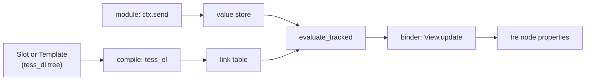

# TEL Integration

> [!NOTE]
> How the shell uses TEL (`tess_el`): where a `<| |>` slot becomes a compiled expression, what names it can read, how the value store feeds it, how a change reaches exactly the node properties that depend on it, and what happens on an error. It is the design for M2a ([M2 Brief](../00%20Home/M2%20Brief.md), G1 and G2), accepted as the plan by the maintainer on 2026-11-04 ("Design first"). The `tess_el` calls below were tried on 0.1.2 on 2026-11-04 (names and a small scope only); behaviour that was not tried is tagged.

## Purpose and Scope

- Define the compile step, the scope, the value store, the link table and the update path for slots, `If`/`Else` and `For`.
- Not in scope: the binder's tables ([Render Binder Design](Render%20Binder%20Design.md)), the module host ([Module Contract](../42%20Python%20API/Module%20Contract.md)), and events (M3b).

## The Parts

| Part | Does | Lives in |
|---|---|---|
| Compiler | Turns each slot into a compiled expression with its `Origin` | `model/` |
| Scope | Answers `lookup(name)` for the expression: module values, `Params`, the file's name tree, `For` variables | `model/` |
| Value store | Holds the latest value of each key a module sent, per use | `model/` |
| Link table | Remembers, for each slot, its tracked paths and the node property it feeds | `model/`, with ids from the binder |
| Binder | Converts the new value and sets the property, through `Window.apply` | `binder/` |

## Compiling

A slot is either a `Slot` (exactly one slot in the value) or a `Template` (text with slots inside), per the lexical rules in the `tess_dl` reference ([TDL Library API](../42%20Python%20API/TDL%20Library%20API.md)).

1. Each slot is compiled separately: `tess_el.compile_expression(slot.text, language="0.1", origin=Origin(file, line, column))`, where the origin is the slot's `text_origin` from `tess_dl`. TEL's errors then name the exact place in the file. TEL's own `compile_template` is not used; the shell joins the parts itself, so every slot keeps its precise origin and its own links.
2. A value that is exactly one `Slot` keeps the type of the result (a number stays a number, then goes to the key's converter). A `Template` joins its text and the `str` of each slot into one string.
3. The `language` argument is the TEL language version the file declares (`TEL: 0.1`). A file pinned to a newer language than the installed `tess_el` supports is refused with `TelVersionError`'s message at the pin's key.
4. `If` conditions use `compile_condition`, a `For` header uses `compile_repeater_parts(names, items, key=, name=, ...)` with the three slots' origins ([ADR-0014 Shell File Language](../30%20Decisions/ADR-0014%20Shell%20File%20Language.md) D64, D65).
5. Compilation happens once per file load, in the load step before any window is built. An error is a load error with `file:line:column`; a surface with an error opens empty and the other surfaces open ([Validation and Errors](../40%20Specifications/Runtime/Validation%20and%20Errors.md)).
6. `Limits` are TEL's defaults (source 2,000 characters, 200,000 steps and so on); the shell raises none at M2. A limit error is reported like any TEL error.

## The Scope

One `Scope` object per use of a surface or module, built by the shell (`lookup(name)` raises `KeyError`; `names()` lets TEL suggest the nearest name). It resolves a name from these, in order:

| Order | Source | Example | Notes |
|---|---|---|---|
| 1 | `For` variables of the entries around the slot | `item.title` | Entry scopes come from TEL's `Entry.scope(parent)` |
| 2 | `params` of the module use | `params.format` | Read-only values from the use |
| 3 | The module's own sent values | `time` (the Clock's `Text: <\| time \|>`); `label.text` for another module | The key is the name the module sent with `ctx.send`; the form `<module>.<key>` is for another module's values ([Module Context > Sending Values](../42%20Python%20API/Module%20Context.md#sending-values)) |
| 4 | The file's name tree | `Main_Shell.Main.Top_Bar.Width` | Plain read-only objects, one per named element, holding typed values ([Expression Language Requirements](../40%20Specifications/Runtime/Expression%20Language%20Requirements.md) T20) |

Rules:

- The scope returns plain values only. TEL refuses host objects inside lists and dicts for `sum`, `sorted`, `==` and similar, so the store keeps lists of dicts and not lists of objects ([Expression Language Requirements > TEL 0.1.0 Released (2026-11-02)](../40%20Specifications/Runtime/Expression%20Language%20Requirements.md#tel-010-released-2026-11-02)). The name tree holds plain data too.
- A name that does not exist is a `KeyError`; TEL turns it into an evaluation error that suggests the nearest name from `names()`.
- Reads are recorded by TEL: `evaluate_tracked(scope)` returns a `Tracked` with `value`, `reads` (a set of dotted-path strings such as `clock.text` and `n`) and `names` (top-level names). No tracking code is written in the shell.

## The Value Store

- Key and shape: a mapping `use -> key -> value`, where a use is `<Module>@<uid>`. A send without `use=` stores the value for every use of the module.
- One writer: only the loop thread writes. `ctx.send` from any thread queues the pair with `call_soon`; the loop collects the queue once per turn, keeps the latest value of each key (coalescing), checks the type, then applies the turn's changes together ([Value Types and Conversion](../42%20Python%20API/Value%20Types%20and%20Conversion.md)).
- An unconvertible value logs the module and the key, and the store keeps the last good value.
- The store survives a hot reload of a view (its values stay for the new links) and is dropped for a module whose instance is replaced.
- Types in M2: strings, numbers, booleans, and lists and dicts of those ([M2 Brief](../00%20Home/M2%20Brief.md), G5).

## The Link Table and Updates

For each slot the shell records one link: the compiled expression, its `reads` from the first evaluation, the node id, the tre property and the converter.

1. Build: evaluate each slot once with `evaluate_tracked`, convert, and build the node with the value; store the link.
2. Change: when a turn changes keys `K` for a use, the shell finds the links of that use whose `reads` include a path equal to, or under, a changed path. Matching is by prefix: a change to `clock` matches a read of `clock.text`, and a change to `Main_Shell.Main.Top_Bar` matches a read of `Main_Shell.Main.Top_Bar.Width`.
3. Re-evaluate only those links with `evaluate_tracked`; the new `reads` replace the old (a conditional expression may read different names).
4. Convert the results and set them with one `Window.apply([(node, props), ...])` per surface per turn. If the new value equals the old one, no call is made.
5. A conversion or evaluation error leaves the property at its last value, logs the module, key and `file:line:column`, and does not stop other links.

The cost of an idle shell is zero: nothing runs between sends, and a module that does not send does not wake the loop ([Performance Budgets](../60%20Quality/Performance%20Budgets.md)).

## If, Else and For

- `If`/`Else`: `tess_el.select_tracked(conditions, scope)` gives the index of the branch and the paths it read. A change to those paths re-selects; if the branch changes, the binder removes the old branch's nodes and builds the new one in one `apply` (M2b).
- `For`: `Repeater.reconcile_tracked(scope, RepeaterState)` returns the entries with a status (new, kept, moved, removed) and the names `<name>_0001`, never reused; the shell keeps the `RepeaterState` per `For` and rebuilds only the entries TEL reports (M2b). Each entry's scope comes from `Entry.scope(parent)`; reads through the item come back as written (`w.title`) and the shell re-bases them.
- Keys of a `For` are `int`, `str` or tuples of those; a bool, float or `None` key is refused by TEL and reported at the `Key` slot.

## Threading

Compile, evaluate and update all run on the loop thread, in a callback between frames. `ctx.send` is the only entry from other threads and goes through `call_soon` ([Process Model and Threading](Process%20Model%20and%20Threading.md)). No TEL call blocks: TEL has no I/O.

## Configuration

None. The TEL limits stay at their defaults at M2.

## Failure Modes and Recovery

| Failure | Result |
|---|---|
| A syntax error in a slot | Load error at the slot's `file:line:column`; the surface opens empty |
| A name not in scope | Evaluation error naming the nearest name; the property keeps its last value, or is left unset on first evaluation, and the error is logged once per change |
| A value of the wrong type for the key | Conversion error naming the key; the last good value stays |
| A module raises in `start()` or in a send | The module is marked failed; its slots show their last value ([Module Contract](../42%20Python%20API/Module%20Contract.md)) |
| A TEL limit is hit | A `TelLimitError` message at the slot; the slot is dropped, the rest keep working |
| A `tess_el` older than the file's language | Refused at load with the pin's position |

## Open Questions

1. [ ] **How is the name tree built and updated on a hot reload (M2b)?** Context: the choices are to rebuild the whole tree or to patch the changed element. Recommendation: rebuild the whole tree at M2b, because a reload is rare, and patch only if a measured cost demands it.
2. [x] At M2a a slot reads only the module's own sent values and `params`; a slot in a shell file or in a module call's param is `not-built` (as built, [M2 Build Log](../00%20Home/M2%20Build%20Log.md)). The name tree and other modules' keys wait for a module that needs them.
3. [x] `evaluate_tracked` with a conditional expression is re-tracked for the names it reads now: confirmed by a test in `tess-shell` (`077d347`, [M2 Build Log](../00%20Home/M2%20Build%20Log.md)).
4. [x] A slot error on the first build leaves the property unset and logs the error (as built).

## Acceptance Criteria

- [ ] A slot `<| time |>` in the Clock's layout shows the value sent with `ctx.send("time", ...)`, and a new send changes only that node's property.
- [ ] A slot reading `params.format` re-evaluates only when the use's params change.
- [ ] A conditional slot that reads different names on later calls updates for the names it reads now.
- [ ] A syntax error in a slot names `file:line:column` of the slot's text, not of the start of the value.
- [ ] Two sends of one key in one turn cause one `apply` with the latest value.
- [ ] A change to a key no slot reads causes no node call.
- [ ] A `For` keeps unchanged entries untouched when an item is added (M2b).
- [ ] Idle between sends: no wake-ups from this layer.

## Links

- [Expression Language Requirements](../40%20Specifications/Runtime/Expression%20Language%20Requirements.md) · [Render Binder Design](Render%20Binder%20Design.md) · [Module Context](../42%20Python%20API/Module%20Context.md) · [Value Types and Conversion](../42%20Python%20API/Value%20Types%20and%20Conversion.md) · [M2 Brief](../00%20Home/M2%20Brief.md) · [Layers and Components](Layers%20and%20Components.md)
