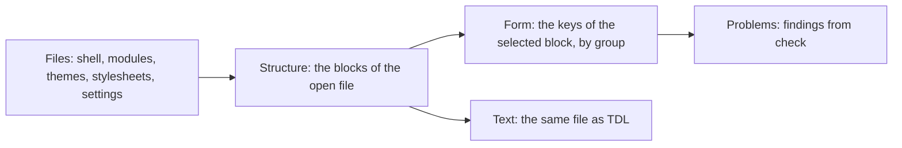

# Configuration Application

> [!NOTE]
> The companion desktop application of the [Tesserae Shell Directive](../00%20Home/Tesserae%20Shell%20Directive.md) (Definition of Done, item 2): a graphical editor for everything a user can configure in Tesserae Shell: shell files, surfaces, blocks, module calls and their params, styles, stylesheets, themes and `settings.tdl`. It is built on Tesserae UI (`tess_ui`) by the `tess-ui` session. It edits the user's `.tdl` files in place and losslessly through `tess_dl`, builds its forms from the schema the shell exports, validates with the shell's own `check`, and lets the running shell show the result through hot reload. Written by the orchestrator on 2026-11-13; confirmed with amendments by the `tess-ui` session on 2026-11-13 (directive rule 5), so `accepted`; the amendments are in [Confirmed by tess-ui (2026-11-13)](#confirmed-by-tess-ui-2026-11-13).

## Purpose and Scope

- Let a user build and change a shell without writing TDL by hand, and without losing anything they did write by hand.
- Cover every built-in option: every key of every root block, surface, block and style, every shipped module's params, every theme token and every setting. "Every" is measured against the shell's exported schema, not against a list in this note.
- Not in v1: editing a module's Python; writing new modules; a free-form drag-and-drop canvas; installing or downloading themes or modules; editing while no shell is installed.

## Where It Lives and What It Depends On

| Question | Decision |
|---|---|
| Repository | Inside the `tess-ui` repository as its own package in `apps/shell_config/` with its own `pyproject.toml` (distribution `tesserae-shell-config`, import `tess_shell_config`, command `tesserae-shell-config`). No new remote is created |
| Depends on | `tess_ui` (the toolkit), `tess_dl` (reading and editing files), `tess_utils` where a converter is shared. It does not import `tess_shell` |
| Talks to the shell | Only through the `tesserae-shell` command: `schema --json`, `check --json --config-dir`, `status --json`, `reload` ([IPC and CLI](Runtime/IPC%20and%20CLI.md)). So the shell still does not depend on Tesserae UI ([ADR-0006 Shell Independent of Tesserae UI](../30%20Decisions/ADR-0006%20Shell%20Independent%20of%20Tesserae%20UI.md)), and the application works with any shell version whose schema it can read |
| When the shell is not installed | The application says so and stops; it bundles no schema of its own |

## The Three Sources of Truth

| What | Source | Use |
|---|---|---|
| What can be written | `tesserae-shell schema --json` (schema 1.1: `kinds`, `roots`, `blocks`, `settings`, `events`, `actions`, `enums`, `tokens`, `modules`; per key: kind, choices, default as TDL text, doc, range, unit, group, `tokens`, `preferred_tokens`, slot, required, built) | Every form, every "add" menu, every default and every range. No key name or enum value is written in the application's code |
| What is written | The user's `.tdl` files, read with `tess_dl.loads` into a lossless tree | The structure view and the current values |
| Whether it is right | `tesserae-shell check --json --config-dir <folder>` | The problems list, with file, line and column |

The application refuses a schema whose major version it does not know, and tolerates new keys in a higher minor version (it shows them with the generic widget of their kind).

## Behaviour

### Opening

- It opens the shell's configuration folder: the folder given with `--config-dir`, else the one `tesserae-shell status --json` or the shell's discovery rule names ([Config Discovery and Registry](Runtime/Config%20Discovery%20and%20Registry.md)). The shell names the resolved folder in its `--json` outputs (T-032).
- It lists the folder's files by type, from each file's root block: shell files, modules, styles, stylesheets, themes and `settings.tdl`.
- A file with syntax errors opens in the text view only, with the errors marked; the structure view is off until it parses.

### The Window

| Area | Shows | Does |
|---|---|---|
| Files | The configuration folder by file type | Open, new file from a type (a minimal valid file with its metadata block), duplicate, rename, delete (to the trash folder, not removed) |
| Structure | The open file's blocks as a tree, with `If` and `For` as nodes | Select; add a child from the block's `allowed_children`; remove; move up, down, or to another parent; duplicate |
| Form | The selected block's keys in the schema's groups, each with its doc line | Edit a value; clear it (remove the property); reset to the default |
| Text | The file's TDL | Edit by hand; the structure and form follow when the text parses |
| Problems | The findings of the last `check`, and syntax errors | A click selects the block and the key |

### Editing a Value

Each key gets the widget of its kind. The kinds and their hints come from the schema's `kinds` table.

| Kind | Widget |
|---|---|
| boolean | A switch |
| enum | A choice list, with each choice's doc where the schema has one |
| number, whole, percent, duration | A number field with the schema's minimum, maximum, step and unit |
| length, bound | A number field with a unit choice from the key's allowed units (`px`, `%`, `AUTO`, `EXPAND`) |
| sides | One field, or four in the order left, top, right, bottom, by the key's arity |
| color | The ColourPicker (T-012), with alpha when the key allows it |
| string, text | A text field; multi-line where the kind says so |
| path | A text field with the file dialog (T-013), in the key's mode and filters |
| icon | An icon picker over the shipped set and the user's `Icons` folder, with a search |
| font | A font family list |
| key_chord | A field that records a key press |
| list | A list editor of the item kind |
| token_ref, and any key whose `tokens` is not empty | The key's widget plus a token button: a list of the theme's tokens of the accepted groups, `preferred_tokens` first, each shown with its value. Choosing one writes `$group.name` |
| expression, and any key with `slot: true` inside a module's layout | The key's widget plus an expression button that swaps it for a text field holding `<\| ... \|>`; the text is written as it is and checked by `check`, not by the application |

A value that the application cannot show with a widget (a call, a list it does not understand, a hand-written expression) is shown as its TDL text in a text field, and is never rewritten unless the user edits it.

### Writing a File

Every change is one `tess_dl` edit on the lossless tree, so comments, blank lines, order and the layout of everything the user did not touch stay byte for byte:

| Change | Edit |
|---|---|
| Set or add a value | `Block.with_property(key, value_text)` |
| Clear a value | `Block.without_property(key)` |
| Add a block | `Block.with_child(format_block(text), index)`; the new block is written with its required keys only |
| Remove or move a block | `Block.without_child`, `Block.move_child` |
| Metadata | `with_metadata`, `without_metadata` |

- The selection is kept across an edit by `Block.index_path` and `Document.at`.
- Undo and redo step through the Documents of the session, per file, without limit until the file is closed.
- A file is written to disk by an explicit Save, or at once when "Apply as I edit" is on. A save writes to a temporary file in the same folder and renames it over the old one. Before the first save of a file in a session, its old content is copied to a `backups` folder in the application's own state folder.
- "Format file" runs `tess_dl.format` on the open file. It is never run without being asked.
- A file changed on disk by another program while it is open is noticed (a file watch); the application asks whether to reload or keep, and never overwrites silently.

### Seeing the Result

- The running shell hot reloads a changed file ([Hot Reload](Runtime/Hot%20Reload.md)); the application adds nothing to that. After a save it runs `check` and shows the findings.
- With "Apply as I edit" off, nothing reaches the shell until Save.
- If no shell is running, the application says so in its status bar and still edits and checks. Until the shell's control interface is built (part M5i of [M5 Brief](../00%20Home/M5%20Brief.md); `status` and `reload` are stubs today), the application cannot tell whether a shell is running: it shows "unknown" and relies on the shell's own file watching for the reload.
- Not in v1: a preview drawn inside the application. #needs-verification whether Tesserae UI's headless screenshot tool can render a shell surface; if it can, a later version shows one.

### Themes, Stylesheets and Settings

They use the same structure, form and text views, with these additions:

- A theme file shows its tokens by group (`color`, `type`, `shape`, `space`, `elevation`, `motion`) from the schema's `tokens` table, with one column per mode the file defines (the base, Light, Dark, High_Contrast, Reduced_Motion). A colour token shows a swatch in each mode.
- A stylesheet shows its `Rule` blocks in order, since order decides ties ([Style Schema > Stylesheet Selectors](../41%20TDL%20Reference/Style%20Schema.md#stylesheet-selectors)). The selector has a builder: a block or module name, a class, a name, a state (`:hovered`, `:pressed`, `:disabled`, `:selected`, `:checked`, `:focused`), a part (`Module::part`). The form shows the style keys the selected block type takes; for a selector the builder cannot read, it shows the union.
- `settings.tdl` shows its sections (`Settings`, `Directories`, `Logging`, `Validation`, `Appearance`, `Debug`, and `Shortcuts` when the shell exports it) as pages.

### Module Calls

A module call in a layout (for example `Clock { }` or `Network { show_name: true }`) is a block whose form comes from the schema's `modules` table: the module's params with type, default and doc, then the common keys. The "add" menu offers every shipped module, and every module found in the user's `Modules` folder by reading its `Params` block with `tess_dl` (a user module has no doc lines; its params show with their names and types).

## Configuration

The application keeps its own settings (window size, "Apply as I edit", recent folders) in its own state folder under `XDG_STATE_HOME`, not in the shell's folder. It adds no key to any shell file.

## Integration

- Processes: the application is one Tesserae UI process. It starts `tesserae-shell` as a short-lived subprocess for `schema`, `check`, `status` and `reload`, never on the UI thread's frame path.
- Files: it reads and writes only inside the chosen configuration folder and its own state folder.
- The shell: no socket, no D-Bus and no import between the two; the command line is the whole interface.

## Design

Tesserae UI's own components and theme. The application follows the desktop's light and dark setting as any Tesserae UI application does. Dense forms: a key is one row with its label, widget, token button and reset button; the doc line is a tooltip and a line under the row when the row has focus.

## Accessibility

Every action is reachable from the keyboard: the three panes are focus regions, the structure is a tree with arrow keys, a form row's buttons are in the Tab order, and the add, remove and move actions have shortcuts and menu entries. Every widget has a name from the key and a description from the doc line. Colour is never the only sign of a problem: a finding has an icon and text.

## Performance Budget

| Case | Budget |
|---|---|
| Start to a usable window, schema read (about 600 KB of JSON) | 1.5 s |
| Opening a file of 500 lines | 100 ms |
| One edit applied to the tree and the form updated | 16 ms |
| `check` after a save | Off the UI thread; the findings within 1 s of the command returning |
| Idle | No timer; no wake-ups while nothing changes |

## Failure Modes and Recovery

| Failure | Result |
|---|---|
| `tesserae-shell` is not on the path | A message naming the command; the application stops |
| The schema's major version is unknown | A message naming both versions; the application stops |
| A file does not parse | Text view only, with the errors; no structure edit until it parses |
| A value is out of the schema's range | The widget refuses it and says the range; nothing is written |
| `check` reports a finding | Listed with file, line and column; the file is still saved, because a user may be half way through a change |
| `check` fails to run or times out (10 s) | One message in the problems list; editing continues |
| The file changed on disk | The user is asked: reload or keep |
| A save fails (permissions, a full disk) | The old file is untouched (the write was to a temporary file); the message names the cause |
| An edit would make an invalid file (`TDLError` from `tess_dl`) | The edit is not applied; the message is shown |

## Safety in Tests

The application's tests never touch the user's real configuration folder, a real shell or the real session ([Orchestration Log](../00%20Home/Orchestration%20Log.md) D-019, D-025): every test works in a temporary folder, uses a recorded schema file or the `tesserae-shell` command with `--config-dir` pointing at that folder, and runs under Tesserae UI's real-session guard.

## Confirmed by tess-ui (2026-11-13)

The `tess-ui` session confirmed the specification and these points were settled with it (orchestrator, Tier 1):

| Point | Settled |
|---|---|
| The package | `apps/shell_config/` in the `tess-ui` repository, with its own `pyproject.toml` and tests in `apps/shell_config/tests`; the repository's test selection, CI plan, type ratchet and real-session guard are extended to cover it |
| `tess_dl` | A direct dependency on the `tess-dl` repository pinned to a full commit hash, while the edit functions and the formatter are unreleased; a version pin once `tess-dl` publishes |
| The shell in tests | Never run. Tests use recorded outputs of `schema --json`, `check --json` and `status --json`, which the shell keeps as fixtures in its repository, and a fake `tesserae-shell` script on the path written into the test's temporary folder |
| The configuration folder | The shell adds the resolved folder to its `--json` outputs (task T-032); until then `--config-dir` or the discovery rule |
| A field's write | On commit of the field (Enter or focus leaving it), not per keystroke; no debounce |
| `check` | Runs in a worker thread and posts its result to the loop |
| Reset to default | Removes the property. Omitting a key gives the schema's default, which is how the schema reads its defaults (a block built bare) |
| File watching | The `watchfiles` package the toolkit already depends on |
| Fonts | The installed families are read with `fc-list : family` (a read-only subprocess); without `fc-list` the widget is a free text field |
| A shortcut value | The recorder writes `Ctrl+Alt+Shift+Meta+Key` in that modifier order with the key last, for example `Ctrl+Shift+F1`; the shell accepts any case ([Global Shortcuts](Integration/Global%20Shortcuts.md)) |
| Widgets to build in the toolkit | An icon picker, a font list, a key-chord recorder, a list editor, the tokens button; the structure tree uses the existing Tree with `If` and `For` as labelled nodes and a keyboard way to move a node to another parent |

## Open Questions

Decided by the orchestrator on 2026-11-13 ([Tesserae Shell Directive](../00%20Home/Tesserae%20Shell%20Directive.md) rule 7, Tier 1); the `tess-ui` session confirms or amends them before the build (rule 5).

1. [x] Where does the application live? In the `tess-ui` repository, `apps/shell_config/`, as its own package.
2. [x] How does it reach the shell? Only through the `tesserae-shell` command.
3. [x] Does it rewrite files? Never as a whole: one lossless edit per change; formatting only when asked.
4. [x] Is there a preview inside the application? Not in v1; the running shell is the preview.
5. [x] Does it edit Python? No.

## Questions After Testing

1. [ ] Is hot reload fast and safe enough for "Apply as I edit", or must saves be debounced? Context: every keystroke in a number field could write the file. Recommendation: write on commit of a field (Enter or focus out), never per keystroke, and debounce 200 ms. Answered by: a test with the shell running against a temporary configuration folder.
2. [ ] Does every key of schema 1.1 get a usable widget? Context: 39 block keys still have no default and 10 kinds are for keys not built. Recommendation: a generic text field for any kind the application does not know, and a report of which keys fell back. Answered by: the coverage test in the acceptance criteria.

## As Built (session report, 2026-11-13, not run in the vault)

Phases C1 to C5 are merged in the `tess-ui` repository (`07fd64f`; suite 10196 passed, 4 skipped). Its own acceptance table passes 12 of 12. Task T-056 then closed what was left (`0cdd651`, CI green at `c0a5d2d`; suite 10234 passed, 4 skipped): nine tests run the real `check` and `schema` commands on temporary folders over every kind of file the application writes; selecting a block takes 11.0 ms at the median and 13.1 ms at p95, an edit 5.4 and 6.4 ms (not on a strictly idle machine). Not verified by anyone: real GPU frame times. What the schema could not tell the application is task T-057 in the shell ([Orchestration Log](../00%20Home/Orchestration%20Log.md) D-058).

## Acceptance Criteria

- [ ] A test walks the whole schema and, for every root block, block, setting, module param and token, builds its form row and checks that a widget exists, that the default shown equals the schema's default text, and that writing a valid value produces a file `tesserae-shell check` accepts. The test lists every key that fell back to the generic text field; the list is empty or each entry has a stated reason.
- [ ] Opening a file and saving it without a change leaves it byte for byte the same, for every file of the shell's shipped configuration and the `tess_dl` corpus.
- [ ] Setting, clearing, adding, removing and moving each change only the lines of that entry: a diff test on files with comments, blank lines, inline blocks and end-of-line comments.
- [ ] Undo after each kind of edit restores the earlier bytes; redo restores the later ones.
- [ ] The selection stays on the same block after every kind of edit.
- [ ] A finding from `check` selects its block and key when clicked.
- [ ] A value outside a key's range cannot be written from its widget.
- [ ] A token chosen for a colour key writes `$color.<name>`; the token list shows only the groups the key accepts, preferred ones first.
- [ ] A file changed on disk while open is never overwritten without the user's answer.
- [ ] A failed save leaves the old file intact (a test that makes the folder read-only).
- [ ] Every action works from the keyboard alone (a headless test drives the window with key events only through one full edit: open, select, change a value, add a block, save).
- [ ] No test reads or writes outside its temporary folder; the suite passes under the real-session guard.
- [ ] The application starts, opens the shell's shipped default configuration copied to a temporary folder, and shows no finding.

## Phases

| Phase | Content | Done when |
|---|---|---|
| C1 | The package skeleton, schema reading, file list, structure tree, text view, lossless open and save | The byte-for-byte and structure criteria pass |
| C2 | The form generator for every kind, tokens, ranges, defaults, reset; ColourPicker and file dialog wired in | The schema coverage test passes |
| C3 | Add, remove, move, duplicate; undo and redo; selection kept | The edit criteria pass |
| C4 | `check` and the problems list; save, backups, the file watch, "Apply as I edit" | The save and findings criteria pass |
| C5 | Theme, stylesheet and settings views; module calls; the icon picker; keyboard pass; the user guide | Every criterion passes |

## Links

- [Tesserae Shell Directive](../00%20Home/Tesserae%20Shell%20Directive.md) · [Orchestration Log](../00%20Home/Orchestration%20Log.md) · [TDL Language](../41%20TDL%20Reference/TDL%20Language.md) · [Block Reference](../41%20TDL%20Reference/Block%20Reference.md) · [Style Schema](../41%20TDL%20Reference/Style%20Schema.md) · [Settings File](../41%20TDL%20Reference/Settings%20File.md) · [Hot Reload](Runtime/Hot%20Reload.md) · [IPC and CLI](Runtime/IPC%20and%20CLI.md) · [ADR-0006 Shell Independent of Tesserae UI](../30%20Decisions/ADR-0006%20Shell%20Independent%20of%20Tesserae%20UI.md)
