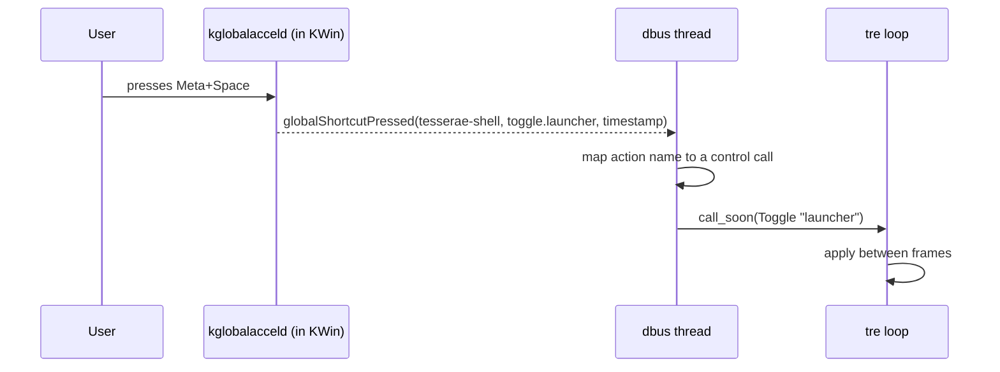

# Global Shortcuts

> [!NOTE]
> How the shell gets keys that work while no shell surface has focus: it registers one component, `tesserae-shell`, with KDE's global-accel service (`org.kde.KGlobalAccel`, held by `kwin_wayland` on the observed session) and turns each key press into a call on the control interface. The XDG GlobalShortcuts portal is the named fallback ([Portals](Portals.md)); the command line is the floor everywhere. [ADR-0005 Global Shortcuts](../../30%20Decisions/ADR-0005%20Global%20Shortcuts.md) (accepted) fixed the choice; this note fixes the names and the flow. The interface was read on 2026-11-02 (kglobalacceld 6.8.2); **no shortcut was registered**, because registering writes to the user's `kglobalshortcutsrc` and shows in System Settings, so the live test waits for the maintainer's permission ([Open Questions](#open-questions)).

## Purpose and Scope

- Specify the component and action names, the registration calls, the key press flow, the user's control over keys, re-registration, and the fallbacks.
- Not in this note: what an action does to a surface ([IPC and CLI > The Interface](../Runtime/IPC%20and%20CLI.md#the-interface), [Surfaces](../Surfaces/Surfaces.md)), and keys inside a focused surface (tre's input and focus, [Panel](../Surfaces/Panel.md)).

## Behaviour

### What the Service Offers (Read 2026-11-02)

`busctl --user introspect org.kde.kglobalaccel /kglobalaccel org.kde.KGlobalAccel` lists these methods; the argument meanings come from the client library's source ([KGlobalAccel `kglobalaccel.cpp`](https://invent.kde.org/frameworks/kglobalaccel/-/raw/master/src/kglobalaccel.cpp) and [`kglobalaccel_p.h`](https://invent.kde.org/frameworks/kglobalaccel/-/raw/master/src/kglobalaccel_p.h), read 2026-11-02).

| Method | Signature | Use |
|---|---|---|
| `doRegister` | `as` | Declares an action: four strings, in order: component unique name, action unique name, component friendly name, action friendly name. The library rejects an action without a name |
| `getComponent` | `s` returns `o` | The object path of a component, from its unique name |
| `setShortcut` | `asaiu` returns `ai` | Sets the keys of an action. The last argument is flags: `SetPresent = 2`, `NoAutoloading = 4`, `IsDefault = 8` (from the library's header) |
| `setShortcutKeys` | `asa(ai)u` returns `a(ai)` | Same, with a list of key sequences |
| `shortcut`, `shortcutKeys`, `defaultShortcut`, `defaultShortcutKeys` | `as` | Read the current and default keys |
| `isGlobalShortcutAvailable`, `globalShortcutAvailable` | `is`, `(ai)s` | Whether a key is free |
| `unRegister`, `unregister`, `setInactive` | `as`, `ss` | Remove an action or mark it not present |
| `allComponents`, `allMainComponents`, `allActionsForComponent` | | Listing |
| `yourShortcutGotChanged`, `yourShortcutsChanged` | signals | The user changed a key in System Settings |

A component is an object `/component/<name>` with the interface `org.kde.kglobalaccel.Component`. Read on `/component/mediacontrol`: properties `uniqueName` (`mediacontrol`) and `friendlyName` (`Media Controller`); methods `shortcutNames`, `allShortcutInfos`, `invokeShortcut`, `isActive`, `cleanUp`; signals `globalShortcutPressed(s component, s action, x timestamp)`, `globalShortcutReleased` and `globalShortcutRepeated`. The path replaces dots and other characters in the unique name with `_` (seen: `org_kde_dolphin_desktop`, `com_anthropic_Claude`); the shell asks `getComponent` and does not derive the path. The newer `pressed`, `repeated` and `released` signals that the client library (current `master`) prefers when present were not on this component's interface in 6.8.2, so the shell uses `globalShortcutPressed` ([library source](https://invent.kde.org/frameworks/kglobalaccel/-/raw/master/src/kglobalaccel.cpp)). The source read is `master`, the machine runs 6.8.2, so details may differ by version. #needs-verification

> [!WARNING]
> **Not tested from a non-KDE client**
> A non-Qt Python client calls these methods over D-Bus directly. Nothing in the library source says it must be a Qt process, but no one has done it here: the Wayland-session behaviour for a client that is not a KDE application is the open point recorded in [ADR-0005 Global Shortcuts > Context](../../30%20Decisions/ADR-0005%20Global%20Shortcuts.md#context). #needs-verification

### Component and Action Names

| Item | Value | Status |
|---|---|---|
| Component unique name | `tesserae-shell` | Proposed |
| Component friendly name | `Tesserae Shell` | Proposed |
| Action unique name | `<verb>.<target>`: `toggle.launcher`, `show.top_bar`, `call.Clock.cycle_format`; the target is a surface's unique `Name:` or `<Module>.<action>` ([IPC and CLI > The Interface](../Runtime/IPC%20and%20CLI.md#the-interface)) | Proposed |
| Action friendly name | A sentence: `Toggle launcher`; for a user-defined key the label is the surface's `Name:` | Proposed |
| Verbs | `show`, `hide`, `toggle` and `call`, the same as the control interface's methods | Proposed |

An action name is stable across restarts, so the user's changed key survives. A surface rename changes its action name; the old one is unregistered at the next start (see [Cleaning Up](#cleaning-up)).

### Where a Key Is Declared

A surface or a module declares a default key; the user changes it in System Settings. Proposed, since the key form is not decided in TDL:

| Place | Key | Registers |
|---|---|---|
| Bar | `Reveal_Key: Meta+B` ([Bar](../Surfaces/Bar.md) table; default none) | `show.<Bar name>` (a reveal key reveals; whether a second press hides is a [Bar](../Surfaces/Bar.md) question) |
| Panel | `Shortcut: Meta+Space` (proposed key, a Panel that opens from a key, [Panel](../Surfaces/Panel.md)) | `toggle.<Panel name>` |
| A module action | `Shortcut` on the action in the module's TDL (proposed) | `call.<Module>.<action>` |

The value is a key sequence in the KDE form (`Meta+Space`, `Ctrl+Alt+T`), a string in TDL. The shell converts it to the integer array that `setShortcut` takes (Qt key codes with modifier bits; the client library does this; for Python the shell writes its own small table for letters, digits, function keys and the named keys, proposed). A sequence the shell cannot parse is a TDL value error with `file:line:column` ([Validation and Errors > The error record](../Runtime/Validation%20and%20Errors.md#the-error-record)).

### Registration

At start, after the shell's own bus name is owned and before the surfaces are shown ([Shell Start and Stop > Start Sequence](../Runtime/Shell%20Start%20and%20Stop.md#start-sequence); the exact step is for that note to add):

1. Check that `org.kde.kglobalaccel` has an owner. If not: no shortcuts, one warning, go to [Fallbacks](#fallbacks).
2. For each declared key, call `doRegister` with the four strings.
3. Set the keys in two calls, as the client library does (`updateGlobalShortcut` in its source): `setShortcutKeys` with the active keys and the flag `SetPresent` (2), then `setShortcutKeys` with the default keys and the flag `IsDefault` (8). The flags are OR-ed and `NoAutoloading` (4) stays clear, so the service restores a key the user changed earlier and the default stays the default. A single call with only `IsDefault` would set the default and never mark the action present. The effect on a non-KDE client is untested. #needs-verification
4. Call `getComponent("tesserae-shell")` and subscribe to `globalShortcutPressed` on the returned path ([D-Bus Service Layer > Listening and Name Owners](D-Bus%20Service%20Layer.md#listening-and-name-owners)). The order (set the keys, then `getComponent`, then subscribe) copies the client library.
5. Subscribe to `yourShortcutsChanged` on `/kglobalaccel` and keep the signals whose component is `tesserae-shell`, so a key the user changes in System Settings is known to the shell.
6. If the service owner changes (kwin restart, `kglobalacceld` restart), repeat from step 1; the client library does the same (`reRegisterAll` on an owner change).

A key that is taken by another component: `setShortcut` returns the keys it actually set; if empty, the action is registered with no key, one warning names the action, and the user can pick a key in System Settings. The shell never steals a key.

### A Key Press

- The handler maps the action name to the same internal command as the `Toggle`, `Show`, `Hide` and `Call` methods and does not go through the bus a second time ([IPC and CLI > Threading](../Runtime/IPC%20and%20CLI.md#threading)).
- A press that arrives while the shell is starting or stopping is dropped with a debug log.
- Key release and repeat are ignored in v1. A key held down toggles once.
- The press is never a user action for a Popup grab, so a key opens a Panel and never a Popup ([Popup > Focus and dismissal (decided)](../Surfaces/Popup.md#focus-and-dismissal-decided)).
- Keyboard focus after a key opens a Panel is the Panel's setting (`keyboard="exclusive"` for the launcher, [V1 Scope](../../10%20Vision/V1%20Scope.md)).

### What the User Sees and Controls

The component appears in System Settings, Shortcuts, as `Tesserae Shell`, with one row per registered action. The user can change, clear or add keys there. The shell reads the change through `yourShortcutsChanged` and does not write keys itself after registration. Whether KDE shows the component for a client that is not a desktop-file application is untested. #needs-verification

### Cleaning Up

- A normal stop calls `setInactive` for each of the shell's actions (part of the stop sequence, [Shell Start and Stop > Stop Sequence](../Runtime/Shell%20Start%20and%20Stop.md#stop-sequence)). The component and the user's keys stay, so they are kept for the next start, but no action is present, so the service does not swallow a key that no one listens for. The client library does the same when its action goes away. #needs-verification for a non-KDE client
- At start, an action that is registered under `tesserae-shell` but no longer declared (a deleted or renamed surface) is removed with `unregister`. The list comes from `shortcutNames` on the component. The shell removes only actions of its own component.
- `tesserae-shell shortcuts clean` removes the whole component (proposed command, [IPC and CLI > The Command Line](../Runtime/IPC%20and%20CLI.md#the-command-line)).

### Fallbacks

| Case | What works |
|---|---|
| No `org.kde.kglobalaccel` on the bus (not KDE) | No global keys. The commands still work: `tesserae-shell toggle launcher`, bound by the user in the compositor ([ADR-0005 Global Shortcuts > Consequences](../../30%20Decisions/ADR-0005%20Global%20Shortcuts.md#consequences), [IPC and CLI](../Runtime/IPC%20and%20CLI.md)). The shell may offer the portal path ([Portals > Global Shortcuts Portal](Portals.md#global-shortcuts-portal)) |
| KDE, but registration is refused | Same as above; the log names the error |
| The user prefers KDE's own custom shortcuts | A KDE custom shortcut that runs `tesserae-shell toggle launcher` works with no registration. The command starts in about 21 ms with `jeepney` ([IPC and CLI > The Command Line](../Runtime/IPC%20and%20CLI.md#the-command-line)) |
| An on-screen or touch user | No shortcut; the Bar's own controls |

## Configuration

`Reveal_Key` on a Bar and `Shortcut` on a Panel and on a module action are the only keys in v1 (all proposed except `Reveal_Key`, [Bar](../Surfaces/Bar.md)). A setting `Shortcuts.Enabled` (default `true`) to turn global registration off is proposed, in `settings.tdl` ([Settings File](../../41%20TDL%20Reference/Settings%20File.md)).

## Python Contract

A module declares a shortcut on its action in its TDL, not in Python, so the shell can register it before the module starts. The action is an `@action` method ([Module Contract](../../42%20Python%20API/Module%20Contract.md)). A module does not call `KGlobalAccel` itself.

## Integration

- D-Bus: `org.kde.kglobalaccel` on the session bus, through the shared service thread ([D-Bus Service Layer](D-Bus%20Service%20Layer.md)). The incoming signal runs on that thread and is handed to the loop with `call_soon`.
- Plasma: the component is the shell's own; no Plasma component is changed ([Plasma Coexistence](Plasma%20Coexistence.md)).
- Config file touched by the service, not by the shell: `~/.config/kglobalshortcutsrc` (exists on the observed machine; not read).

## Design

None. The keys are shown in the Bar's and Panel's tooltips and in the launcher's placeholder text where a key is set (wording in [V1 Widgets](../../50%20Design%20System/V1%20Widgets.md) when the modules are written).

## Accessibility

- A shortcut is the keyboard way to reach a hidden Bar and the launcher ([Bar > Auto-hide (decided 2026-10-27)](../Surfaces/Bar.md#auto-hide-decided-2026-10-27)). With no key set, a keyboard-only user has no way to reveal an auto-hidden Bar; the open question in [Bar](../Surfaces/Bar.md) stands. Recommendation: on first start, if the Bar auto-hides and has no `Reveal_Key`, the shell logs one hint and shows a one-time Panel notice.
- The shell does not claim keys that assistive technology uses (Orca's, the compositor's screen-reader keys); a conflict returns an empty key and a warning.

## Performance Budget

- Registration: one `doRegister` and one `setShortcut` per action, once per start; target under 50 ms for 10 actions (measured in testing).
- A key press to the surface changing state: under one frame after the signal reaches the service thread; the D-Bus hop is the cost, measured in testing.
- Idle: no timer.

## Failure Modes and Recovery

| Failure | Result |
|---|---|
| Service missing | No global keys; one warning; commands still work |
| The shell stops | Actions set inactive; component and keys kept |
| Key taken | Action registered without a key; one warning; user picks a key |
| `doRegister` or `setShortcut` raises | That action is skipped; the rest register |
| The service restarts | The shell re-registers on the owner change |
| The signal arrives for an unknown action | Dropped, logged once at debug |
| The user binds a key and the surface is gone | The action does nothing and the log names the missing surface |

## Open Questions

1. [ ] **Test permission.** A live test registers a throwaway component (`tesserae-shell-test`), sets a key, receives one press, then calls `unregister` and `cleanUp`. It writes a group to `~/.config/kglobalshortcutsrc`; the service rewrites that file. Recommendation: allow it, after a copy of the file to `/tmp`, in the testing phase and not before. This is the only test that proves a non-KDE client works.
2. [ ] The exact meaning and values of the `u` flags beyond the three seen; the `GlobalShortcutLoading` values are in a header not read. #needs-verification
3. [ ] Whether a component without a desktop file appears in System Settings with its friendly name.
4. [ ] The TDL key for a Panel and a module action (`Shortcut`) and its value type; `Reveal_Key` is decided in name only ([Bar](../Surfaces/Bar.md)).
5. [ ] Whether a held key should repeat the toggle (recommendation: no).
6. [ ] The portal path as a second implementation, or only the commands (recommendation: commands only in v1, [Portals](Portals.md)).

## Acceptance Criteria

- [ ] With the service present, the component `tesserae-shell` exists after start and lists every declared action.
- [ ] A key press reaches the shell as one `globalShortcutPressed` and changes the target surface within one frame of the call arriving on the loop.
- [ ] A key the user changes in System Settings is used at the next press without restarting the shell.
- [ ] A taken key leaves the action registered with no key and logs one warning.
- [ ] After a restart of the shortcut service, the shell re-registers and the keys work again.
- [ ] A deleted surface's action is removed at the next start; other components are untouched.
- [ ] With no service on the bus, the shell starts, logs one warning, and `tesserae-shell toggle <name>` still works.
- [ ] No key press opens a Popup.

## Links

- [Integration](Integration.md) · [ADR-0005 Global Shortcuts](../../30%20Decisions/ADR-0005%20Global%20Shortcuts.md) · [D-Bus Service Layer](D-Bus%20Service%20Layer.md) · [Plasma Coexistence](Plasma%20Coexistence.md) · [Portals](Portals.md) · [IPC and CLI](../Runtime/IPC%20and%20CLI.md) · [Bar](../Surfaces/Bar.md) · [Panel](../Surfaces/Panel.md)
