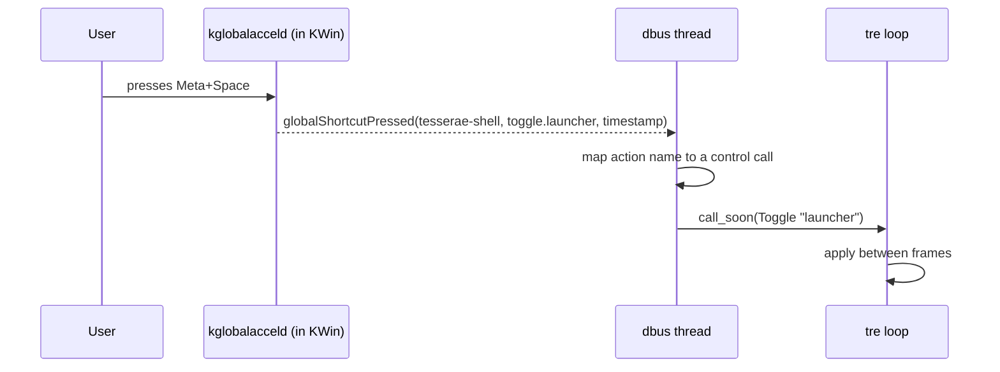

# Global Shortcuts

> [!NOTE]
> How the shell gets keys that work while no shell surface has focus: it registers one component, `tesserae-shell`, with KDE's global-accel service (`org.kde.KGlobalAccel`, held by `kwin_wayland` on the observed session) and turns each key press into a call on the control interface. The XDG GlobalShortcuts portal is the named fallback ([Portals](Portals.md)); the command line is the floor everywhere. [ADR-0005 Global Shortcuts](../../30%20Decisions/ADR-0005%20Global%20Shortcuts.md) (accepted) fixed the choice; this note fixes the names and the flow. The interface was read on 2026-11-02 (kglobalacceld 6.8.2); **no shortcut was registered**, because registering writes to the user's `kglobalshortcutsrc` and shows in System Settings, so the live test waits for the maintainer's permission ([Open Questions](#open-questions)).

## Purpose and Scope

- Specify the component and action names, the registration calls, the key press flow, the user's control over keys, re-registration, and the fallbacks.
- Not in this note: what an action does to a surface ([IPC and CLI > The Interface](../Runtime/IPC%20and%20CLI.md#the-interface), [Surfaces](../Surfaces/Surfaces.md)), and keys inside a focused surface (tre's input and focus, [Panel](../Surfaces/Panel.md)).

## Behaviour

### What the Service Offers (Read 2026-11-02)

`busctl --user introspect org.kde.kglobalaccel /kglobalaccel org.kde.KGlobalAccel` lists these methods; the argument meanings come from the client library's source ([KGlobalAccel `kglobalaccel.cpp`](https://invent.kde.org/frameworks/kglobalaccel/-/raw/master/src/kglobalaccel.cpp) and [`kglobalaccel_p.h`](https://invent.kde.org/frameworks/kglobalaccel/-/raw/master/src/kglobalaccel_p.h), read 2026-11-02).

| Method                                                               | Signature                  | Use                                                                                                                                                                                |
| -------------------------------------------------------------------- | -------------------------- | ---------------------------------------------------------------------------------------------------------------------------------------------------------------------------------- |
| `doRegister`                                                         | `as`                       | Declares an action: four strings, in order: component unique name, action unique name, component friendly name, action friendly name. The library rejects an action without a name |
| `getComponent`                                                       | `s` returns `o`            | The object path of a component, from its unique name                                                                                                                               |
| `setShortcut`                                                        | `asaiu` returns `ai`       | Sets the keys of an action. The last argument is flags: `SetPresent = 2`, `NoAutoloading = 4`, `IsDefault = 8` (from the library's header)                                         |
| `setShortcutKeys`                                                    | `asa(ai)u` returns `a(ai)` | Same, with a list of key sequences                                                                                                                                                 |
| `shortcut`, `shortcutKeys`, `defaultShortcut`, `defaultShortcutKeys` | `as`                       | Read the current and default keys                                                                                                                                                  |
| `isGlobalShortcutAvailable`, `globalShortcutAvailable`               | `is`, `(ai)s`              | Whether a key is free                                                                                                                                                              |
| `unRegister`, `unregister`, `setInactive`                            | `as`, `ss`                 | Remove an action or mark it not present                                                                                                                                            |
| `allComponents`, `allMainComponents`, `allActionsForComponent`       |                            | Listing                                                                                                                                                                            |
| `yourShortcutGotChanged`, `yourShortcutsChanged`                     | signals                    | The user changed a key in System Settings                                                                                                                                          |

A component is an object `/component/<name>` with the interface `org.kde.kglobalaccel.Component`. Read on `/component/mediacontrol`: properties `uniqueName` (`mediacontrol`) and `friendlyName` (`Media Controller`); methods `shortcutNames`, `allShortcutInfos`, `invokeShortcut`, `isActive`, `cleanUp`; signals `globalShortcutPressed(s component, s action, x timestamp)`, `globalShortcutReleased` and `globalShortcutRepeated`. The path replaces dots and other characters in the unique name with `_` (seen: `org_kde_dolphin_desktop`, `com_anthropic_Claude`); the shell asks `getComponent` and does not derive the path. The newer `pressed`, `repeated` and `released` signals that the client library (current `master`) prefers when present were not on this component's interface in 6.8.2, so the shell uses `globalShortcutPressed` ([library source](https://invent.kde.org/frameworks/kglobalaccel/-/raw/master/src/kglobalaccel.cpp)). The source read is `master`, the machine runs 6.8.2, so details may differ by version. #needs-verification

> [!WARNING]
> **Not tested from a non-KDE client**
> A non-Qt Python client calls these methods over D-Bus directly. Nothing in the library source says it must be a Qt process, but no one has done it here: the Wayland-session behaviour for a client that is not a KDE application is the open point recorded in [ADR-0005 Global Shortcuts > Context](../../30%20Decisions/ADR-0005%20Global%20Shortcuts.md#context). #needs-verification

### The `u` Flags in Plain Words

The signature of `setShortcut` is `asaiu` and of `setShortcutKeys` is `asa(ai)u`. The last letter, `u`, is a number: an unsigned 32-bit integer used as a set of on and off switches (flags). Each switch is one bit, and the number sent is the switches added together. The names and values are from KDE's `kglobalaccel_p.h` and `kglobalaccel.h` (read on 2026-11-10; enum `SetShortcutFlag` and `GlobalShortcutLoading`):

| Value | Name | What it does |
|---|---|---|
| 0 | Autoloading (no bit set) | KDE looks up the key the user saved earlier for this action and uses it; the key given is used only the first time |
| 2 | `SetPresent` | The call sets the action's active keys and marks the action as present (the application is running and owns it) |
| 4 | `NoAutoloading` | Do not restore a saved key: use exactly the keys given. The header's own words: "Prevent autoloading of saved global shortcut for action" |
| 8 | `IsDefault` | The keys in this call are the default keys, the ones "reset to default" returns to, not the active keys |

Switches add: 2 and 4 together is 6. No other bit is named in these headers, so 1 and every value above 15 are not used. What the shell sends: the active keys with 2, then the default keys with 8, and never 4, so a key the user changed in System Settings survives a restart ([Registration](#registration)). The meanings of `SetPresent` and `IsDefault` are read from the names and from how the client library's `updateGlobalShortcut` uses them; the header has a comment only for `NoAutoloading`. The live test ([Open Questions](#open-questions) item 1) confirms them on a real session. #needs-verification

### Component and Action Names

| Item | Value | Status |
|---|---|---|
| Component unique name | `tesserae-shell` | Proposed |
| Component friendly name | `Tesserae Shell` | Proposed |
| Action unique name | `<verb>.<target>`: `toggle.launcher`, `show.top_bar`, `call.Clock.cycle_format`; the target is a surface's unique `Name:` or `<Module>.<action>` ([IPC and CLI > The Interface](../Runtime/IPC%20and%20CLI.md#the-interface)) | Proposed |
| Action friendly name | A sentence: `Toggle launcher`; for a user-defined key the label is the surface's `Name:` | Proposed |
| Verbs | `show`, `hide`, `toggle` and `call`, the same as the control interface's methods | Proposed |

An action name is stable across restarts, so the user's changed key survives. A surface rename changes its action name; the old one is unregistered at the next start (see [Cleaning Up](#cleaning-up)).

### Where a Key Is Declared

A surface or a module declares a default key; the user changes it in System Settings. Proposed, since the key form is not decided in TDL:

| Place | Key | Registers |
|---|---|---|
| Bar | `Reveal_Key: Meta+B` ([Bar](../Surfaces/Bar.md) table; default none) | `show.<Bar name>` (a reveal key reveals; whether a second press hides is a [Bar](../Surfaces/Bar.md) question) |
| Panel | `Shortcut: Meta+Space` (proposed key, a Panel that opens from a key, [Panel](../Surfaces/Panel.md)) | `toggle.<Panel name>` |
| A module action | `Shortcut` on the action in the module's TDL (proposed) | `call.<Module>.<action>` |

The value is a key sequence in the KDE form (`Meta+Space`, `Ctrl+Alt+T`), a string in TDL. The shell converts it to the integer array that `setShortcut` takes (Qt key codes with modifier bits; the client library does this; for Python the shell writes its own small table for letters, digits, function keys and the named keys, proposed). A sequence the shell cannot parse is a TDL value error with `file:line:column` ([Validation and Errors > The error record](../Runtime/Validation%20and%20Errors.md#the-error-record)).

### Keyboard Access: Shortcuts in settings.tdl (Decided 2026-11-08, Names to Be Determined)

The maintainer decided (2026-11-08, answering [M3 Build Log](../../00%20Home/M3%20Build%20Log.md) D102) that the shell can be reached from the keyboard through listeners for shortcut keys that the user defines. The shell listens for them globally, because no shell surface has focus when the user wants it. KDE uses its global shortcuts (the service of this note); other compositors and desktop environments have their own mechanism, and the shell listens through whichever one exists. `settings.tdl` ([Settings File](../../41%20TDL%20Reference/Settings%20File.md)) is where the user defines them, in plain language, in a `Shortcuts` block. His example, as given:

```tdl
Shortcuts {
  [
    Focus_Shell: "ctrl+shift+F1",
    Cycle_Surface: "alt+tab"
  ]
}
```

> [!NOTE]
> **Still to be determined (maintainer: "The exact key:values are still to be determined")**
> The action names and what each one does. Recorded as given, with these notes:
> - His example spelled the first name `Forcus_Shell`; he confirmed on 2026-11-08 that this was a typo. It is `Focus_Shell`.
> - **The bracket form is not valid TDL.** `tess_dl`'s language reference (`tess-dl/docs/language.md`, read 2026-11-08) says a list holds values, never blocks: "A group of `Key: value` pairs is a block, never a list" (section Lists). Entries in a block are properties or blocks separated by a newline or a `,`, so a `[` with no key where an entry belongs is `tdl-unexpected-text` (sections Blocks and properties, Errors). The same content in valid TDL is `Shortcuts { Focus_Shell: "ctrl+shift+F1", Cycle_Surface: "alt+tab" }`, one `Name: "keys"` property per action, on separate lines or comma-separated. The brackets are dropped; nothing else of his example changes.
> - His example writes keys as `ctrl+shift+F1`; the sections above use the KDE form `Meta+Space`. The shell accepts any case (decided 2026-11-08, below).

His two names were examples, not definitions: the action names are to be determined (maintainer, 2026-11-08). What follows only shows the kind of action keyboard access needs, and fixes no name:

| Kind of action | Serves |
|---|---|
| Give keyboard focus to a shell surface, such as the Frame's painter, without the mouse | The keyboard way into the Frame ([Frame > Open Questions](../Surfaces/Frame.md#open-questions), D102) |
| Move keyboard focus from one shell surface to the next | Reaching a Panel, a strip or a Bar from the keyboard |

Focus alone is not enough: Tab and Enter need a block that can take focus (D53), so focusable blocks stay a separate piece of the keyboard design.

**Action names given on 2026-11-10.** The maintainer's design for shortcut modes names four actions: `Enter_Shortcut_Mode`, `Exit_Shortcut_Mode`, `Set_Shortcut_Mode`, `Next_Focus` and `Previous_Focus`, with the keys `Shortcut_Mode` and `Tab_Index` on surfaces and blocks. They are specified in [Focus and Keyboard](Focus%20and%20Keyboard.md). The two example names of 2026-11-08 (`Focus_Shell`, `Cycle_Surface`) were examples and are not used.

Where it is built: the shortcuts and the keyboard-only access are milestone M6 ([M6 Brief](../../00%20Home/M6%20Brief.md)), parts M6c and M6d; the registration uses the D-Bus layer built in M5a ([M5 Brief](../../00%20Home/M5%20Brief.md)).

Relation to the keys declared on surfaces (`Reveal_Key`, `Shortcut`, above): those are defaults a surface or module ships; the `Shortcuts` block is the user's own list.

**Decided (maintainer, 2026-11-08)**

- The block form is `Shortcuts { Name: "keys" }`, as the grammar above allows. Key strings are accepted in any case. The action names and what each does are still to be determined.
- **The desktop wins.** A global shortcut of the desktop environment or compositor takes precedence over a shell shortcut. The shell never steals a key ([Registration](#registration)). A user who wants shell shortcuts makes sure they do not conflict.
- **Conflict warnings, where the shell can detect them.** One warning, not an error, and the shell still starts, for:
  1. a shell key that conflicts with a shortcut already set in the desktop or compositor;
  2. two shell shortcuts that share a key at the same level, whether both are in `Shortcuts` or one is a default that a surface or module declares. **Neither works:** both are left without the key, so there is no winner and no race (maintainer, 2026-11-08: "I do not want even a hint of a race condition").

**Levels and modes (maintainer, 2026-11-08; a future direction, not designed).** "The same level" matters because he expects modes later: a focused Panel or dock is a mode, and keys such as the up and down arrows work only in that selected Panel. A key can then mean different things at different levels without a conflict, and a conflict exists only between two actions at one level. For now there is one level, the global one. How a mode is entered, left and declared is open question 11.

How the warnings are found (my design; the maintainer asked for them "if we can"):

| Conflict | Where it is found | Warning |
|---|---|---|
| With the desktop | At registration: on KDE the shell asks `isGlobalShortcutAvailable` before it requests a key; the keys `setShortcutKeys` returns say nothing about a clash ([Registration](#registration)). `isGlobalShortcutAvailable` can ask first. Other compositors: only if their mechanism says so; where it cannot be detected there is no warning | Names the action and the key. Whether the service names the other component was not read. #needs-verification |
| Within the shell | When `settings.tdl` and the shell files load, before any registration | Names both actions, with `file:line:column` for each ([Validation and Errors > The error record](../Runtime/Validation%20and%20Errors.md#the-error-record)); neither is registered with the key |

### Registration

At start, after the shell's own bus name is owned and before the surfaces are shown ([Shell Start and Stop > Start Sequence](../Runtime/Shell%20Start%20and%20Stop.md#start-sequence); the exact step is for that note to add):

1. Check that `org.kde.kglobalaccel` has an owner. If not: no shortcuts, one warning, go to [Fallbacks](#fallbacks).
2. For each declared key, call `doRegister` with the four strings.
3. Set the keys in two calls, as the client library does (`updateGlobalShortcut` in its source): `setShortcutKeys` with the active keys and the flag `SetPresent` (2), then `setShortcutKeys` with the default keys and the flag `IsDefault` (8). The flags are OR-ed and `NoAutoloading` (4) stays clear, so the service restores a key the user changed earlier and the default stays the default. A single call with only `IsDefault` would set the default and never mark the action present. The effect on a non-KDE client is untested. #needs-verification
4. Call `getComponent("tesserae-shell")` and subscribe to `globalShortcutPressed` on the returned path ([D-Bus Service Layer > Listening and Name Owners](D-Bus%20Service%20Layer.md#listening-and-name-owners)). The order (set the keys, then `getComponent`, then subscribe) copies the client library.
5. Subscribe to `yourShortcutsChanged` on `/kglobalaccel` and keep the signals whose component is `tesserae-shell`, so a key the user changes in System Settings is known to the shell.
6. If the service owner changes (kwin restart, `kglobalacceld` restart), repeat from step 1; the client library does the same (`reRegisterAll` on an owner change).

A key that is taken by another component: the shell asks `isGlobalShortcutAvailable(key, "tesserae-shell")` before it requests the key and never requests one that is not free. It registers the action without that key, logs one warning naming the action and the key, and the user can pick another key in System Settings. The shell never steals a key.

> [!CAUTION]
> **Corrected on 2026-11-15: an empty reply does not mean "taken"**
> This section used to say that an empty reply from `setShortcutKeys` means the desktop owns the key. The maintainer's KWin hand check of the same day (reported by the code session, not run in the vault) showed otherwise: with a fresh component the real `kglobalacceld` accepts a key that another component owns. The shell asked for `Ctrl+Alt+Delete`, which `ksmserver` owns (Log Out); `setShortcutKeys` replied with that key set, and `isGlobalShortcutAvailable` said false for it. So the reply cannot be used to detect a taken key, and a key the shell requested this way would have been given to two components with no warning. The only test is `isGlobalShortcutAvailable`, asked first.

### A Key Press



- The handler maps the action name to the same internal command as the `Toggle`, `Show`, `Hide` and `Call` methods and does not go through the bus a second time ([IPC and CLI > Threading](../Runtime/IPC%20and%20CLI.md#threading)).
- A press that arrives while the shell is starting or stopping is dropped with a debug log.
- Key release and repeat are ignored in v1. A key held down toggles once.
- The press is never a user action for a Popup grab, so a key opens a Panel and never a Popup ([Popup > Focus and dismissal (decided)](../Surfaces/Popup.md#focus-and-dismissal-decided)).
- Keyboard focus after a key opens a Panel is the Panel's setting (`keyboard="exclusive"` for the launcher, [V1 Scope](../../10%20Vision/V1%20Scope.md)).

### What the User Sees and Controls

The component appears in System Settings, Shortcuts, as `Tesserae Shell`, with one row per registered action. The user can change, clear or add keys there. The shell reads the change through `yourShortcutsChanged` and does not write keys itself after registration. Whether KDE shows the component for a client that is not a desktop-file application is untested. #needs-verification

### Cleaning Up

- A normal stop calls `setInactive` for each of the shell's actions (part of the stop sequence, [Shell Start and Stop > Stop Sequence](../Runtime/Shell%20Start%20and%20Stop.md#stop-sequence)). The component and the user's keys stay, so they are kept for the next start, but no action is present, so the service does not swallow a key that no one listens for. The client library does the same when its action goes away. #needs-verification for a non-KDE client
- At start, an action that is registered under `tesserae-shell` but no longer declared (a deleted or renamed surface) is removed with `unregister`. The list comes from `shortcutNames` on the component. The shell removes only actions of its own component.
- `tesserae-shell shortcuts clean` removes the whole component (proposed command, [IPC and CLI > The Command Line](../Runtime/IPC%20and%20CLI.md#the-command-line)).

### Fallbacks

| Case | What works |
|---|---|
| No `org.kde.kglobalaccel` on the bus (not KDE) | No global keys. The commands still work: `tesserae-shell toggle launcher`, bound by the user in the compositor ([ADR-0005 Global Shortcuts > Consequences](../../30%20Decisions/ADR-0005%20Global%20Shortcuts.md#consequences), [IPC and CLI](../Runtime/IPC%20and%20CLI.md)). The shell may offer the portal path ([Portals > Global Shortcuts Portal](Portals.md#global-shortcuts-portal)) |
| KDE, but registration is refused | Same as above; the log names the error |
| The user prefers KDE's own custom shortcuts | A KDE custom shortcut that runs `tesserae-shell toggle launcher` works with no registration. The command starts in about 21 ms with `jeepney` ([IPC and CLI > The Command Line](../Runtime/IPC%20and%20CLI.md#the-command-line)) |
| An on-screen or touch user | No shortcut; the Bar's own controls |

## Configuration

`Reveal_Key` on a Bar and `Shortcut` on a Panel and on a module action are the only keys in v1 (all proposed except `Reveal_Key`, [Bar](../Surfaces/Bar.md)). Decided 2026-11-13 (orchestrator): there is no `Enabled` key inside `Shortcuts`, because every `Name: "keys"` entry there is an action and `Enabled` would read as one. Global registration is turned off with `Settings { Global_Shortcuts: false }` (default `true`), beside the `Shortcuts` block, in `settings.tdl` ([Settings File](../../41%20TDL%20Reference/Settings%20File.md)).

## Python Contract

A module declares a shortcut on its action in its TDL, not in Python, so the shell can register it before the module starts. The action is an `@action` method ([Module Contract](../../42%20Python%20API/Module%20Contract.md)). A module does not call `KGlobalAccel` itself.

## Integration

- D-Bus: `org.kde.kglobalaccel` on the session bus, through the shared service thread ([D-Bus Service Layer](D-Bus%20Service%20Layer.md)). The incoming signal runs on that thread and is handed to the loop with `call_soon`.
- Plasma: the component is the shell's own; no Plasma component is changed ([Plasma Coexistence](Plasma%20Coexistence.md)).
- Config file touched by the service, not by the shell: `~/.config/kglobalshortcutsrc` (exists on the observed machine; not read).

## Design

None. The keys are shown in the Bar's and Panel's tooltips and in the launcher's placeholder text where a key is set (wording in [V1 Widgets](../../50%20Design%20System/V1%20Widgets.md) when the modules are written).

## Accessibility

- A shortcut is the keyboard way to reach a hidden Bar and the launcher ([Bar > Auto-hide (decided 2026-10-27)](../Surfaces/Bar.md#auto-hide-decided-2026-10-27)). With no key set, a keyboard-only user has no way to reveal an auto-hidden Bar; the open question in [Bar](../Surfaces/Bar.md) stands. Recommendation: on first start, if the Bar auto-hides and has no `Reveal_Key`, the shell logs one hint and shows a one-time Panel notice.
- The shell does not claim keys that assistive technology uses (Orca's, the compositor's screen-reader keys); a conflict is found by `isGlobalShortcutAvailable`: the key is not requested and one warning is logged.

## Performance Budget

- Registration: one `doRegister` and one `setShortcut` per action, once per start; target under 50 ms for 10 actions (measured in testing).
- A key press to the surface changing state: under one frame after the signal reaches the service thread; the D-Bus hop is the cost, measured in testing.
- Idle: no timer.

## Failure Modes and Recovery

| Failure | Result |
|---|---|
| Service missing | No global keys; one warning; commands still work |
| The shell stops | Actions set inactive; component and keys kept |
| Key taken by the desktop or compositor | Found by `isGlobalShortcutAvailable` before the request; the key is not requested; action registered without it; one warning naming the action and the key; the desktop's shortcut keeps the key; the user picks another key |
| Two shell actions share one key at the same level | One warning naming both with `file:line:column`; the shell starts; neither action gets the key (decided 2026-11-08) |
| `doRegister` or `setShortcut` raises | That action is skipped; the rest register |
| The service restarts | The shell re-registers on the owner change |
| The signal arrives for an unknown action | Dropped, logged once at debug |
| The user binds a key and the surface is gone | The action does nothing and the log names the missing surface |

## The Service's Interface as Read (2026-11-13)

Read by the vault session with a read-only `busctl introspect` of `org.kde.kglobalaccel` on the maintainer's session (no call made), to check what the code session's fake service assumes:

| Member | Signature |
|---|---|
| `doRegister` | in `as` |
| `setShortcutKeys` | in `as`, `a(ai)`, `u`; out `a(ai)` |
| `setShortcut` (older form) | in `as`, `ai`, `u`; out `ai` |
| `shortcutKeys` | in `as`; out `a(ai)` |
| `isGlobalShortcutAvailable` | in `i`, `s`; out `b` |
| `globalShortcutAvailable` | in `(ai)`, `s`; out `b` |
| `setInactive`, `unRegister` | in `as` |
| `unregister` | in `s`, `s`; out `b` |
| `getComponent` | in `s`; out `o` |
| signal `yourShortcutsChanged` | `as`, `a(ai)` |
| signal `yourShortcutGotChanged` (older form) | `as`, `ai` |
| On a component (`/component/<name>`): `allShortcutInfos` | out `a(ssssssaiai)`, with or without one `s` argument |
| On a component: signals `globalShortcutPressed`, `globalShortcutReleased`, `globalShortcutRepeated` | `s`, `s`, `x` |
| On a component: `shortcutNames`, `isActive`, `cleanUp`, `invokeShortcut`; properties `friendlyName`, `uniqueName` | as named |

## As Built in M6c (code session's report, 2026-11-13, not run in the vault)

Merged as `974596d` (task T-047): the key parser, the `Shortcuts` block with the forms below, a Panel's `Shortcut` and a Bar's `Reveal_Key`, `Settings { Global_Shortcuts }`, the service client on the `dbus` thread (flags 2 then 8, never 4), the conflict warning, changes applied at reload, the key-name list in the schema export. Full suite 4600 passed. Everything was tested against a fake service on a private bus; nothing touched the real service. Press callback p50 2.2 microseconds; idle 0 wake-ups. Not built: what the five fixed actions do (M6a and M6d fill that in), the portal fallback, a clean-up command, the listing in `status`.

Decided by the orchestrator on 2026-11-13 ([Orchestration Log](../../00%20Home/Orchestration%20Log.md) D-052): before warning that a key is taken, the shell asks `isGlobalShortcutAvailable`, so a key the user cleared in System Settings is not reported as taken at every start; a key changed in `settings.tdl` replaces the user's saved key for that action at reload; a `Call` shortcut whose module no surface uses loads that module, so a media key can act without the module on a Bar; a Frame has no `Shortcut` key and uses a `Toggle_<Name>` entry (changed on 2026-11-15: the maintainer answered that a Frame takes a `Shortcut` key, built in `tess-shell` PR #10, schema 1.5, by the code session's report); the extra media key names read from Qt's header stay.

## KWin Hand Check of M6c (maintainer, 2026-11-15; code session's report, not run in the vault)

The maintainer ran the kit `/tmp/tess-kwin-m6c` on his session. Lines 1 to 10, 12 and 14 passed. Line 13 was not run, because `kglobalacceld` is not a systemd unit on his session.

| Finding | Effect on this note |
|---|---|
| Line 3: the component shows as "Tesserae Shell" in System Settings with both rows and their keys | Answers question 3 under Questions After Testing: a component without a desktop file does appear with its friendly name |
| Line 9: a key the user cleared in System Settings gives no warning on real KDE | The `isGlobalShortcutAvailable` check before the warning (D-052) works as decided |
| Line 11: the real service accepts a key another component owns | The correction in [Registration](#registration): ask `isGlobalShortcutAvailable` first, never request a key that is not free. Built: `tess-shell` PR #18, merged with CI green by the code session's report (2026-11-15). It also reports that a key the user saved in an earlier run wins over the key in the file, and the shell logs that at INFO; this is what the registration flags in step 3 already imply (`NoAutoloading` stays clear) |

## Action Names and Forms (Decided 2026-11-13)

Decided by the orchestrator ([Tesserae Shell Directive](../../00%20Home/Tesserae%20Shell%20Directive.md) rule 7, Tier 1; [Orchestration Log](../../00%20Home/Orchestration%20Log.md) D-047). The maintainer's requirement of 2026-11-10 stands: shortcuts are data in `settings.tdl`, read again at every reload, with no key hard-coded, so each choice below can be changed later without touching a user's other settings. This settles questions 4 and 7 without the live test, which no session may run on the maintainer's real shortcut settings ([Orchestration Log](../../00%20Home/Orchestration%20Log.md) D-019); the live registration is a hand check.

| Form in `Shortcuts { }` | Meaning |
|---|---|
| `Enter_Shortcut_Mode`, `Exit_Shortcut_Mode`, `Set_Shortcut_Mode`, `Next_Focus`, `Previous_Focus`: `"keys"` | The five fixed actions of [Focus and Keyboard](Focus%20and%20Keyboard.md) |
| `Toggle_<Name>`, `Show_<Name>`, `Hide_<Name>`: `"keys"` | The verb is the text before the first underscore; `<Name>` is the `Name` of a Panel, Bar or Frame, written exactly. `Toggle_Launcher: "Meta+Space"` toggles the Panel named `Launcher`. A name that matches no surface is a load warning naming the nearest; the shortcut is not registered |
| `<Any_Name> { Keys: "keys", Action: ..., ... }` | A block entry is a handler in the form of [Events and Actions > A Handler](../../42%20Python%20API/Events%20and%20Actions.md#a-handler), with `Keys` beside it: `Volume_Up { Keys: "AudioRaiseVolume", Action: Call, Target: "Audio.step", delta: 5 }`. Its name is the user's and is what the desktop's shortcut settings show |

- A Panel's own `Shortcut: "keys"` key is the same as a `Toggle_<Name>` entry for it, and a Bar's `Reveal_Key` the same as `Show_<Name>`; when both the key and a `Shortcuts` entry exist, the `Shortcuts` entry wins with one warning.
- The value is a string in the form of [Key Names (Decided 2026-11-13)](#key-names-decided-2026-11-13).
- The action id the desktop sees is the entry's name; its friendly text is the name with underscores as spaces.

## Key Names (Decided 2026-11-13)

Decided by the orchestrator ([Tesserae Shell Directive](../../00%20Home/Tesserae%20Shell%20Directive.md) rule 7; the shell and the configuration application must write and read the same text, [Orchestration Log](../../00%20Home/Orchestration%20Log.md) D-037). The shell's parser for shortcut values is built in M6c; the configuration application's key recorder already writes this form.

- A value is modifiers and one key joined by `+`. The written order is `Ctrl`, `Alt`, `Shift`, `Meta`, then the key: `Ctrl+Shift+F1`. The shell reads any order and any case (decided 2026-11-08).
- Key names are full words in title case: `Enter`, `Escape`, `Tab`, `Space`, `Backspace`, `Delete`, `Insert`, `Home`, `End`, `PageUp`, `PageDown`, `Left`, `Right`, `Up`, `Down`, `F1` to `F24`, and `Plus` for the plus key (because `+` is the separator). A letter is written upper case, a digit as it is.
- Media and hardware keys use the X key names without the `XF86` prefix, written as they are there: `AudioRaiseVolume`, `AudioLowerVolume`, `AudioMute`, `AudioMicMute`, `AudioPlay`, `AudioPause`, `AudioStop`, `AudioNext`, `AudioPrev`, `MonBrightnessUp`, `MonBrightnessDown`, and any other such name the desktop's shortcut service accepts. The form with the prefix (`XF86AudioRaiseVolume`) is read as an alias and never written (orchestrator, 2026-11-13).
- The shell also reads the short names KDE and Qt write, as aliases: `Return` for `Enter`, `Esc`, `Del`, `Ins`, `PgUp`, `PgDown`. It never writes them.
- The list of key names is exported in the shell's schema with the `key_chord` kind when the parser is built, so the application reads it instead of keeping its own table.
- A name the shell does not know is a value error with `file:line:column`, naming the nearest known name.

## Open Questions

1. [x] Test permission: the live test with a throwaway component, after a copy of `kglobalshortcutsrc` to `/tmp`, in the testing phase and not before (maintainer, 2026-11-10, as recommended).
2. [x] The `u` flags: the maintainer found nothing in the note that said plainly what they are. Written plainly in [The `u` Flags in Plain Words](#the-u-flags-in-plain-words) (2026-11-10).
5. [x] A held key does not repeat the toggle (maintainer, 2026-11-10, as recommended).
6. [x] The portal path is not built in v1; commands only (maintainer, 2026-11-10, as recommended; [Portals](Portals.md)).
7. [x] The action names: `Enter_Shortcut_Mode`, `Exit_Shortcut_Mode`, `Set_Shortcut_Mode`, `Next_Focus` and `Previous_Focus` are given ([Focus and Keyboard](Focus%20and%20Keyboard.md)). The form is `Shortcuts { Name: "keys" }` (2026-11-08). The names of the other actions are now a question under Questions After Testing (item 7 of 2026-11-10 asked for them to follow the test).
8. [x] Key strings: any case is accepted, `ctrl+shift+F1` and `Ctrl+Shift+F1` alike, and converted to the backend's form. A string the shell cannot parse is a value error with `file:line:column` (maintainer, 2026-11-08, as recommended).
9. [x] Precedence: the desktop's or compositor's global shortcut wins over the shell's; the shell warns about conflicts with the desktop and within the shell; a change in System Settings on KDE wins as before. On a compositor with no global mechanism the shell cannot listen globally, and says so once at start (maintainer, 2026-11-08; this replaces my recommendation that the user's `Shortcuts` win over a surface default).
10. [x] Two shell actions that share a key at the same level: neither works, with one warning naming both (maintainer, 2026-11-08; this replaces my recommendation that the first in load order keeps it).
11. [x] Modes: decided by the maintainer on 2026-11-10 as `Shortcut_Mode: true | false` on a surface, with `Enter_Shortcut_Mode`, `Exit_Shortcut_Mode`, `Next_Focus`, `Previous_Focus` and `Tab_Index`; written in [Focus and Keyboard](Focus%20and%20Keyboard.md). Open there: how mode keys are delivered (recommendation: the mode's surface takes keyboard focus, not more global shortcuts) and the name of the action that sets the mode on a focused Panel.

### Shortcuts Stay Changeable

The maintainer asked (2026-11-10, items 4 and 7) that shortcuts be as dynamic as possible, and where not, easy to change or tweak after testing. So: no key and no action binding is hard-coded; every key comes from `settings.tdl` `Shortcuts` or from a surface's own declared key; the `Shortcuts` block is read again at hot reload and the registrations are updated (a changed key is re-registered, a removed one is unregistered, with no restart); and the `Shortcut_Mode` of a surface can be changed at run time ([Focus and Keyboard](Focus%20and%20Keyboard.md)). The live test and the first weeks of use decide the final keys and where each key is declared.

## Questions After Testing

Numbers 3, 4 and 7 keep the numbers they had in Open Questions, because other notes refer to them.

3. [x] Does a component without a desktop file appear in System Settings with its friendly name? Answered on 2026-11-15 by the maintainer's hand check: yes, it shows as "Tesserae Shell" with both rows and their keys ([KWin Hand Check of M6c (maintainer, 2026-11-15; code session's report, not run in the vault)](#kwin-hand-check-of-m6c-maintainer-2026-11-15-code-sessions-report-not-run-in-the-vault)). Original text: Context: the maintainer answered "No" on 2026-11-10, but the vault cannot tell whether that means "it does not appear" or "not needed", and the question is a fact about KDE. Recommendation: treat it as unanswered and settle it by the live test; if the component shows only by its id, ship a desktop file for the friendly name ([Portals](Portals.md)). Answered by: the live test with a throwaway component (Open Questions item 1). #needs-verification
4. [x] Which TDL key sets the shortcut of a Panel or a module action (`Shortcut`), and what is its value type? Context: `Reveal_Key` is decided in name only ([Bar](../Surfaces/Bar.md)); the maintainer (2026-11-10) wants this tested before a decision, with shortcuts as dynamic as possible and easy to change afterwards ([Shortcuts Stay Changeable](#shortcuts-stay-changeable)). Recommendation: `Shortcut: "keys"` on the Panel or module, a string in the same form and parsing rules as the `Shortcuts` block (item 8), with `Reveal_Key` as the Bar's name for the same thing. Answered by: the live test, registering a shortcut from a surface key and from `Shortcuts`. Decided by the orchestrator on 2026-11-13 without the live test: `Shortcut: "keys"` on a Panel, equal to a `Toggle_<Name>` entry ([Action Names and Forms (Decided 2026-11-13)](#action-names-and-forms-decided-2026-11-13)).
7. [x] What are the names of the shell actions other than `Enter_Shortcut_Mode`, `Exit_Shortcut_Mode`, `Set_Shortcut_Mode`, `Next_Focus` and `Previous_Focus`? Context: the maintainer (2026-11-10) left the rest of the list for testing, with the same requirement as question 4: dynamic, and easy to change after tests; the form is `Shortcuts { Name: "keys" }`. Recommendation: one action per surface verb (toggle, show, hide) named in `Verb_Surface` style like the four given names, fixed after the live test shows which actions are used. Answered by: the live test and the first weeks of use. Decided by the orchestrator on 2026-11-13: `Toggle_<Name>`, `Show_<Name>`, `Hide_<Name>` and block entries that carry a handler ([Action Names and Forms (Decided 2026-11-13)](#action-names-and-forms-decided-2026-11-13)).

## Acceptance Criteria

- [ ] With the service present, the component `tesserae-shell` exists after start and lists every declared action.
- [ ] A key press reaches the shell as one `globalShortcutPressed` and changes the target surface within one frame of the call arriving on the loop.
- [ ] A key the user changes in System Settings is used at the next press without restarting the shell.
- [ ] A taken key leaves the action registered with no key and logs one warning.
- [ ] After a restart of the shortcut service, the shell re-registers and the keys work again.
- [ ] A deleted surface's action is removed at the next start; other components are untouched.
- [ ] With no service on the bus, the shell starts, logs one warning, and `tesserae-shell toggle <name>` still works.
- [ ] No key press opens a Popup.
- [ ] A key in `settings.tdl` `Shortcuts` is registered at start and works with no shell surface focused; an unparsable key sets a value error with `file:line:column`.
- [ ] A `Shortcuts` key that the desktop or compositor already uses is not registered over it, and one warning names the action and the key.
- [ ] Two shell shortcuts with the same key at the same level give one warning naming both with `file:line:column`, the shell still starts, and neither action receives the key.
- [ ] A change to `Shortcuts` in `settings.tdl` is applied at hot reload: a new key is registered, a changed key is replaced, a removed key is unregistered, with no restart.
- [ ] Keys written in any case (`ctrl+shift+F1`, `Ctrl+Shift+f1`) register the same key.

## Links

- [Integration](Integration.md) · [ADR-0005 Global Shortcuts](../../30%20Decisions/ADR-0005%20Global%20Shortcuts.md) · [D-Bus Service Layer](D-Bus%20Service%20Layer.md) · [Plasma Coexistence](Plasma%20Coexistence.md) · [Portals](Portals.md) · [IPC and CLI](../Runtime/IPC%20and%20CLI.md) · [Bar](../Surfaces/Bar.md) · [Panel](../Surfaces/Panel.md)
