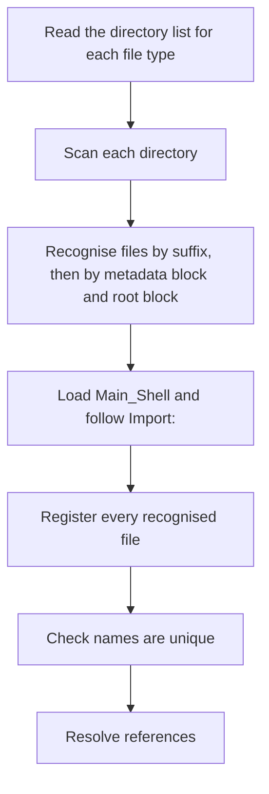

# Config Discovery and Registry

> [!NOTE]
> How the shell finds its files, decides which are loaded, gives each a stable identity, and keeps that identity in `registry.json`. Decided already: the config directory layout, the search order and fallback, `settings.tdl` before the registry (the name `settings.tdl` is confirmed, with the root block `Settings`, D20, [ADR-0014 Shell File Language > Decisions on the Open Items (2026-10-30)](../../30%20Decisions/ADR-0014%20Shell%20File%20Language.md#decisions-on-the-open-items-2026-10-30)), UIDs made with `uuid.uuid7()`, the registry as a JSON file, the UID written into the file's metadata block, reference errors at load, and rebuilding the registry from file UIDs ([ADR-0007 Shell UI Layer > Config directory and registry (2026-10-25)](../../30%20Decisions/ADR-0007%20Shell%20UI%20Layer.md#config-directory-and-registry-2026-10-25), [Settings File](../../41%20TDL%20Reference/Settings%20File.md)). This note adds the rules that make those work, as proposals with recommendations.

## Purpose and Scope

- Define discovery, file recognition, name uniqueness, the registry file and its operations, the UID write, and reference resolution.
- Not in this note: what a shell, module, style, theme or stylesheet file contains (the TDL reference, folder [41 TDL Reference](../../41%20TDL%20Reference/41%20TDL%20Reference.md)), how errors are reported ([Validation and Errors](Validation%20and%20Errors.md)), watching for changes ([Hot Reload](Hot%20Reload.md)), and the order of start-up ([Shell Start and Stop](Shell%20Start%20and%20Stop.md)).

## Behaviour

### Where Files Are

The folders and `settings.tdl` are in [Settings File > The config directory](../../41%20TDL%20Reference/Settings%20File.md#the-config-directory): `Shells/`, `Modules/<module_name>/`, `Styles/`, `Themes/`, `Stylesheets/` and `schemas/` under the config directory. A configured directory in `settings.tdl` is searched first and the default folder is the fallback ([Settings File](../../41%20TDL%20Reference/Settings%20File.md), decided 2026-10-27). Shipped modules come from the package and are registry-only; a user module of the same name overrides one ([ADR-0007 Shell UI Layer > Modules, styles, themes and stylesheets live in the config directory (2026-10-27)](../../30%20Decisions/ADR-0007%20Shell%20UI%20Layer.md#modules-styles-themes-and-stylesheets-live-in-the-config-directory-2026-10-27)).

### Discovery



- **What is scanned.** Each directory is scanned recursively for files that end in a shell suffix (`_Shell.tdl`, `_Module.tdl`, `_Style.tdl`, `_Theme.tdl`, `_Stylesheet.tdl`). Dot files, `schemas/`, `logs/` and editor temporary files (names starting with a dot or ending in `~`, `.swp`, `.tmp` or `.bak`) are skipped. Recursive, not one level, so a user can sort Styles into folders; a module is still one folder `Modules/<module_name>/` (AGENTS > 9. Naming in the designed system). Decided 2026-10-28.
- **What is a shell file.** A file is recognised by its suffix, by its metadata block (which holds `TDL:` and `Name:`) and by its one root block (`Shell`, `Module`, `Style`, `Stylesheet` or `Theme`). The root block is authoritative over the suffix ([TDL Language > The Metadata Block](../../41%20TDL%20Reference/TDL%20Language.md#the-metadata-block), [ADR-0014 Shell File Language > Layout Rules](../../30%20Decisions/ADR-0014%20Shell%20File%20Language.md#layout-rules), [ADR-0007 Shell UI Layer > Recognising a shell file and importing (2026-10-25)](../../30%20Decisions/ADR-0007%20Shell%20UI%20Layer.md#recognising-a-shell-file-and-importing-2026-10-25), [Common Keys and Conventions > Keys every file has](../../41%20TDL%20Reference/Common%20Keys%20and%20Conventions.md#keys-every-file-has)). A file with a shell suffix and no metadata block, no `TDL:`, no `Name:`, or not exactly one root block is refused with an error naming it ([TDL Language > Errors](../../41%20TDL%20Reference/TDL%20Language.md#errors) lists the proposed codes). A root block that disagrees with the suffix is a load error that names both. A file with another name is ignored, and a note is logged at info level.
- **What is loaded.** The top-level shell file is `Main_Shell` from `settings.tdl` (default `Main_Shell.tdl`) in the shells directory, and every file reachable through `Import:` from it ([Shell File](../../41%20TDL%20Reference/Shell%20File.md)). An imported `_Shell.tdl` holds surface blocks only, sits under a `Monitor`'s `Children` and takes that `Monitor`'s monitor (D22). A `_Shell.tdl` in `Shells/` that nothing imports is not loaded and is logged at info level (decided 2026-10-28). Modules, styles, themes and stylesheets are all registered, whether used or not, so that a name used as a key resolves.
- **Imports** are paths relative to the importing file and nest ([Common Keys and Conventions > Structure keys](../../41%20TDL%20Reference/Common%20Keys%20and%20Conventions.md#structure-keys)). A cycle is an error naming the chain; a missing file is an error with the paths tried.
- **Parsing** uses the shell's own TDL parser ([ADR-0014 Shell File Language](../../30%20Decisions/ADR-0014%20Shell%20File%20Language.md)). The same module or block name may appear many times in one `Children { }`, ordered by position, and each is named from its position (`Clock_1`, `Clock_2`), so a repeated name is not an error ([TDL Language > Names and the Registry](../../41%20TDL%20Reference/TDL%20Language.md#names-and-the-registry)). A property key repeated inside one block (two `Text:` lines) is an error naming both places (D9, [ADR-0014 Shell File Language > Decisions on the Open Items (2026-10-30)](../../30%20Decisions/ADR-0014%20Shell%20File%20Language.md#decisions-on-the-open-items-2026-10-30)). The loader reads the metadata block first, then the root block, which picks the schema; the parsed tree is an ordered list of entries (head, properties, children) that keeps repeated names (D12). Parse errors carry `file:line:column` from the parser ([Validation and Errors > Parsing](Validation%20and%20Errors.md#parsing)). (Earlier, with YAML, a loader had to reject duplicate keys because PyYAML keeps the last of two equal keys silently; a test on 2026-10-28 loaded two `Clock:` entries and got one.)

### Names

- A `Name:` is required in every file and is unique across the shell ([Common Keys and Conventions > Keys every file has](../../41%20TDL%20Reference/Common%20Keys%20and%20Conventions.md#keys-every-file-has), decided 2026-10-26; required by D39). It uses letters, digits and `_` only. The file's `Name:` is the root of a dotted path, so an element is reached as `RootShell.DP1.Top_Bar` ([TDL Language > The Metadata Block](../../41%20TDL%20Reference/TDL%20Language.md#the-metadata-block)). A repeated use of one definition gets a path name per use (proposed).
- There is one registry of names for built-in blocks, surface types (Bar, Frame, Panel, Popup) and modules ([TDL Language > Names and the Registry](../../41%20TDL%20Reference/TDL%20Language.md#names-and-the-registry), [ADR-0014 Shell File Language > Layout Rules](../../30%20Decisions/ADR-0014%20Shell%20File%20Language.md#layout-rules)). A name registered twice is a load error naming both files, except that a user module overrides a shipped module of the same name. The same name in a configured directory and in the default folder uses the configured one, with an info notice ([Settings File](../../41%20TDL%20Reference/Settings%20File.md)).
- A module is called by its metadata `Name:` as the block head: `Clock { }` ([Module File > Using a module](../../41%20TDL%20Reference/Module%20File.md#using-a-module)). The name is looked up in the registry; an unknown head that is neither a block, a surface type nor a registered module is an error with the nearest names ([Validation and Errors > Semantic checks](Validation%20and%20Errors.md#semantic-checks)).

### Identity and UIDs

- A UID is a `uuid.uuid7()` ([ADR-0007 Shell UI Layer > UIDs and the registry (2026-10-25)](../../30%20Decisions/ADR-0007%20Shell%20UI%20Layer.md#uids-and-the-registry-2026-10-25)). A file carries its own UID in the file, as `UID:` in the file's metadata block, directly after the last version field; it travels with the file when the file is moved or renamed.
- Named entries inside a file (a surface, a module use, a popup) get registry-only UIDs, keyed by the file's UID and the entry's name path. The files themselves are not edited for these. Python keys each use of a module as `Clock@<uid>` (module name, then the use's UID; [TDL Language > Names and the Registry](../../41%20TDL%20Reference/TDL%20Language.md#names-and-the-registry)). Decided 2026-10-28; the earlier text says anything with a unique name gets a UID and the file holds its own.
- Shipped modules have stable, registry-only UIDs (decided 2026-10-26).
- **Identity** compares the entry's values other than the UID, with `name` and `location`. If they agree, the entry is the same; a mismatch means a new entry and the old one is treated as removed ([ADR-0007 Shell UI Layer > UIDs and the registry (2026-10-25)](../../30%20Decisions/ADR-0007%20Shell%20UI%20Layer.md#uids-and-the-registry-2026-10-25)).
- **A copied file.** Two files that carry the same UID is an error naming both: the user removed the `UID:` line from neither copy. The shell does not choose one (decided 2026-10-28). Giving the later file a new UID was rejected because it can silently change which copy keeps state.

### The Registry File

`registry.json` is at the configured path, default `registry.json` in the config directory ([Settings File](../../41%20TDL%20Reference/Settings%20File.md)). A JSON file, not a database (decided 2026-10-25). Proposed shape:

```json
{
  "registry": 1,
  "entries": {
    "0192f4a0-7c3e-7000-8a1b-3f2c9d4e5a60": {
      "type": "Module",
      "name": "Clock",
      "file": "Modules/Clock/Clock_Module.tdl",
      "state": {}
    },
    "0192f4a0-8d11-7000-9c2d-1b4e6f7a8c91": {
      "kind": "panel",
      "name": "clock_widget",
      "file": "Shells/Main_Shell.tdl",
      "owner": "0192f4a0-7c3e-7000-8a1b-3f2c9d4e5a60",
      "state": {"offset": [40, 40, 0, 0]}
    }
  }
}
```

The registry stores a moved Panel's position as `offset` in the shell's order (left, top, right, bottom), not in tre's `margin` order; the shell converts at the tre boundary (D57). The example is a Panel 40 px from the left and 40 px from the top.

| Field            | Meaning                                                                                                                          |
|------------------|----------------------------------------------------------------------------------------------------------------------------------|
| `registry`       | The format version of the file; a newer version than the shell knows is an error                                                 |
| `type` or `kind` | A file's type (its root block: Shell, Module, Style, Stylesheet, Theme), or a surface's type (Bar, Frame, Panel, Popup); the JSON field names are the registry's own |
| `name`           | The unique name                                                                                                                  |
| `file`           | Relative to the config directory when inside it, otherwise absolute                                                              |
| `owner`          | For a named entry inside a file, the file's UID                                                                                  |
| `state`          | What the shell saves: a floating Panel's position ([Panel > Position and attachment](../Surfaces/Panel.md#position-and-attachment)); other state is added as it is found |

- **Reading.** At start, on the main thread before the loop runs ([Shell Start and Stop](Shell%20Start%20and%20Stop.md)). A file that is not valid JSON is an error and stops the shell; the shell does not overwrite it. A missing file is created empty (decided 2026-10-27).
- **Writing.** A single writer thread collects changes and writes at most once every 500 ms, and once at stop. It writes to a temporary file in the same directory, flushes it, and replaces the registry atomically (`os.replace`), so a crash leaves the old file whole. Recommendation; this settles the open question about registry I/O on the loop ([ADR-0007 Shell UI Layer > Open items](../../30%20Decisions/ADR-0007%20Shell%20UI%20Layer.md#open-items)).
- **A moved or empty registry.** If the registry is new, empty or moved and the files already carry UIDs, the shell logs a warning and rebuilds each record from the UID in its file instead of issuing new ones (decided 2026-10-27, [Settings File](../../41%20TDL%20Reference/Settings%20File.md)). What a rebuilt record holds is name, kind or type, and file, found by scanning; the saved `state` is lost (decided 2026-10-28).
- **Removed entries.** When a file or entry is gone, its record is kept for 30 days and then dropped (decided 2026-10-28), so that renaming a file and back does not lose a Panel's position.

### Writing the UID into a File

The shell edits a file the user wrote, so it is careful (risk R-06 in the [Risk Register](../../00%20Home/Risk%20Register.md)).

1. Before the first write to a file, copy it to a backups folder under the config directory (`backups/`, ignored by version control like `schemas/`; decided 2026-10-28).
2. Patch the file text at the tree node's position to insert the line `UID: <uuid7>` into the metadata block (between the `---` lines, directly after the last version field), and leave every other byte alone, so comments, layout, order, quoting and line endings survive. The shell does not print the tree back out (D10, [ADR-0014 Shell File Language > Decisions on the Open Items (2026-10-30)](../../30%20Decisions/ADR-0014%20Shell%20File%20Language.md#decisions-on-the-open-items-2026-10-30); [ADR-0014 Shell File Language > What TDL Is (Decided)](../../30%20Decisions/ADR-0014%20Shell%20File%20Language.md#what-tdl-is-decided), item 13); there is no separate comment-keeping writer.
3. Check that the file did not change since it was read (content hash); if it did, skip and retry on the next load.
4. Write a temporary file in the same directory, then replace the original atomically; keep the file's permissions.
5. Tell the watcher this write is the shell's own, so the change does not trigger a reload ([Hot Reload > The shell's own writes](Hot%20Reload.md#the-shells-own-writes)).
6. If the file cannot be written (read-only, not owned), log a warning and keep its identity in the registry only.

### References

- A reference is by name: `Attach_To`, a module call head, `Import:` paths for files, `Kind:` where a type is named by value. The registry resolves it ([Common Keys and Conventions > Names and references](../../41%20TDL%20Reference/Common%20Keys%20and%20Conventions.md#names-and-references)).
- An unresolved reference is an error at load naming the file, the entry and the name. A target that disappears while running is a warning and the referring surface stays hidden until it returns ([ADR-0007 Shell UI Layer > Config directory and registry (2026-10-25)](../../30%20Decisions/ADR-0007%20Shell%20UI%20Layer.md#config-directory-and-registry-2026-10-25), [Panel > Failure modes and recovery](../Surfaces/Panel.md#failure-modes-and-recovery)).
- Python reaches a file's parsed TDL tree by file name, unique name or UID through `ctx.tdl(ref)` ([Module Context](../../42%20Python%20API/Module%20Context.md); renamed from `ctx.yaml` by D14); the registry resolves it.

## Configuration

`settings.tdl` keys: `Directories`, `Registry`, `Main_Shell` ([Settings File](../../41%20TDL%20Reference/Settings%20File.md)). Proposed addition: `Registry_Retention` (days an orphaned record is kept, default 30; the 30 days are decided). No other key.

## Python Contract

A module receives its own UID and name in the context and can read other TDL files through the registry ([Module Context](../../42%20Python%20API/Module%20Context.md)). It never reads or writes the registry.

## Integration

- Files: read through the standard library; shell files through the TDL parser (a module in the shell package, [ADR-0014 Shell File Language](../../30%20Decisions/ADR-0014%20Shell%20File%20Language.md)); JSON through the standard library.
- Threads: discovery and parsing may run on the config watcher thread; the registry and the model are updated on the loop with a finished result ([Process Model and Threading > Threads](../../20%20Architecture/Process%20Model%20and%20Threading.md#threads)). One writer thread for the registry.
- Platform: `os.replace` is atomic on one filesystem; the temporary file is in the registry's own directory for that reason.

## Design

None.

## Accessibility

None directly. Error messages follow [Validation and Errors](Validation%20and%20Errors.md).

## Performance Budget

- Discovery scans a few dozen files; parsing dominates. Validation is in code and fast, so no validation cache is kept ([ADR-0020 Validation in Code](../../30%20Decisions/ADR-0020%20Validation%20in%20Code.md)).
- A registry write is off the loop and bounded by one write per 500 ms.
- Budgets are set in `60 Quality/`.

## Failure Modes and Recovery

| Failure                                         | Result                                                                      |
|-------------------------------------------------|-----------------------------------------------------------------------------|
| `registry.json` is not valid JSON               | Error naming the file; the shell stops and does not overwrite it            |
| The registry is newer than the shell knows      | Error naming the version; the shell stops                                   |
| Two files carry the same UID                    | Error naming both                                                           |
| A name registered twice (a user module of a shipped name overrides, not an error) | Error naming both files and lines                         |
| A shell-suffix file with no metadata block, no `TDL:`, no `Name:`, or not exactly one root block | Error naming the file                               |
| A root block that disagrees with the suffix     | Error naming both                                                           |
| A configured directory is missing or unreadable | Error naming the key and the path ([Settings File > Errors specific to this file](../../41%20TDL%20Reference/Settings%20File.md#errors-specific-to-this-file)) |
| The UID write fails                             | Warning; the file keeps a registry-only identity                            |
| A file changes during the UID write             | The write is skipped and retried                                            |
| The registry write fails (disk full)            | Logged; the old file stays whole; retried at the next change and at stop    |

## Open Questions

All seven were answered on 2026-10-28, as recommended.

1. [x] **Scan depth:** recursive for all types.
2. [x] **A copied file with a duplicate UID:** an error naming both.
3. [x] **Retention of removed records:** 30 days.
4. [x] **What a rebuilt record holds:** name, kind or type and file from the scan; saved state is lost.
5. [x] **Named entries:** registry-only UIDs for entries inside a file.
6. [x] A `backups/` folder under the config directory for the first UID write.
7. [x] **Unimported shell files:** a `_Shell.tdl` in `Shells/` that nothing imports is ignored with an info notice.
- [ ] The registry writer: one thread, one write per 500 ms (proposed, not asked).
- [x] The UID write: the shell patches the text at the node's position and does not print the tree back out (D10, [ADR-0014 Shell File Language > Decisions on the Open Items (2026-10-30)](../../30%20Decisions/ADR-0014%20Shell%20File%20Language.md#decisions-on-the-open-items-2026-10-30)).
- [x] A property key repeated inside one block is an error naming both places; repeated block names are allowed (D9).

## Acceptance Criteria

- [ ] With the default folders and no `settings.tdl`, the shell finds `Shells/Main_Shell.tdl` and registers every module, style, theme and stylesheet.
- [ ] A `Directories.Modules` path is searched before `Modules/`; a module found only in `Modules/` still loads.
- [ ] Two entries with the same name fail the load and the error names both files and lines.
- [ ] A property key repeated inside one block fails the load and the error names both places.
- [ ] Two `Clock { }` blocks in one `Children { }` load, in positional order, named `Clock_1` and `Clock_2`.
- [ ] A `.tdl` syntax error is reported with `file:line:column` from the TDL parser.
- [ ] A shell-suffix file with no metadata block, no `TDL:`, no `Name:`, or not exactly one root block is refused by name; a root block that disagrees with the suffix is a load error naming both.
- [ ] The registry lists each file by its root block; the dotted path starts at the file's `Name:` (`RootShell.DP1.Top_Bar`).
- [ ] The first load writes `UID:` into the metadata block of each file, directly after the last version field, keeping comments and line endings and changing no other byte, and a backup exists first.
- [ ] A file moved to another folder keeps its UID and its saved state.
- [ ] Deleting `registry.json` and starting rebuilds records from the files' UIDs with a warning, and creates the file.
- [ ] A crash during a registry write leaves the previous registry readable.
- [ ] A reference to a missing name fails the load; removing a target while running hides its Panel and logs a warning.

## Links

- [Runtime](Runtime.md) · [Settings File](../../41%20TDL%20Reference/Settings%20File.md) · [Shell File](../../41%20TDL%20Reference/Shell%20File.md) · [Common Keys and Conventions](../../41%20TDL%20Reference/Common%20Keys%20and%20Conventions.md) · [Validation and Errors](Validation%20and%20Errors.md) · [Hot Reload](Hot%20Reload.md) · [Shell Start and Stop](Shell%20Start%20and%20Stop.md)
