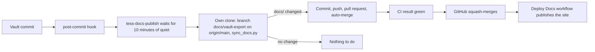

# Docs Publishing

> [!NOTE]
> Every commit in this vault ends up on the design site (`https://mindderivative.github.io/tess-shell/`) with no manual step. A hook starts `tess-docs-publish`, which exports the vault into `docs/` of the `tess-shell` repository, opens one pull request and turns on auto-merge. GitHub merges it when the required check `CI result` is green, and the merge deploys the site. Decided and built on 2026-11-15 at the maintainer's request: he had done the export, branch, pull request and merge by hand once and said he never wants to again.

## Purpose and scope

- In: the path from a vault commit to the live site, and what to do when it stops.
- Out: how the vault is converted for GitHub (`tools/sync_docs.py` in the `tess-shell` repository) and the site's build (`mkdocs.yml`, `docs.yml`).

## Behaviour

| Part | Where | Does |
|---|---|---|
| Hook | `.git/hooks/post-commit` in the vault (not versioned) | Touches a time stamp and starts the publisher detached; never blocks a commit |
| Publisher | `~/.local/bin/tess-docs-publish` | Waits until the vault has been quiet for 10 minutes (`TESS_DOCS_QUIET`, seconds), so a run of commits makes one export; one run at a time (`flock`) |
| Its clone | `~/.cache/tess-shell-docs-publish/repo` | A shallow clone of `tess-shell`, used only by the publisher; the checkouts the code sessions work in are never touched |
| Branch and pull request | `docs/vault-export`, one open pull request | A new export force-pushes the same branch and updates the same pull request |
| Merge | GitHub auto-merge (squash) | The repository setting `allow_auto_merge` was turned on for this on 2026-11-15; the ruleset on `main` still applies in full (pull request, `CI result`, no bypass) |
| Site | `docs.yml` in `tess-shell` | Runs when `docs/` changes on `main` |

The publisher exports the vault's committed state (git `HEAD`), never uncommitted edits.

## Commands

| Command | Does |
|---|---|
| `tess-docs-publish` | What the hook runs: wait for quiet, then publish |
| `tess-docs-publish --now` | Publish at once |
| `tess-docs-publish --dry-run` | Stop before the commit and the push; prints how many files would change |

## Failure modes and recovery

| Failure | Result |
|---|---|
| `gh` not logged in, a push or pull request step fails, `sync_docs.py` fails | One line in `~/.cache/tess-shell-docs-publish/publish.log` and a critical desktop notification; the next vault commit tries again |
| CI on the pull request fails (for example the strict docs build finds a broken link) | The pull request stays open with auto-merge on; the next export replaces its content, so fixing the note in the vault and committing is the repair |
| Nothing changed in `docs/` | The run says so in the log and ends |
| Two exports overlap | The second sees the lock, ends, and the first run exports the newest state anyway |
| The machine is off | The hook did not run; the next commit exports everything |

## Facts that matter

- Delay: about ten minutes of quiet, then a short CI run on the pull request, then the deploy. A pull request that changes only `docs/` skips lint, the test shards and the package check (`tess-shell` PR #24, 2026-11-15, maintainer's request): a `changes` job in `ci.yml` lists the pull request's files and, when every path is under `docs/`, skips those three jobs. The strict docs build and `CI result` still run, and `CI result` accepts a skip only when the `changes` job decided it. Any other change, a push, a tag (`release.yml` calls `ci.yml`), a manual run, or a failed file listing runs everything.
- The code sessions read specs from `docs/` of their own worktrees, which come from `origin/main`, so they see a note after the pull request merges. The vault is the source of truth.
- The earlier hook wrote the export into the `tess-shell` main checkout and left about 130 uncommitted files there. That is gone.
- `docs/` is generated: edit the vault, not the files in `docs/`.

## Questions After Testing

1. [ ] Does a docs-only export merge within a few minutes? Context: the docs-only path skips the long jobs, so the wait should be the docs build plus the check itself. Recommendation: read the time between opening and merge on the first few exports and look again if it is over ten minutes. Answered by: the first exports after PR #24.

## Acceptance criteria

- [x] `tess-docs-publish --dry-run` exports into its own clone and reports the changed file count without pushing (run 2026-11-15, 133 files).
- [x] A vault commit with no later commit for the quiet period opens or updates one pull request with auto-merge on, with nobody doing anything (2026-11-15: vault commit `08960f4` opened pull request #23 with 4 files; run with a 5-second quiet period).
- [x] After the merge the site shows the note (2026-11-15: #23 merged by auto-merge 5 minutes after it opened, the Deploy Docs run succeeded, and the live page `Docs Publishing` answers 200).
- [ ] A docs-only pull request skips lint, test and package and still merges on a green `CI result` (checked on the first export after PR #24).
- [ ] A broken export shows in the log and as a notification.

## Links

[70 Delivery](70%20Delivery.md) · [Packaging and Session Start](Packaging%20and%20Session%20Start.md) · [Home](../00%20Home/Home.md)
