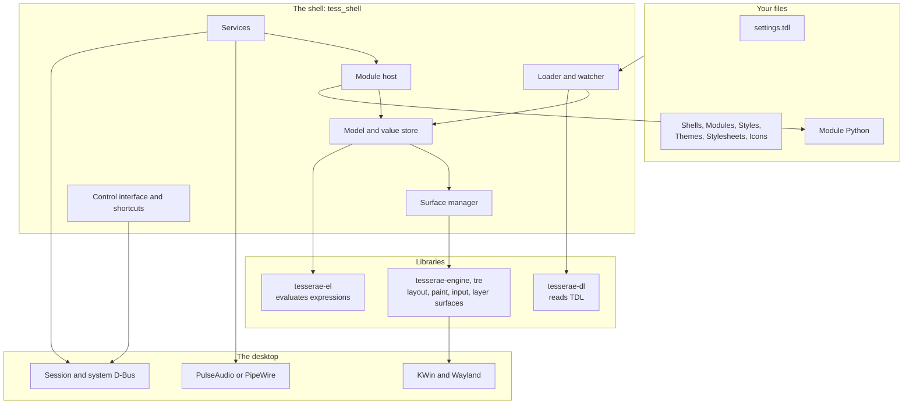
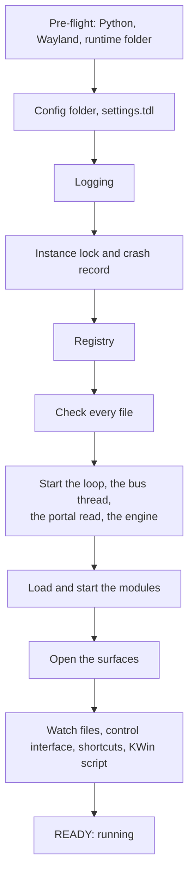

# Architecture

This page explains, at the level of someone who writes shell files, what the Tesserae Shell program is, what it is made of and what happens between a file on disk and a surface on screen. It describes what the code does today. The [design notes](design/index.md) hold the reasons and the detail; the links below lead to them.

## One process, one loop, and a process for each module of yours

`tesserae-shell run` is one Python process. It has one **event loop**, which is the loop of the Tesserae Render Engine (tre), on the main thread. Everything that touches a window or a node of the drawing tree runs on that loop, between frames: reading a file you saved, building the tree, evaluating a `<| ... |>` slot, calling the Python of a module that ships with the shell. Anything that waits (the desktop's message bus, the sound server, files, timers) runs on another thread and hands only a finished value to the loop.

The Python of a module **of yours** is not in that process. Each module file of yours runs in a child process of its own, which the shell starts, talks to over a socket pair in JSON lines, and watches. The shell keeps every service and all state; the child holds the module's class and a `ctx` whose calls the shell answers. A module that hangs or crashes there does not stop the loop ([Modules](#modules)).

Two rules follow, and they are the ones a module author feels:

* **Nothing blocking on the loop.** A module's `start()` and its action methods are short; slow work goes to a thread of its own and comes back with `ctx.call_soon` ([Modules](guide/modules.md)).
* **Python is never in layout or paint.** tre lays out and draws on its own; the shell only changes properties between frames. An idle shell draws nothing and wakes only for its own timers.

Detail: [Process Model and Threading](design/20%20Architecture/Process%20Model%20and%20Threading.md) in the design notes.

## The layers

From the bottom up:

* **tre** (`tesserae-engine`, imported as `tess_re`) owns the drawing: the layer-shell windows, layout, the GPU, animation, pointer and keyboard input. It knows nothing about shells, files or modules.
* **TDL** (`tesserae-dl`) reads a `.tdl` file into a tree with positions, so every finding has a file, line and column. **TEL** (`tesserae-el`) evaluates what is inside a `<| ... |>` slot, which can only read values and cannot run code.
* **The shell** (`tess_shell`, this package) turns your files into surfaces and keeps them true: it finds and checks the files, builds a typed tree, opens a window for each surface, hosts the modules and talks to the desktop.
* **Your files** are what you write: `settings.tdl`, shell files that say what the screen looks like, module files, styles, themes, stylesheets and icon sets, and the Python of modules of your own.

Dependencies point one way. The libraries know nothing of the shell, and a module never touches a tre node: it sends values, and the shell draws them.

Detail: [Layers and Components](design/20%20Architecture/Layers%20and%20Components.md), [System Context](design/20%20Architecture/System%20Context.md) and [Shell Package Layout](design/20%20Architecture/Shell%20Package%20Layout.md).

## How a file becomes a surface

1. **Find and read.** The shell reads `settings.tdl`, then every shell, module, style, theme and stylesheet file in the folders it names ([The configuration folder](guide/configuration-folder.md)). `Import:` lines pull more files in.
2. **Check.** Each file is parsed, its metadata block and root block are checked, and every key and value is checked against what the shell knows. This is exactly what `tesserae-shell check` does; at start and on every reload the shell does the same before it changes anything. A file with an error is refused as a whole ([Messages](reference/messages.md)).
3. **Build the model.** The main shell file (`Main_Shell` in `settings.tdl`) becomes a tree of `Monitor` blocks and their surfaces. Each monitor the compositor reports is matched to a `Monitor` block, by connector, then description, then index. A module call such as `Clock { ... }` is replaced by the module's layout file; a slot becomes a compiled expression that remembers which values it read.
4. **Open surfaces.** For each surface on each monitor the shell asks tre for a layer-shell window (a Bar, Panel or Frame) or a popup window, with the geometry the file implies. A Bar also reserves its space, so windows keep clear of it.
5. **Keep it true.** A module sends a value; the shell stores it, and only the slots that read that value are evaluated again and only the changed properties are set, together in one turn of the loop. A saved file is checked again and, if it is valid, applied by comparing the new tree with the old one by key. A reload with an error changes nothing.

Detail: [Data Flow](design/20%20Architecture/Data%20Flow.md), [Render Binder Design](design/20%20Architecture/Render%20Binder%20Design.md) and [Hot Reload](design/40%20Specifications/Runtime/Hot%20Reload.md).

## The start sequence

A failure before the loop starts is printed and stops the shell with an exit code ([Exit codes](guide/command-line.md#exit-codes)): `settings.tdl` or a file with errors gives 1, a machine that cannot run it gives 2, a second shell gives 4. From the loop on, a fault is local: a surface that fails is logged and skipped, a module that raises is marked failed and the others go on. `systemd`, when it starts the shell, is told when it is ready and when it is stopping; it is told ready after the processes of your modules have started (or 10 seconds have passed). Stopping is the reverse: the surfaces close, the modules are stopped (a module of yours gets 3 seconds for `stop()` and then its process ends) and their threads joined, the registry is written once, and the lock is released ([Install and start](guide/install.md)).

Detail: [Shell Start and Stop](design/40%20Specifications/Runtime/Shell%20Start%20and%20Stop.md).

## Services

The shell is a client of the desktop, never a replacement for it. It runs beside Plasma and does not remove or move Plasma's panels.

| Service | What the shell uses it for |
|---|---|
| Wayland layer-shell, through tre | Every Bar, Panel, Popup and Frame is a window of the compositor. A compositor without layer-shell cannot run it. |
| Session and system D-Bus | One thread, started with the shell, holds the bus connections. It reads the desktop's appearance (the Settings portal), UPower for the Battery, NetworkManager for the Network, MPRIS for the Media module, the status-notifier watcher for the Tray, and global shortcuts (`org.kde.kglobalaccel`). It also owns the shell's own bus name, `io.github.mindderivative.TesseraeShell`, which is how `status`, `reload`, `show`, `hide` and `toggle` reach the running shell. |
| PulseAudio or PipeWire | The Audio and Volume_OSD modules speak the PulseAudio protocol to the sound server (`pipewire-pulse` is enough). |
| KWin's script interface | A small KWin script, loaded while the shell runs, tells the shell about fullscreen windows (a Bar hides) and the window list (the Tasks module). It is optional ([`settings.tdl`](guide/settings.md#kwin)). |

A service that is not there does not stop the shell: the module that depends on it hides itself and returns when the service appears. [Troubleshooting](guide/troubleshooting.md#the-desktop) lists the messages.

## Modules

A module is a layout file, `Name_Module.tdl`, and optionally a Python file, `Name_Module.py`, next to it, with one class. The shell ships its modules (Clock, Battery, Tray and the rest); yours are in the `Modules` folder and a module of yours with a shipped one's name replaces it.

* The module host imports the Python of a module that ships with the shell, creates the class once and calls `start()` after the model is built and `stop()` at the end. For a module of yours the host starts a child process, which does the same with your file. The shell's own modules run **inside the shell's process, as you**; yours run in a **process of their own, also as you**. That process is fault containment, not a sandbox ([Trust and security](guide/configuration-folder.md#trust-and-security)).
* A module sends values (`ctx.send`); the layout reads them in slots. A click or other event on a block calls a method of the class marked `@action`. For a module of yours, the values and the calls cross the process boundary as plain data, and a `ctx` member that must answer at once waits for the shell for at most 2 seconds (`ShellCallTimeout`).
* A module that raises in `start()` is started again with a growing delay (1, 2, 4, 8 and 16 seconds), five times, and then stays failed until you save a file or run `reload`. Other modules and all surfaces keep running. The same back-off restarts the process of a module of yours that crashed or was killed.
* A module's callbacks are timed. More than 100 of them over 4 ms in a minute is the warning `slow-module`; more than 16 threads is `many-threads`. A callback of one of your modules that has run for 2 seconds is named in the log, and at 5 seconds its process is killed (`module-process`).
* Reload of the Python of one of your modules starts the new process beside the old one and stops the old one only after the new one has imported the file. `Debug { User_Modules_In_Process: true }` in `settings.tdl` runs your modules in the shell's process instead. A process costs about 20 MB. Detail: [the module API](api/module-api.md#two-kinds-of-module).

## The watchdog and crashes

A thread outside the loop asks the loop once a second to store a heartbeat. If a callback keeps the loop for 2 seconds the log says so, with the module and the traceback of every thread. At 10 seconds, under the `systemd` unit that `install-session` writes, the shell asks `systemd` to restart it. A hang in a module of yours never reaches this: the shell's loop does not wait for it, and the same thread that watches the loop watches each module process, naming a callback at 2 seconds and killing the process at 5. The shell also keeps a record of unclean exits; after three in a row within 10 minutes the next start is a *safe start* that does not run the Python of your own modules, so a crash loop in a module of yours does not take the bar with it. See [When the shell hangs or crashes](guide/troubleshooting.md#when-the-shell-hangs-or-crashes) for what to do.

## Where state lives

| What | Where |
|---|---|
| Your files | The configuration folder: `$XDG_CONFIG_HOME/tesserae-shell`, else `~/.config/tesserae-shell` |
| Logs | `logs/` in the configuration folder (one file a day), or the `Directory` of the `Logging` block; the terminal; the `systemd` journal |
| The registry: UIDs and the positions of Panels you moved | `registry.json`, by default in the configuration folder (the `Registry` setting) |
| Backups of a file the shell edits (the `UID:` line), the crash record, the launcher's start counts | The state folder: `$XDG_STATE_HOME/tesserae-shell`, else `~/.local/state/tesserae-shell` |
| The instance lock | `$XDG_RUNTIME_DIR/tesserae-shell/`, which disappears at logout |

Your files hold what you wrote and nothing the shell decided, apart from the `UID:` line it adds the first time it sees a file. The registry can be deleted: the shell rebuilds it from the UIDs in your files, and loses only the saved positions.

## More

* [Architecture overview in the design notes](design/20%20Architecture/20%20Architecture.md) lists every architecture note and the decisions behind them.
* [Contributing](contributing.md) shows where each of these parts is in the repository.
