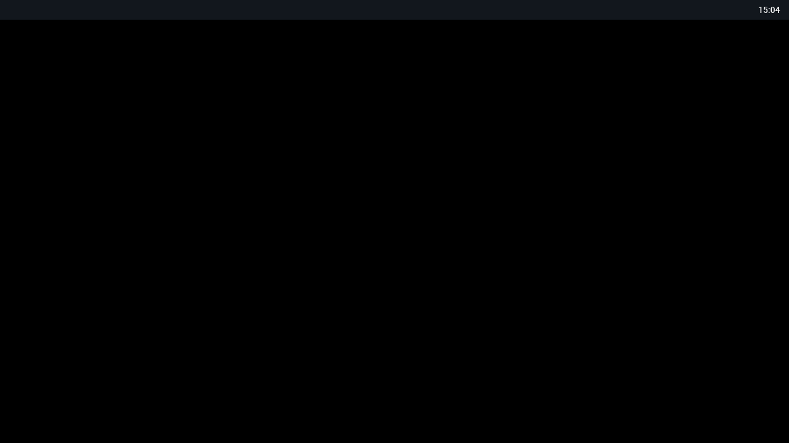
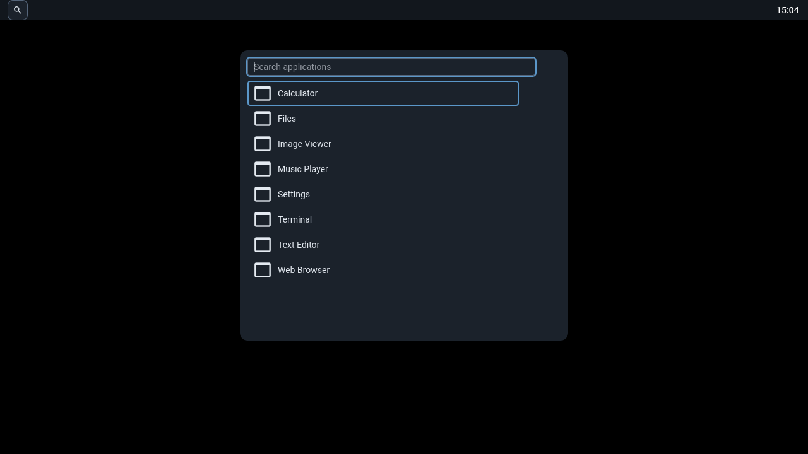
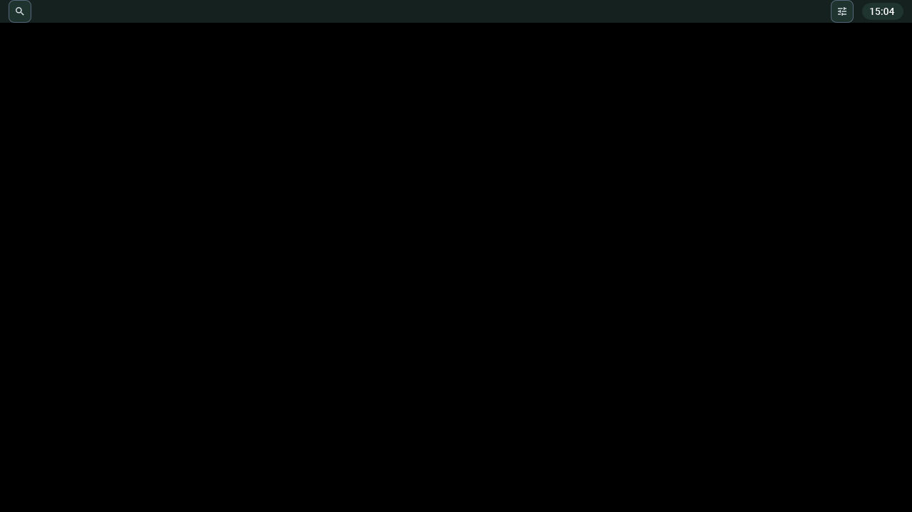

# Tutorial: build a shell in five steps

This page builds one shell from an empty folder. Each step adds to the last one and ends with a folder that passes `tesserae-shell check`, so you can stop after any step with something that works. You need the shell installed ([Install and start](install.md)) and a KDE Plasma session on Wayland. The shell is pre-alpha: keep your usual Plasma panel until you trust it.

The five steps:

1. A Bar with a clock.
2. A Panel with the Launcher, opened by a button, a shortcut or a command.
3. A Popup, and the Tray.
4. A style of your own: a theme with a dark and a light look, and a stylesheet.
5. A module of your own, in Python.

The listings are the files of real folders, `step-1-bar` to `step-5-module` under `examples/11-tutorial/` next to this page. A test runs each through `check`, so they are valid for the version of the shell this guide describes. `check` proves a file is valid, not how it looks: what each step says you should see comes from the descriptions in [Surfaces](surfaces.md) and [Modules](modules.md). The screenshots were taken from the shell running on a private headless sway compositor with software rendering, with made-up applications in the Launcher; KWin draws shadows and fonts a little differently.

## Before you start

The shell reads `~/.config/tesserae-shell/` by default ([The configuration folder](configuration-folder.md)). To leave your real folder alone, work in a folder of your own and give each command `--config-dir`:

```sh
mkdir -p ~/tutorial-shell/Shells
```

Each step says which files are new or changed. Copy a listing into the file of that path, or copy the whole folder of the step from `docs/guide/examples/11-tutorial/` in the source. The commands are the same every time:

```sh
tesserae-shell check --config-dir ~/tutorial-shell
tesserae-shell run --config-dir ~/tutorial-shell
```

`check` needs no compositor and prints `ok: N files checked`, or each mistake with its line and a hint. `run` starts the shell and stays in the foreground; stop it with `Ctrl+C`. While it runs, saving a file reloads it, so you see the change without a restart ([hot reload](configuration-folder.md#hot-reload)).

## Step 1: a Bar with a clock

You will build a strip along the top of every monitor with the time at its right end. Two files:

<!-- BEGIN generated: example-set:11-tutorial/step-1-bar -->
File `settings.tdl`:

```tdl
---
TDL: 0.2
Name: Settings
---
Settings {
    Appearance { Stylesheets: [Default] }
}
```

File `Shells/Main_Shell.tdl`:

```tdl
---
TDL: 0.2
Name: Main_Shell
---
# Step 1: one Bar along the top of every monitor, with the time at its right end.
Shell {
    Monitor {
        Name: Main
        Index: default
        Children {
            Bar {
                Name: Top_Bar
                Edge: TOP
                Width: EXPAND
                Height: 32
                Style { Background: $color.surface }
                Children {
                    FlexBox {
                        Width: EXPAND
                        Flex: HORIZONTAL
                        Align_Items: CENTER
                        Padding: [12, 0, 12, 0]
                        Children {
                            Spacer { }
                            Clock { format: "%H:%M" }
                        }
                    }
                }
            }
        }
    }
}
```

<!-- END generated: example-set:11-tutorial/step-1-bar -->

`settings.tdl` names the `Default` stylesheet, which gives text and the shipped modules their look. `Shells/Main_Shell.tdl` is the file the shell looks for first. A `Monitor` with `Index: default` covers every monitor. Its `Bar` sits on the top edge, 32 pixels thick, and holds a `FlexBox` (a row) with an empty `Spacer` that pushes the `Clock` to the right. The Bar's background is `$color.surface`, a token of the theme and not a fixed colour; step 4 uses that.

Run `check`, then `run`. You should see a 32-pixel strip along the top of each monitor with the time as `HH:MM` at the right, and your windows should start below it. Change `"%H:%M"` to `"%H:%M:%S"` and save: the clock changes without a restart.



The detail: [Your first Bar](first-bar.md), [Surfaces](surfaces.md#bar), [Modules: Clock](modules.md#clock).

## Step 2: a Launcher Panel

You will add a Panel that lists your applications with a search field, shown by a button, by a keyboard shortcut and by a command. Both files change:

<!-- BEGIN generated: example-set:11-tutorial/step-2-launcher -->
File `settings.tdl`:

```tdl
---
TDL: 0.2
Name: Settings
---
Settings {
    Appearance { Stylesheets: [Default] }
    # Meta+Space toggles the Panel named Launcher. `tesserae-shell toggle Launcher` does the same.
    Shortcuts { Toggle_Launcher: "Meta+Space" }
}
```

File `Shells/Main_Shell.tdl`:

```tdl
---
TDL: 0.2
Name: Main_Shell
---
# Step 2: the Bar of step 1 gets a button, and the shell gets a Panel named Launcher.
Shell {
    Monitor {
        Name: Main
        Index: default
        Children {
            Bar {
                Name: Top_Bar
                Edge: TOP
                Width: EXPAND
                Height: 32
                Style { Background: $color.surface }
                Children {
                    FlexBox {
                        Width: EXPAND
                        Flex: HORIZONTAL
                        Align_Items: CENTER
                        Padding: [12, 0, 12, 0]
                        Children {
                            Button { Icon: "mdi:magnify", Label: "Applications", On_Click { Action: Toggle, Target: Launcher } }
                            Spacer { }
                            Clock { format: "%H:%M" }
                        }
                    }
                }
            }
            Panel {
                Name: Launcher
                Layer: OVERLAY
                Anchor: [TOP]
                Inset: [0, 80, 0, 0]
                Width: 520
                Height: 460
                Keyboard: EXCLUSIVE
                Visible: false
                Style { Background: $color.surface_raised, Corner_Radius: 12, Elevation: 30% }
                Children { Applications { max_results: 10, icon_size: 28 } }
            }
        }
    }
}
```

<!-- END generated: example-set:11-tutorial/step-2-launcher -->

What is new:

* A `Panel` named `Launcher`, on the `OVERLAY` layer, anchored to the top with 80 pixels of space above it. `Visible: false` starts it hidden, and `Keyboard: EXCLUSIVE` sends what you type to its search field. It holds an `Applications` module.
* A `Button` in the Bar whose `On_Click` toggles the Panel by its name.
* In `settings.tdl`, `Shortcuts { Toggle_Launcher: "Meta+Space" }`, the global shortcut that toggles the Panel named `Launcher`.

Save, then open the Launcher in any of three ways: click the button, press `Meta+Space`, or run in a terminal

```sh
tesserae-shell toggle Launcher
```

The control commands talk to the running shell over the session bus, so they work from any terminal (and from a key binding of your own). You should see a 520 by 460 pixel Panel below the Bar with a search field and a list of applications, and typing narrows the list. The global shortcut goes through KWin and is **not yet checked on KWin** in this guide; the button and the command do not depend on it.



The detail: [Surfaces: Panel](surfaces.md#panel), [The Launcher](keyboard.md#the-launcher), [The command line](command-line.md).

## Step 3: a Popup, and the Tray

You will add the system tray to the Bar and a Popup of your own, opened by a button, that holds the volume, the network and the battery. One file changes:

<!-- BEGIN generated: example-set:11-tutorial/step-3-popup -->
File `settings.tdl`:

```tdl
---
TDL: 0.2
Name: Settings
---
Settings {
    Appearance { Stylesheets: [Default] }
    # Meta+Space toggles the Panel named Launcher. `tesserae-shell toggle Launcher` does the same.
    Shortcuts { Toggle_Launcher: "Meta+Space" }
}
```

File `Shells/Main_Shell.tdl`:

```tdl
---
TDL: 0.2
Name: Main_Shell
---
# Step 3: a Tray in the Bar (its menus are Popups the shell provides) and a Popup of your own.
Shell {
    Monitor {
        Name: Main
        Index: default
        Children {
            Bar {
                Name: Top_Bar
                Edge: TOP
                Width: EXPAND
                Height: 32
                Style { Background: $color.surface }
                Children {
                    FlexBox {
                        Width: EXPAND
                        Flex: HORIZONTAL
                        Align_Items: CENTER
                        Spacing: 12
                        Padding: [12, 0, 12, 0]
                        Children {
                            Button { Icon: "mdi:magnify", Label: "Applications", On_Click { Action: Toggle, Target: Launcher } }
                            Spacer { }
                            Tray { icon_size: 18, spacing: 6 }
                            Button { Icon: "mdi:tune", Label: "Quick", On_Click { Action: Show, Target: Quick } }
                            Clock { format: "%H:%M" }
                        }
                    }
                }
            }
            Panel {
                Name: Launcher
                Layer: OVERLAY
                Anchor: [TOP]
                Inset: [0, 80, 0, 0]
                Width: 520
                Height: 460
                Keyboard: EXCLUSIVE
                Visible: false
                Style { Background: $color.surface_raised, Corner_Radius: 12, Elevation: 30% }
                Children { Applications { max_results: 10, icon_size: 28 } }
            }
            Popup {
                Name: Quick
                Attach: BOTTOM
                Alignment: END
                Gap: 4
                Max_Width: 280
                Style { Background: $color.surface_raised, Corner_Radius: 8, Elevation: 20% }
                Children {
                    FlexBox {
                        Flex: VERTICAL
                        Padding: 12
                        Spacing: 10
                        Children {
                            Audio { show_percent: true, show_slider: true }
                            Network { show_name: true }
                            Battery { }
                        }
                    }
                }
            }
        }
    }
}
```

<!-- END generated: example-set:11-tutorial/step-3-popup -->

What is new:

* `Tray` shows one icon for each application that registers a StatusNotifierItem. A click activates the application; a secondary click opens its menu, which the shell draws in its own Popups `Tray_Menu`, `Tray_Menu_2` and `Tray_Menu_3`. You write none of them. The shell is a second tray host beside Plasma's, so the same icons can show in both.
* A `Popup` named `Quick`. `Attach: BOTTOM` puts it under the block that opened it and `Alignment: END` lines its right edge up with that block. It is as large as its content, up to `Max_Width`. The button that opens it says `On_Click { Action: Show, Target: Quick }`. A click outside the Popup, or Escape, closes it.
* Inside it, a column with `Audio` and its slider, `Network` and `Battery`. `Battery` hides itself when the machine has no battery, and `Network` when NetworkManager is absent.

You should see the tray icons and a tune button left of the clock, and the button opens a small raised card under it. A command never opens a Popup, because a Popup needs the click that opened it: `tesserae-shell show Quick` is refused.

The detail: [Surfaces: Popup](surfaces.md#popup), [Modules: Tray](modules.md#tray), [Audio](modules.md#audio), [Network](modules.md#network), [Battery](modules.md#battery).

## Step 4: a style of your own

You will give the shell its own colours in a dark and a light look, and a rule that styles one block. Two files are new and two change:

<!-- BEGIN generated: example-set:11-tutorial/step-4-style -->
File `settings.tdl`:

```tdl
---
TDL: 0.2
Name: Settings
---
Settings {
    Appearance {
        Theme: Mine
        Stylesheets: [Default, Mine]
        Follow_Desktop: true
    }
    Shortcuts { Toggle_Launcher: "Meta+Space" }
}
```

File `Shells/Main_Shell.tdl`:

```tdl
---
TDL: 0.2
Name: Main_Shell
---
# Step 4: the same shell, with the clock in a chip.
Shell {
    Monitor {
        Name: Main
        Index: default
        Children {
            Bar {
                Name: Top_Bar
                Edge: TOP
                Width: EXPAND
                Height: 32
                Style { Background: $color.surface }
                Children {
                    FlexBox {
                        Width: EXPAND
                        Flex: HORIZONTAL
                        Align_Items: CENTER
                        Spacing: 12
                        Padding: [12, 0, 12, 0]
                        Children {
                            Button { Icon: "mdi:magnify", Label: "Applications", On_Click { Action: Toggle, Target: Launcher } }
                            Spacer { }
                            Tray { icon_size: 18, spacing: 6 }
                            Button { Icon: "mdi:tune", Label: "Quick", On_Click { Action: Show, Target: Quick } }
                            FlexBox {
                                Class: chip
                                Padding: [10, 4, 10, 4]
                                Children { Clock { format: "%H:%M" } }
                            }
                        }
                    }
                }
            }
            Panel {
                Name: Launcher
                Layer: OVERLAY
                Anchor: [TOP]
                Inset: [0, 80, 0, 0]
                Width: 520
                Height: 460
                Keyboard: EXCLUSIVE
                Visible: false
                Style { Background: $color.surface_raised, Corner_Radius: 12, Elevation: 30% }
                Children { Applications { max_results: 10, icon_size: 28 } }
            }
            Popup {
                Name: Quick
                Attach: BOTTOM
                Alignment: END
                Gap: 4
                Max_Width: 280
                Style { Background: $color.surface_raised, Corner_Radius: 8, Elevation: 20% }
                Children {
                    FlexBox {
                        Flex: VERTICAL
                        Padding: 12
                        Spacing: 10
                        Children {
                            Audio { show_percent: true, show_slider: true }
                            Network { show_name: true }
                            Battery { }
                        }
                    }
                }
            }
        }
    }
}
```

File `Themes/Mine_Theme.tdl`:

```tdl
---
TDL: 0.2
Name: Mine
---
# Only what differs from the Default theme. The base values are the dark look; Modes.Light
# changes them when the desktop is in its light colour scheme.
Theme {
    Color {
        Surface: "#14211f"
        Surface_Raised: "#1f332f"
        Primary: "#5fd3b4"
        On_Primary: "#06201a"
        Accent: DESKTOP
    }
    Modes {
        Light {
            Color {
                Surface: "#eef7f4"
                Surface_Raised: "#ffffff"
                On_Surface: "#13241f"
                Primary: "#0f7a62"
                On_Primary: "#ffffff"
            }
        }
    }
}
```

File `Stylesheets/Mine_Stylesheet.tdl`:

```tdl
---
TDL: 0.2
Name: Mine
---
# The look of the blocks that carry Class: chip, taken from the theme's tokens, so it follows
# light and dark with the theme.
Stylesheet {
    Rule { Selector: ".chip", Background: $color.surface_raised, Corner_Radius: $shape.full }
    Rule { Selector: ".chip:hovered", Background: $color.primary }
}
```

<!-- END generated: example-set:11-tutorial/step-4-style -->

What is new:

* `Themes/Mine_Theme.tdl` holds only the tokens that differ from the `Default` theme; the rest come from there. The values at the top are the dark look, and `Modes { Light { ... } }` overrides them for the light colour scheme. `Accent: DESKTOP` makes the accent colour follow the desktop's.
* `Stylesheets/Mine_Stylesheet.tdl` has two rules for blocks with `Class: chip`, written from tokens (`$color.surface_raised`, `$shape.full`), so they follow the mode too.
* `settings.tdl` names both: `Theme: Mine`, `Stylesheets: [Default, Mine]` (lowest priority first) and `Follow_Desktop: true`, so the shell follows the desktop live.
* In the shell file the clock sits in a `FlexBox` with `Class: chip`. A class goes on a block, not on a module call such as `Clock`, so the chip is the box around the clock.

You should see the Bar and the Panels in dark green with a mint primary colour, and the clock in a pill that fills with the primary colour under the pointer. Switch Plasma between its light and dark colour scheme and the shell follows without a restart. (Changing `Follow_Desktop` itself needs a restart.)



The detail: [Styling and themes](styling.md): the token tables, modes, selectors and style keys.

## Step 5: a module of your own

You will write `Uptime`, a module that shows how long the machine has been up, read again every minute and on a click. A module is a layout in `Uptime_Module.tdl` and the Python beside it in `Uptime_Module.py`, both in `Modules/Uptime/`; its optional look is a style file in `Styles/`. The shell file gets one new line (`Uptime { label: "up" }` beside the clock):

<!-- BEGIN generated: example-set:11-tutorial/step-5-module -->
File `settings.tdl`:

```tdl
---
TDL: 0.2
Name: Settings
---
Settings {
    Appearance {
        Theme: Mine
        Stylesheets: [Default, Mine]
        Follow_Desktop: true
    }
    Shortcuts { Toggle_Launcher: "Meta+Space" }
}
```

File `Shells/Main_Shell.tdl`:

```tdl
---
TDL: 0.2
Name: Main_Shell
---
# Step 5: the same shell, with your own module, Uptime, beside the clock.
Shell {
    Monitor {
        Name: Main
        Index: default
        Children {
            Bar {
                Name: Top_Bar
                Edge: TOP
                Width: EXPAND
                Height: 32
                Style { Background: $color.surface }
                Children {
                    FlexBox {
                        Width: EXPAND
                        Flex: HORIZONTAL
                        Align_Items: CENTER
                        Spacing: 12
                        Padding: [12, 0, 12, 0]
                        Children {
                            Button { Icon: "mdi:magnify", Label: "Applications", On_Click { Action: Toggle, Target: Launcher } }
                            Spacer { }
                            Tray { icon_size: 18, spacing: 6 }
                            Button { Icon: "mdi:tune", Label: "Quick", On_Click { Action: Show, Target: Quick } }
                            Uptime { label: "up" }
                            FlexBox {
                                Class: chip
                                Padding: [10, 4, 10, 4]
                                Children { Clock { format: "%H:%M" } }
                            }
                        }
                    }
                }
            }
            Panel {
                Name: Launcher
                Layer: OVERLAY
                Anchor: [TOP]
                Inset: [0, 80, 0, 0]
                Width: 520
                Height: 460
                Keyboard: EXCLUSIVE
                Visible: false
                Style { Background: $color.surface_raised, Corner_Radius: 12, Elevation: 30% }
                Children { Applications { max_results: 10, icon_size: 28 } }
            }
            Popup {
                Name: Quick
                Attach: BOTTOM
                Alignment: END
                Gap: 4
                Max_Width: 280
                Style { Background: $color.surface_raised, Corner_Radius: 8, Elevation: 20% }
                Children {
                    FlexBox {
                        Flex: VERTICAL
                        Padding: 12
                        Spacing: 10
                        Children {
                            Audio { show_percent: true, show_slider: true }
                            Network { show_name: true }
                            Battery { }
                        }
                    }
                }
            }
        }
    }
}
```

File `Modules/Uptime/Uptime_Module.py`:

```python
"""Uptime: a module of your own. The class name is the module's Name."""

from __future__ import annotations

from tess_shell import Event, Module, action


def read_uptime() -> str:
    """How long the machine has been up, from /proc/uptime, as '3h 07m' or '12m'."""
    with open("/proc/uptime") as f:
        minutes = int(float(f.read().split()[0]) // 60)
    hours, minutes = divmod(minutes, 60)
    return f"{hours}h {minutes:02d}m" if hours else f"{minutes}m"


class Uptime(Module):
    def start(self) -> None:
        self.refresh_now()
        self.ctx.on_tick("minute", self.refresh_now)

    def refresh_now(self) -> None:
        self.ctx.send("uptime", read_uptime())  # every use of the module gets it

    @action
    def refresh(self, event: Event) -> None:
        # Run by a click on the module: On_Click { Action: Call, Target: "Uptime.refresh" }
        self.refresh_now()
```

File `Modules/Uptime/Uptime_Module.tdl`:

```tdl
---
TDL: 0.2
Name: Uptime
---
# params say what a use may set; the block tree shows what the Python sends, in <| ... |>.
Module {
    Style: ../../Styles/Uptime_Style.tdl

    Params {
        label { Type: string, Default: "up" }
    }
    FlexBox {
        Flex: HORIZONTAL
        Spacing: 4
        On_Click { Action: Call, Target: "Uptime.refresh" }
        Children {
            Text { Class: uptime_text, Text: <| params.label + " " + uptime |> }
        }
    }
}
```

File `Themes/Mine_Theme.tdl`:

```tdl
---
TDL: 0.2
Name: Mine
---
# Only what differs from the Default theme. The base values are the dark look; Modes.Light
# changes them when the desktop is in its light colour scheme.
Theme {
    Color {
        Surface: "#14211f"
        Surface_Raised: "#1f332f"
        Primary: "#5fd3b4"
        On_Primary: "#06201a"
        Accent: DESKTOP
    }
    Modes {
        Light {
            Color {
                Surface: "#eef7f4"
                Surface_Raised: "#ffffff"
                On_Surface: "#13241f"
                Primary: "#0f7a62"
                On_Primary: "#ffffff"
            }
        }
    }
}
```

File `Stylesheets/Mine_Stylesheet.tdl`:

```tdl
---
TDL: 0.2
Name: Mine
---
# The look of the blocks that carry Class: chip, taken from the theme's tokens, so it follows
# light and dark with the theme.
Stylesheet {
    Rule { Selector: ".chip", Background: $color.surface_raised, Corner_Radius: $shape.full }
    Rule { Selector: ".chip:hovered", Background: $color.primary }
}
```

File `Styles/Uptime_Style.tdl`:

```tdl
---
TDL: 0.2
Name: Uptime_Style
---
# The module's own look: a class its layout uses. A rule of your stylesheet still wins over it.
Style {
    Classes {
        uptime_text {
            Kind: Text
            Font_Size: 13
            Font_Weight: 500
        }
    }
}
```

<!-- END generated: example-set:11-tutorial/step-5-module -->

Read the files from the Python outward:

* The class `Uptime` has the module's name. `start` runs once. `self.ctx.on_tick("minute", fn)` calls `fn` at the start of every minute, and `self.ctx.send("uptime", text)` sends a value to every use of the module under the key `uptime`. `@action` marks `refresh` as something the layout can call.
* In `Uptime_Module.tdl`, `Params` lists what a use may set. The block tree shows what the Python sends: `<| params.label + " " + uptime |>` is a slot that reads the param and the sent value and is kept up to date. The `FlexBox`'s `On_Click { Action: Call, Target: "Uptime.refresh" }` runs the action.
* `Style:` names the module's own look file, relative to the module file, and the file defines the class `uptime_text`. A rule in one of your stylesheets still wins over it.

Save the files. You should see text like `up 3h 07m` (your own value; `12m` when the machine has been up less than an hour) just left of the clock chip, and a click on it reads the value again. The shell starts your module's Python in a process of its own, so a module that hangs or crashes cannot freeze the bar; the value can appear a moment after the bar's first paint. That process runs with your rights and is not a sandbox ([Trust and security](configuration-folder.md#trust-and-security)): write your own, or read one before you add it.

The detail: [A configuration folder with a module of your own](configuration-folder.md#a-configuration-folder-with-a-module-of-your-own). The design notes hold the full contract ([Module File](../design/41%20TDL%20Reference/Module%20File.md)).

## Where to go next

* Put the folder at `~/.config/tesserae-shell/` and start the shell with your session ([Install and start](install.md)).
* Every module the shell ships, with its parameters: [Modules](modules.md). Every setting: [`settings.tdl`](settings.md).
* When something does not appear: [Troubleshooting](troubleshooting.md).
