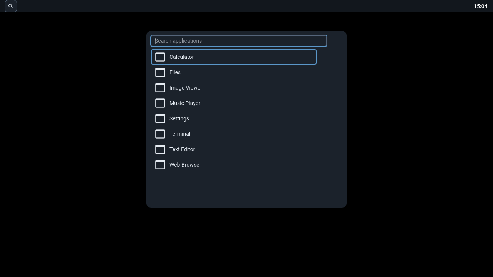
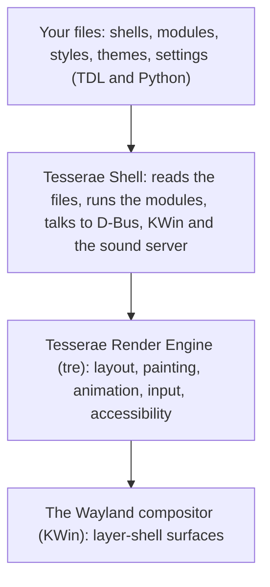

# Tesserae Shell

**Build your own desktop shell: bars, panels, docks, launchers, on-screen displays and widgets, for KDE Plasma on Wayland.** A Tesserae Shell is a few **TDL files** that say what the screen looks like, a little **Python** where you want logic, and a rendering engine underneath, the [Tesserae Render Engine](https://mindderivative.github.io/tess-re/) (tre), which draws every frame on the GPU. The shell runs beside the desktop you already have; it does not replace Plasma, its compositor or its panels.

!!! warning "Pre-alpha"
    Tesserae Shell is young software. The pages say plainly what is built, what has been tried on a real KWin session and what has not. Keep a way back to your usual Plasma panel.

```tdl
---
TDL: 0.2
Name: Main_Shell
---
# One Bar along the top of every monitor, with the time at its right end.
Shell {
    Monitor {
        Name: Main
        Index: default
        Children {
            Bar {
                Name: Top_Bar
                Edge: TOP
                Width: EXPAND
                Height: 32
                Style { Background: $color.surface }
                Children {
                    FlexBox {
                        Width: EXPAND
                        Flex: HORIZONTAL
                        Align_Items: CENTER
                        Padding: [12, 0, 12, 0]
                        Children {
                            Spacer { }
                            Clock { format: "%H:%M" }
                        }
                    }
                }
            }
        }
    }
}
```

Save that as `~/.config/tesserae-shell/Shells/Main_Shell.tdl`, run `tesserae-shell run`, and a bar with a clock appears along the top of every monitor. Save the file again with a change and the bar updates about 200 ms later, without a restart. [Getting Started](guide/first-bar.md) walks through it line by line.



The picture is the shell from the [Tutorial](guide/tutorial.md), on a test compositor with software rendering; on KWin the look differs a little (fonts, shadows).

## What you can build

| Surface | What it is |
|---|---|
| `Bar` | A strip along one edge of a monitor that keeps its space free of windows, like a panel |
| `Panel` | An anchored or centred surface: a dock, a launcher, an on-screen display, a widget. It can show and hide, slide, take the keyboard, or join a Bar or a Frame |
| `Popup` | A menu or a tooltip that opens beside what you clicked or hovered |
| `Frame` | A ring around the whole output with strips, melded panels and peeking tabs |
| `Monitor` | Which monitors a set of surfaces goes on: all, one by name, the first, or by description, with hot-plug handled for you |

Inside a surface you put **blocks** (text, images, icons, boxes, buttons) and **modules**: ready-made pieces with their own logic. The shell ships a Clock, Battery, Workspaces, Network, Media, Audio, a volume on-screen display, a system Tray, a Task list, the Applications list and Launcher, and text fields, sliders, toggles and menus. A module of your own is a `<Name>_Module.tdl` with a `<Name>_Module.py` next to it. [Modules](guide/modules.md) lists what ships; [Writing a module](guide/writing-a-module.md) shows how to write one.

## What you get

- **Live editing.** Save a shell, module, style or icon file and the running shell updates once. A file with an error changes nothing and is reported as `file:line:column`.
- **A real look.** Themes with colour, type, shape, space, elevation and motion tokens, light and dark modes that follow your desktop, stylesheets with classes and states, shadows and animation. See [Styling and Themes](guide/styling.md).
- **Accessibility.** Roles, names and live announcements reach a screen reader; focus and the keyboard work everywhere. See [Keyboard and Shortcuts](guide/keyboard.md).
- **A safe default.** TDL files cannot run code. Modules are Python that runs with your rights, so you write them or read them first. See [Security and Trust](guide/security.md).
- **A way to check.** `tesserae-shell check` validates every file without a compositor, and the same checks run in your own scripts and tests.

## Where to go next

| If you want to | Read |
|---|---|
| Install it and start it with your session | [Installation](guide/install.md) |
| See a first bar | [Getting Started](guide/first-bar.md) |
| Build a whole shell step by step | [Tutorial](guide/tutorial.md) |
| Look up a block, key or setting | [Surfaces](guide/surfaces.md), [Modules](guide/modules.md), [Settings](guide/settings.md) |
| Write a module | [Writing a module](guide/writing-a-module.md) and the [Module API](api/module-api.md) |
| Understand a message | [Messages](reference/messages.md) and [Troubleshooting](guide/troubleshooting.md) |
| Know how it works | [Architecture](architecture.md) and the [Design](design/index.md) record |
| Upgrade | [Upgrading](upgrading.md) |

## How it fits together



Rust draws every frame and Python only runs when something happens, so a module never slows a frame. The [Architecture](architecture.md) page explains the layers.

## The other projects

Tesserae Shell is one of several projects that share a style and a few libraries: [tre](https://mindderivative.github.io/tess-re/), the rendering engine; [Tesserae](https://mindderivative.github.io/tess-ui/), a framework for desktop applications; `tess_dl`, the reader of TDL files; and `tess_el`, the expression language behind the `<| |>` slots. The shell does not depend on the application framework.
